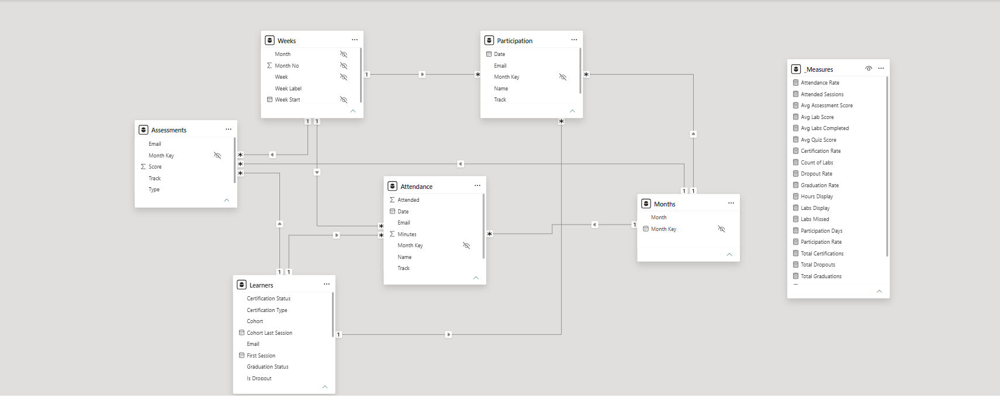

# Dare Careers Dashboard — Data Model (Star Schema)

[Back to README](../README.md) · [Project Report](Project_Report.pdf) · [Data Model](Data_Model.md) · [DAX Measures](DAX_Measures.txt) · [Power Query](PowerQuery_M_Code.txt) · [Test Results](Test_Results.md)

Three **fact tables** share three **dimension tables**. Nine one-to-many, single-direction relationships.

```
                 ┌──────────────┐     ┌──────────────┐     ┌──────────────┐
  DIMENSIONS     │   Learners   │     │    Weeks     │     │    Months    │
                 │ Key: Email   │     │ Key: Week    │     │ Key: Month   │
                 │ 140 rows     │     │ 10 rows      │     │ Key · 3 rows │
                 └──────┬───────┘     └──────┬───────┘     └──────┬───────┘
                        │ 1                  │ 1                  │ 1
                        ├────────────────────┼────────────────────┤
                        │ *                  │ *                  │ *
                 ┌──────▼───────┐     ┌──────▼───────┐     ┌──────▼───────┐
  FACTS          │  Attendance  │     │ Participation│     │ Assessments  │
                 │ 7,000 rows   │     │ 6,037 rows   │     │ 2,800 rows   │
                 └──────────────┘     └──────────────┘     └──────────────┘
   (each dimension connects to all three fact tables)

                 ┌───────────────────────────────┐
                 │ _Measures (no relationships)  │  21 DAX measures
                 └───────────────────────────────┘
```

## Schema in Power BI (Model view)



Crossed-eye icons mark hidden helper and key columns.

## Fact and dimension tables

| Table | Type | Grain (one row is…) | Rows | Keys | Built from |
|---|---|---|---|---|---|
| Attendance | Fact | one learner in one Zoom session | 7,000 | Email, Week, Month Key | 100 Zoom CSVs |
| Participation | Fact | one learner on one day they participated | 6,037 | Email, Week, Month Key | 2 participation workbooks |
| Assessments | Fact | one learner, one week, one type (Lab/Quiz) | 2,800 | Email, Week, Month Key | 2 labs & quizzes workbooks |
| Learners | Dimension | one learner | 140 | Email (unique) | Attendance + Status |
| Weeks | Dimension | one program week | 10 | Week (unique) | Attendance |
| Months | Dimension | one calendar month | 3 | Month Key (unique) | All three fact tables |
| _Measures | Measure table | — | — | none | 21 DAX measures |
| Status | Staging (not loaded) | one learner | 140 | Email | Status workbooks  merged into Learners |

## Relationships

| # | From (1) | To (*) | Key | Direction |
|---|---|---|---|---|
| 1 | Learners | Attendance | Email | Single |
| 2 | Learners | Participation | Email | Single |
| 3 | Learners | Assessments | Email | Single |
| 4 | Weeks | Attendance | Week | Single |
| 5 | Weeks | Participation | Week | Single |
| 6 | Weeks | Assessments | Week | Single |
| 7 | Months | Attendance | Month Key | Single |
| 8 | Months | Participation | Month Key | Single |
| 9 | Months | Assessments | Month Key | Single |

Labs and quizzes share one Assessments table (Type column); learner status lives in the Learners dimension. So the brief's Attendance, Participation, Labs, Quizzes and Learner Status are all related through these 9 links.

## Data dictionary

| Table | Column | Type | Description | In report |
|---|---|---|---|---|
| Attendance | Email | Text | Learner email, lowercased (key to Learners) | Shown |
| Attendance | Name | Text | Learner name | Shown |
| Attendance | Track | Text | Power BI or AWS Cloud, from folder name | Shown |
| Attendance | Date | Date | Session date, from file name | Shown |
| Attendance | Week | Whole number | Program week 1–10, from folder name (key to Weeks) | Shown |
| Attendance | Minutes | Whole number | Minutes in the Zoom session | Shown |
| Attendance | Attended | Whole number | 1 if Minutes > 30, else 0 | Shown |
| Attendance | Month Key | Date | First day of the session's month (key to Months) | Hidden |
| Participation | Date | Date | Day of participation | Shown |
| Participation | Name | Text | Learner name from the daily list | Shown |
| Participation | Track | Text | Power BI or AWS Cloud | Shown |
| Participation | Week | Whole number | Program week, looked up from Attendance | Shown |
| Participation | Email | Text | Learner email, matched by name + track | Shown |
| Participation | Month Key | Date | First day of the month | Hidden |
| Assessments | Email | Text | Learner email | Shown |
| Assessments | Type | Text | Lab or Quiz | Shown |
| Assessments | Track | Text | Power BI or AWS Cloud | Shown |
| Assessments | Score | Decimal | 0–100; a lab counts as completed when > 0 | Shown |
| Assessments | Week | Whole number | Program week 1–10 | Shown |
| Assessments | Month Key | Date | Month of that week, from learner's first session | Hidden |
| Learners | Email | Text | Unique learner key | Shown |
| Learners | Name | Text | Learner name | Shown |
| Learners | Track | Text | Power BI or AWS Cloud | Shown |
| Learners | Cohort | Text | "Cohort " + month of first session (Cohort Aug 2024) | Shown |
| Learners | Certification Type | Text | AWS or Power BI | Shown |
| Learners | Graduation Status | Text | Graduate / Non Graduate | Shown |
| Learners | Certification Status | Text | Certified / Not Certified (Learner Status slicer) | Shown |
| Learners | Truncated Attendance | True/False | TRUE if any session was 30 minutes or less | Shown |
| Learners | Is Dropout | True/False | Non Graduate AND Not Certified AND truncated attendance | Shown |
| Learners | Learner Outcome | Text | Graduated / Did Not Graduate / Dropped Out | Shown |
| Learners | Program Status | Text | Ongoing if cohort had a session in last 14 days, else Completed | Shown |
| Learners | First Session, Last Session, Short Sessions, Cohort Last Session | Date / Whole number | Helper columns for the rules | Hidden |
| Weeks | Week Label | Text | Week 1 … Week 10 (sorted by Week) | Shown |
| Weeks | Week, Week Start, Month, Month No | Number / Date / Text | Key and helper columns | Hidden |
| Months | Month | Text | e.g. August 2024 (sorted by Month Key) | Shown |
| Months | Month Key | Date | Unique key | Hidden |
