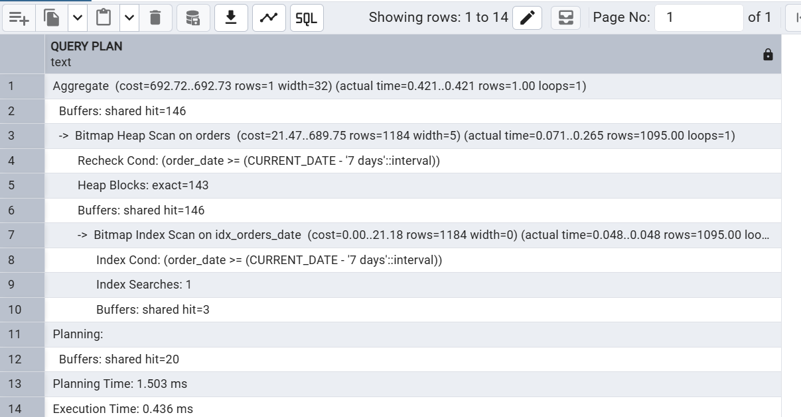

# 08 · Optimization

| File | Does |
|---|---|
| `01_indexes.sql` | Creates the indexes. In the run order it comes right after `01_schema` |
| `02_explain_plans.sql` | Times key queries without and with each index on 500,000 temporary rows, then rolls the test data back |
| `query_plan_optimization.png` | pgAdmin screenshot of the date-range query using `idx_orders_date` |

## Indexes

PostgreSQL creates indexes automatically for primary keys and `UNIQUE` constraints, but **not** for foreign-key columns. These cover the foreign keys and the main queries:

| Index | Columns | Used by |
|---|---|---|
| `idx_orders_customer_date` | `orders (customer_id, order_date)` | A customer's order history; the tier trigger |
| `idx_orders_date` | `orders (order_date)` | Monthly and date-range revenue |
| `idx_order_details_product` | `order_details (product_id)` | Best sellers; product foreign key |
| `idx_inv_logs_product_time` | `inventory_logs (product_id, changed_at)` | One product's audit history |
| `idx_inv_logs_type_time` | `inventory_logs (change_type, changed_at)` | e.g. all replenishments last month |
| `idx_inv_logs_reference` | `inventory_logs (reference_id)` *partial* | Everything that happened in one order |
| `idx_products_low_stock` | `products (product_id) WHERE stock_qty < reorder_level` *partial* | `vw_low_stock`, `sp_auto_replenish` |
| `idx_products_category` | `products (category)` | Category reports |

`order_details.order_id` is already covered by the `UNIQUE (order_id, product_id)` constraint.

**Partial index for low stock.** It only holds the products that are below their reorder level. It stays tiny however big the catalogue grows, and PostgreSQL uses it whenever a query asks for `stock_qty < reorder_level`.

## Results

`02_explain_plans.sql` temporarily adds 100,000 products, 100,000 orders and 300,000 log rows:

| Query | Index | Before | After | Speed-up |
|---|---|---:|---:|---:|
| Low-stock lookup | `idx_products_low_stock` | 7.37 ms | 0.11 ms | ~70x |
| One customer's last 30 days | `idx_orders_customer_date` | 4.15 ms | 0.18 ms | ~23x |
| One product's audit history (7 days) | `idx_inv_logs_product_time` | 44.81 ms | 0.26 ms | ~175x |
| Revenue for the last 7 days | `idx_orders_date` | 0.69 ms | 0.39 ms | ~2x |

These were measured on PostgreSQL 16, and exact times vary by machine. The date-range query gains least because, even without its own index, PostgreSQL can partly use `idx_orders_customer_date`.

## How the explain script stays safe

Everything runs inside `BEGIN … ROLLBACK`:
- **"Before":** each index is dropped inside a `SAVEPOINT`, the query is timed, and the savepoint is rolled back, which restores the index.
- **Test data IDs:** the test rows use IDs starting at 900,000,000, so the real ID counters are never touched.
