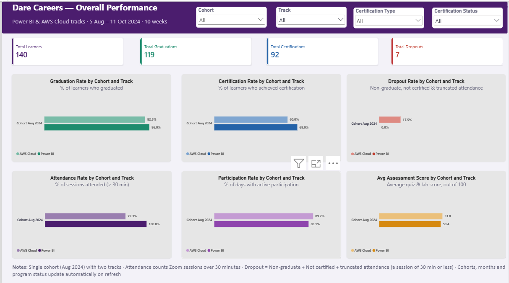
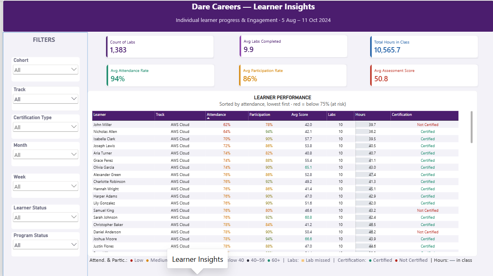
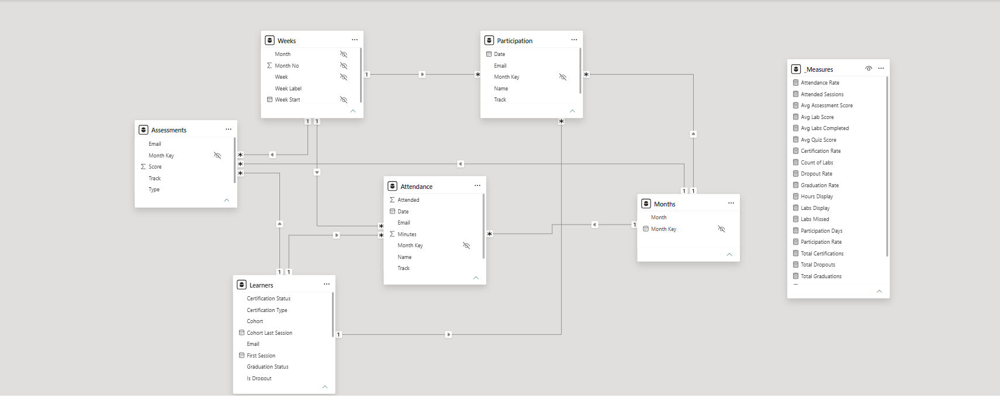

# Dare Careers — Learner Performance Dashboard

**Power BI project · Justine Umutoni**
One cohort (Aug 2024) · two tracks (Power BI, AWS Cloud) · 140 learners · 10 weeks (5 Aug – 11 Oct 2024)

A two-page Power BI dashboard that tracks Zoom attendance, daily participation, weekly lab and quiz scores, and learner outcomes (graduation, certification, dropout), so program managers and trainers can follow performance and spot at-risk learners.

**[Open the dashboard on SharePoint](https://amalitech-my.sharepoint.com/:u:/p/justine_umutoni/IQAAiku700TUTLZHEICqYesXAQQ7kMiy5QCGL5VAwAUCse4?e=x0IvdF)**

| Quick links | |
|---|---|
| Dashboard (SharePoint) | [Open link](https://amalitech-my.sharepoint.com/:u:/p/justine_umutoni/IQAAiku700TUTLZHEICqYesXAQQ7kMiy5QCGL5VAwAUCse4?e=x0IvdF) |
| Power BI file | [Dare Careers Dashboard.pbix](02_Report/Dare%20Careers%20Dashboard.pbix) |
| Project report | [PDF](03_Documentation/Project_Report.pdf) · [Word](03_Documentation/Project_Report.docx) |
| Data model | [Data_Model.md](03_Documentation/Data_Model.md) |
| DAX measures | [DAX_Measures.txt](03_Documentation/DAX_Measures.txt) |
| Power Query code | [PowerQuery_M_Code.txt](03_Documentation/PowerQuery_M_Code.txt) |
| Test results | [Test_Results.md](03_Documentation/Test_Results.md) |
| Source data | [Dare Careers Data](01_Data/Dare%20Careers%20Data) |

---

## Folder contents

- [README.md](README.md) — this file
- [01_Data](01_Data)
  - [Dare Careers Data](01_Data/Dare%20Careers%20Data) — original source data, unchanged (106 files)
    - [Cloud Training](01_Data/Dare%20Careers%20Data/Cloud%20Training)
    - [PowerBI Training](01_Data/Dare%20Careers%20Data/PowerBI%20Training)
- [02_Report](02_Report)
  - [Dare Careers Dashboard.pbix](02_Report/Dare%20Careers%20Dashboard.pbix) — the Power BI dashboard
- [03_Documentation](03_Documentation)
  - [Project_Report.pdf](03_Documentation/Project_Report.pdf) — full write-up
  - [Project_Report.docx](03_Documentation/Project_Report.docx) — full write-up (Word)
  - [Data_Model.md](03_Documentation/Data_Model.md) — star schema, fact/dimension tables, relationships, data dictionary
  - [Data_Model_Schema_PowerBI.png](03_Documentation/Data_Model_Schema_PowerBI.png) — model diagram from Power BI
  - [DAX_Measures.txt](03_Documentation/DAX_Measures.txt) — all 21 DAX measures
  - [PowerQuery_M_Code.txt](03_Documentation/PowerQuery_M_Code.txt) — all 7 Power Query queries
  - [Test_Results.md](03_Documentation/Test_Results.md) — validation tests (all passed)
- [04_Design](04_Design)
  - [Page1_Overall_Performance.png](04_Design/Page1_Overall_Performance.png) — Page 1 as built
  - [Page2_Learner_Insights.png](04_Design/Page2_Learner_Insights.png) — Page 2 as built

## How to open the dashboard

1. Copy the whole folder to your computer.
2. Open [`02_Report/Dare Careers Dashboard.pbix`](02_Report/Dare%20Careers%20Dashboard.pbix) in Power BI Desktop (or use the [SharePoint link](https://amalitech-my.sharepoint.com/:u:/p/justine_umutoni/IQAAiku700TUTLZHEICqYesXAQQ7kMiy5QCGL5VAwAUCse4?e=x0IvdF)).
3. **Home  Transform data  Manage Parameters  FolderPath**  enter the full path to `01_Data\Dare Careers Data\` on your computer (ending with `\`).
4. **Close & Apply.**

## The two pages

| Page | For | Contents |
|---|---|---|
| **1. Overall Performance** | Program managers | Cards: Total Learners, Graduations, Certifications, Dropouts · Bar charts by cohort and track: Graduation, Certification, Dropout, Attendance, Participation rates and Avg Assessment Score · Slicers: Cohort, Track, Certification Type, Learner Status |
| **2. Learner Insights** | Trainers | Cards: Count of Labs, Avg Labs Completed, Total Hours in Class, Avg Attendance, Avg Participation, Avg Assessment Score · Learner table with colour-coded at-risk indicators · Slicers: Cohort, Track, Certification Type, Month, Week, Learner Status, Program Status |

Shared slicers (Cohort, Track, Certification Type, Learner Status) are synced between the pages.

### Page 1: Overall Performance

### Page 2: Learner Insights

## Key results

| Measure | AWS Cloud | Power BI | All |
|---|---|---|---|
| Learners | 40 | 100 | 140 |
| Graduation rate | 82.5% | 86.0% | 85.0% |
| Certification rate | 60.0% | 68.0% | 65.7% |
| Dropout rate | 17.5% (7) | 0.0% | 5.0% |
| Attendance rate | 79.3% | 100.0% | 94.1% |
| Participation rate | 89.2% | 85.1% | 86.2% |
| Avg assessment score | 51.8 | 50.4 | 50.8 |

All 7 dropouts and all 7 learners below 75% attendance are in the AWS Cloud track.

## Business rules

- **Attendance:** a session counts only when the learner spent **more than 30 minutes** in Zoom.
- **Cohort:** the data is **one cohort** (Cohort Aug 2024); Power BI and AWS Cloud are **tracks**, not cohorts.
- **Dropout:** **Non-Graduate AND Not Certified AND truncated attendance** (at least one session of 30 minutes or less), confirmed with the instructor.
- **Certification Type:** AWS or Power BI.
- **Program Status:** Ongoing if the cohort had a session in the last 14 days, otherwise Completed.

## Data model

Star schema with **3 fact tables** (Attendance, Participation, Assessments) and **3 dimension tables** (Learners, Weeks, Months), joined by **9 one-to-many, single-direction relationships**. Labs and quizzes share the Assessments table (Type = Lab or Quiz); learner status lives in the Learners dimension. All measures are stored in a disconnected `_Measures` table. Details: [Data_Model.md](03_Documentation/Data_Model.md).

## Ready for future cohorts

Add new files to `01_Data` using the same folder structure and click **Refresh**. Cohort, Track, Weeks, Months and Program Status are all derived from the data, so new cohorts and tracks appear in every slicer and chart automatically.

## Brief coverage

| Requirement | Where |
|---|---|
| Page 1: 6 bar charts, 4 cards, 4 slicers | [Dashboard](02_Report/Dare%20Careers%20Dashboard.pbix) (Page 1), [image](04_Design/Page1_Overall_Performance.png) |
| Page 2: learner table, 6 cards, 6 slicers | [Dashboard](02_Report/Dare%20Careers%20Dashboard.pbix) (Page 2), [image](04_Design/Page2_Learner_Insights.png) |
| 30-minute attendance rule | Attendance query ([PowerQuery_M_Code.txt](03_Documentation/PowerQuery_M_Code.txt)) |
| Data cleaned and structured | [PowerQuery_M_Code.txt](03_Documentation/PowerQuery_M_Code.txt), [Project Report](03_Documentation/Project_Report.pdf) |
| Weekly lab and quiz scores aggregated | Assessments table, [DAX_Measures.txt](03_Documentation/DAX_Measures.txt) |
| DAX for attendance %, averages, certification and graduation rates | [DAX_Measures.txt](03_Documentation/DAX_Measures.txt) |
| Relationships between Attendance, Participation, Labs, Quizzes, Learner Status | [Data_Model.md](03_Documentation/Data_Model.md), [schema image](03_Documentation/Data_Model_Schema_PowerBI.png) |
| Instructor feedback (single cohort, dropout rule, Certification Type, future cohorts) | Model, [Project Report](03_Documentation/Project_Report.pdf) |
