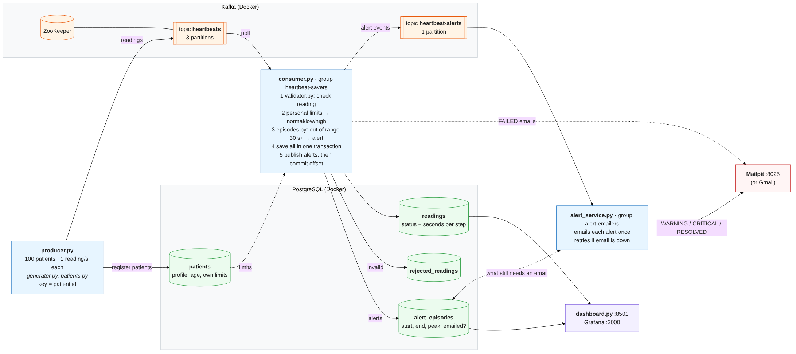

# PulseGuard: Real-Time Patient Heart Beat Monitoring

PulseGuard simulates smartwatches worn by the patients of a clinic. It streams their heart
rates through **Kafka**, checks every reading against **each patient's own limits**, saves
everything in **PostgreSQL**, and **emails** the on-call person when a patient's heart rate
stays out of range, or when the pipeline itself fails.



> The lab calls the person being monitored a *customer*, and its message fields are
> `customer_id`, `timestamp` and `heart_rate`. PulseGuard keeps those exact field names;
> a "customer" here is a clinic patient (`PT-0001`, `PT-0002`, ...).

| Document | What's in it |
|---|---|
| **README.md** (this file) | what it does and how to run it |
| [**RUNBOOK.md**](RUNBOOK.md) | step-by-step: start, check, stop, and what to do for each email |
| [**DESIGN.md**](DESIGN.md) | Kafka architecture, design decisions, best practices, anti-patterns, trade-offs |
| [**TEST_CASES.md**](TEST_CASES.md) | every test case and its result |

## How it works

1. **`producer.py`** registers the patients in PostgreSQL the first time, then sends one
   reading per patient per second to the Kafka topic **`heartbeats`**, keyed by patient id.
   - **`patients.py`** gives every patient a profile (athlete / adult / senior, age, resting rate)
     and their **own limits**: high = 85% of (220 − age), low = 40 for athletes, otherwise 50.
   - **`generator.py`** makes the heart rate drift naturally, with exercise, rare **medical
     events** (out of range for a minute or more) and **sensor glitches** (single bad values).
2. **`consumer.py`** (group `heartbeat-savers`) reads batches from `heartbeats`, then
   (each step is one line in `process_one_batch`, with the detail in its own file):
   - **`validator.py`** checks each reading; bad ones go to `rejected_readings` with a reason
   - labels each reading `normal` / `low` / `high` using **that patient's** limits
   - **`episodes.py`** looks for **health alerts**: out of range for **30 seconds** or more
   - **`batch.py`** handles each batch; **`database.py`** saves readings, rejected messages and alerts in **one transaction**
   - publishes each alert to the Kafka topic **`heartbeat-alerts`**
   - only then commits the Kafka offset, so nothing is ever lost
3. **`alert_service.py`** (group `alert-emailers`) reads `heartbeat-alerts` and emails each
   alert once when it starts and once when it ends (**`health_alerts.py`**). Emails it can't send are retried.
4. **Failure emails:** if the consumer, producer, alert service or pipeline check fails, it emails
   a **system problem** email to the IT team (`SYSTEM_ALERT_TO`), written in plain words: what
   stopped, why, and whether data is lost, with the technical error only at the bottom.
   When that part starts working again, a **BACK ONLINE** email says how long it was down.
5. **Grafana** (<http://localhost:3000>) shows readings, open alerts and timing.

### What happens to each reading

| Reading | Result | Saved in |
|---|---|---|
| inside the patient's limits | `normal` | `readings` |
| below their low limit (but 25+ bpm) | `low` | `readings` |
| above their high limit (but 230 or less) | `high` | `readings` |
| out of range for 30 s or more | **health alert** + email | `alert_episodes` |
| below 25 / above 230, broken JSON, missing fields, bad timestamp | rejected | `rejected_readings` (with the reason) |

A short spike (one glitch, or a few seconds of effort) is saved as `high` or `low` but does
**not** raise an alert. Alerts are only for heart rates that **stay** out of range.

### Database tables

| Table / view | What's in it |
|---|---|
| `patients` | `customer_id`, `profile`, `age`, `resting_bpm`, `low_limit`, `high_limit` |
| `readings` | `customer_id`, `recorded_at`, `heart_rate`, `status`, timing (`sent_at`, `received_at`, `saved_at`, `kafka_seconds`, `save_seconds`, `total_seconds`). Indexed on `recorded_at`. |
| `rejected_readings` | `raw_message`, `reason`, `rejected_at` |
| `alert_episodes` | one row per alert: `kind`, `severity`, `limit_bpm`, `peak_bpm`, `started_at`, `ended_at`, `opened_email_at`, `closed_email_at` |
| `latest_readings` (view) | newest reading per patient |
| `open_alerts` (view) | alerts still going on |
| `timing_per_minute` (view) | average seconds per step, per minute |

## Folder structure

```
heartbeat-monitor/
├── pulseguard/                  the Python code (a package)
│   ├── config.py                all settings (Kafka, database, limits, email)
│   ├── services/                the three programs you run
│   │   ├── producer.py          sends readings to Kafka
│   │   ├── consumer.py          starts up and loops over batches from Kafka
│   │   └── alert_service.py     reads the alerts topic, keeps going if the database is down
│   ├── simulation/              fake patients and heart rates
│   │   ├── patients.py          patient profiles and personal limits
│   │   └── generator.py         normal life, medical events, glitches
│   ├── processing/              rules applied to each reading
│   │   ├── validator.py         checks one message (is it valid?)
│   │   ├── readings.py          checks a batch and labels each reading with the patient's limits
│   │   ├── episodes.py          decides when a patient needs a health alert (30 s rule)
│   │   ├── alerts.py            finds, prints and publishes alerts to the alerts topic
│   │   ├── batch.py             one batch: check -> alerts -> save -> publish -> commit
│   │   └── timing.py            measures how long each step takes
│   ├── storage/
│   │   ├── database.py          connects to PostgreSQL and saves each batch
│   │   ├── alerts_db.py         reads and updates health alerts in PostgreSQL
│   │   └── retry.py             database down? keep the batch, wait, retry with a new connection
│   └── notifications/
│       ├── email_sender.py      sends one email (all emails go through here)
│       ├── alert_emailer.py     emails each alert that still needs one, exactly once
│       ├── health_alerts.py     doctors: alert raised / back to normal
│       ├── system_alerts.py     IT team: SYSTEM PROBLEM in plain words
│       └── back_online.py       IT team: BACK ONLINE after a problem
├── scripts/                     end-to-end self-check (19 checks through real Kafka and PostgreSQL)
│   ├── check_pipeline.py        send -> wait -> compare -> clean up -> email if broken
│   ├── check_cases.py           the 19 test messages and what should happen
│   └── check_report.py          results in plain words, remove test patients
├── sql/                         schema.sql (tables, indexes, views), queries.sql (examples)
├── tests/                       pytest tests, one file per topic (helpers.py = shared helpers)
├── docs/                        architecture diagram
├── grafana/                     Grafana data source and dashboard
├── docker-compose.yml           ZooKeeper, Kafka, Kafka UI, PostgreSQL, Mailpit, Grafana
└── requirements.txt, requirements-dev.txt, pytest.ini, .env.example
```

Run every command **from the project folder** (`heartbeat-monitor`). The programs are run as
modules with `python -m`, e.g. `python -m pulseguard.services.consumer`, so Python can find
the `pulseguard` package.

## How to run

You need **Docker Desktop** (running) and **Python 3.10+**. The commands are for Windows
PowerShell; on Mac or Linux, activate with `source .venv/bin/activate`.

**1. Start the services**

```powershell
docker compose up -d
docker compose ps
```

Wait until `hb-kafka`, `hb-zookeeper` and `hb-postgres` show **healthy**. This also starts
**Mailpit** (test email inbox, <http://localhost:8025>) and **Kafka UI** (<http://localhost:8080>).

**2. Install the Python packages (first time only)**

```powershell
python -m venv .venv
.venv\Scripts\activate
pip install -r requirements-dev.txt
```

**3. Start the three programs, each in its own window** (run `.venv\Scripts\activate` in each)

```powershell
python -m pulseguard.services.consumer --quiet     # window 1: check, save, find alerts
python -m pulseguard.services.alert_service        # window 2: email alerts
python -m pulseguard.services.producer             # window 3: 100 patients
```

Producer options: `--patients 500`, `--seconds 60`, `--bad-chance 0.1` (more glitches),
`--event-chance 0.001` (more medical events),
`--emergency PT-0007` (start a medical event for that patient now), `--emergency-kind low`.

**4. Look at the data**

```powershell
docker exec -it hb-postgres psql -U heartbeat -d heartbeat -c "SELECT * FROM open_alerts;"
docker exec -i hb-postgres psql -U heartbeat -d heartbeat < sql/queries.sql
```

**5. Dashboard**

Grafana starts with `docker compose up -d`: open <http://localhost:3000> (admin / admin).

**6. Stop**: Ctrl+C in each window, then `docker compose down` (or `down -v` to delete the database).

See [RUNBOOK.md](RUNBOOK.md) for health checks and what to do when something fails.

## Demonstrating the emails

**Health alert:**

```powershell
python -m pulseguard.services.producer --emergency PT-0007
```

PT-0007's heart rate climbs above their personal high limit and stays there for 75 seconds.
About 30 seconds after it crosses the limit, the consumer prints `ALERT WARNING: PT-0007 ...`
and Mailpit (<http://localhost:8025>) receives
`[PulseGuard] WARNING: PT-0007 heart rate HIGH (... bpm, limit ...)`. When it calms down,
a second email arrives: `[PulseGuard] RESOLVED: PT-0007 heart rate back to normal after ... s`.
The other 99 patients' glitches do not cause any alerts.

**Failure and automatic recovery:** with the consumer and alert service running, run
`docker stop hb-postgres`. They do **not** stop: each emails
`[PulseGuard] SYSTEM PROBLEM: ... (database not reachable)` once, then prints
`Database is down. Holding N messages and trying again in 10 s...`. Run `docker start hb-postgres`:
within 10 seconds they save the batch they were holding, carry on, and email
`[PulseGuard] BACK ONLINE: ... (was down ...)`. Nobody has to restart anything, and no readings are lost.

To use a real inbox instead of Mailpit (e.g. Gmail), set `SMTP_HOST`, `SMTP_PORT=587`,
`SMTP_TLS=yes`, `SMTP_USER`, `SMTP_PASSWORD` (an *app password*) and `ALERT_TO` (see `.env.example`).

## Timing: how long each step takes

The **producer** prints how long each round of sends takes and the overall readings per second.
The **consumer** prints, every 5 seconds:

```
timing: producer -> consumer: avg 5 ms (max 6 ms) | saving: avg 18.5 ms per batch | total trip: about 24 ms
```

Every reading also stores its timing in the database (`kafka_seconds`, `save_seconds`,
`total_seconds`), and `timing_per_minute` shows the averages. If the consumer starts after
the producer, the first delays are large because messages were waiting in Kafka; once it
catches up they drop to milliseconds.

## Tests

| Kind | Command | What it proves |
|---|---|---|
| Unit + database + email tests | see below | every part, including 60+ error cases |
| Email tests | `pytest tests/test_email.py tests/test_failure_emails.py tests/test_back_online.py tests/test_alert_emails.py -v` | emails really arrive at a real (local) email server, exactly once |
| End-to-end | `python -m scripts.check_pipeline` (consumer and alert service running) | 19 checks through real Kafka, PostgreSQL and email; ends `19/19 passed` |

The self-check uses its own test patients (`TEST-...`). They never reach doctors: their alert
emails go to the IT team marked `[TEST]`, the dashboards hide them, and they are deleted from
the database when the check ends.

```powershell
docker exec hb-postgres createdb -U heartbeat heartbeat_test      # once
$env:TEST_DB="host=localhost port=5433 dbname=heartbeat_test user=heartbeat password=heartbeat"
pytest -v
```

Without `TEST_DB`, the database tests are skipped. To see a failure, stop the consumer and run
`python -m scripts.check_pipeline`: the checks fail, and a `SYSTEM PROBLEM: self-check failed` email lists them.
All test cases are listed in [TEST_CASES.md](TEST_CASES.md).

## Problems and fixes

| Problem | Fix |
|---|---|
| `password authentication failed for user "heartbeat"` | another PostgreSQL on your computer uses port 5432; that's why this project uses **5433** |
| `relation "patients" does not exist` | old database: `docker compose down -v`, then `docker compose up -d` |
| `Kafka not ready yet` | wait 30 seconds after `docker compose up -d` |
| No emails in Mailpit | `docker compose ps` shows `hb-mailpit`? Try `python -m pulseguard.notifications.email_sender` |

More in [RUNBOOK.md](RUNBOOK.md).
