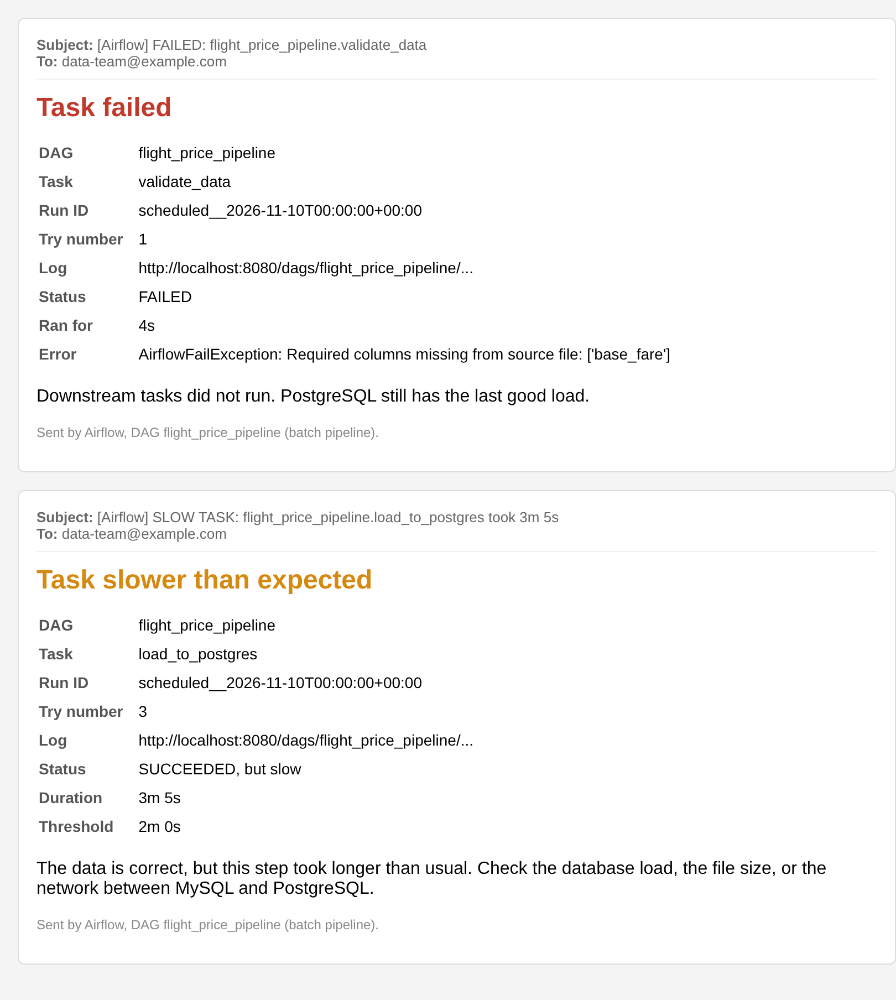

# Flight Price Analysis — Airflow Pipeline (Bangladesh)

An Apache Airflow pipeline that ingests the Kaggle **Flight Price Dataset of Bangladesh**
into MySQL, validates and transforms it, computes KPIs, and publishes the results to
PostgreSQL for analysis.

```
CSV ──► MySQL staging ──► validate ──► transform ──► 4 KPIs (parallel) ──► PostgreSQL analytics ──► verify
```

* **Getting the data?** [`docs/KAGGLE_SETUP.md`](docs/KAGGLE_SETUP.md): Kaggle token (`kaggle.json`) and dataset download.
* **Setting up from scratch** (Docker, Python venv, **Kaggle token and dataset download**, `.env`)? See [Full setup](#full-setup-new-computer-or-new-user) below.
* **First time running it?** Follow [`docs/HOW_TO_RUN.md`](docs/HOW_TO_RUN.md): start, trigger, watch, check results, stop.
* **Running or supporting the pipeline?** Read [`docs/RUNBOOK.md`](docs/RUNBOOK.md): how to run it, what each alert means, and what to do.
* **Turning on email alerts?** Follow [`docs/EMAIL_SETUP.md`](docs/EMAIL_SETUP.md), a step-by-step Gmail setup with screenshots.
* **Design write-up** (architecture, tasks, KPI logic, challenges): [`docs/REPORT.md`](docs/REPORT.md).

The DAG has three task groups: **extract** (CSV → MySQL), **transform** (validate, enrich, 4 KPIs) and
**load** (→ PostgreSQL, verify, notify). It has typed run **params**, a per-task **retry policy** with
exponential backoff, and **email alerts** with a fallback log file ([`data/alerts.log`](data/alerts.log)).

## Project layout

```
flight-price-pipeline/
├── docker-compose.yml          # Airflow 3.1.3 + MySQL 8 (staging) + Postgres 16 (analytics)
├── .env.example                # credentials / ports → copy to .env
├── dags/
│   ├── flight_price_pipeline.py    # the DAG (TaskFlow API)
│   ├── .airflowignore              # stops Airflow parsing the package as DAG files
│   └── flight_pipeline/            # pipeline logic, importable and testable without Airflow
│       ├── config.py               # schema, required columns, rules, season calendar
│       ├── schema.py               # MySQL + PostgreSQL DDL
│       ├── db.py                   # DB-API helpers (batched INSERT, COPY)
│       ├── ingestion.py            # CSV → stg_flight_prices_raw
│       ├── validation.py           # schema + row-level data quality checks
│       ├── transformation.py       # total fare, season, peak flag, route, calendar fields
│       ├── kpis.py                 # the 4 KPI computations
│       ├── report.py               # KPI report: data/reports/kpi_report.html with charts
│       ├── alerts.py               # email alerts: failed, timed out, slow task, slow run
│       ├── check_email.py          # step-by-step email connection check
│       └── stages.py               # DB-to-DB stage functions called by the DAG
├── data/                       # put Flight_Price_Dataset_of_Bangladesh.csv here
├── scripts/
│   ├── run_all.ps1             # one command: start, check, run, show results, open report
│   ├── download_data.py        # downloads the Kaggle dataset into data/
│   └── generate_sample_data.py # synthetic CSV with the same header (testing only)
├── tests/                      # unit tests (pytest): pipeline logic + alerts
└── docs/
    ├── HOW_TO_RUN.md           # step-by-step running process (Windows)
    ├── RUNBOOK.md              # operator guide: run, alerts, what to do, re-run
    ├── EMAIL_SETUP.md          # Gmail alert setup: 2-Step Verification, App Password, test
    ├── EMAIL_ALERT_TESTS.md    # test cases: success, slow, retry, failed, timed out (with screenshots)
    ├── KAGGLE_SETUP.md         # Kaggle token, dataset download, slow downloads, troubleshooting
    ├── REPORT.md               # project report
    └── img/                    # alert email examples + email setup screenshots
```

## Quick start

**One command** (after the setup below): `powershell -ExecutionPolicy Bypass -File scripts\run_all.ps1`
starts everything, runs the pipeline, checks the results and opens the KPI report. See
[`docs/HOW_TO_RUN.md`](docs/HOW_TO_RUN.md#run-everything-with-one-command).


1. **Get the data.** `python scripts/download_data.py` (needs a Kaggle token, see [Full setup, step 3](#3-set-up-kaggle-and-download-the-dataset)), or download
   `Flight_Price_Dataset_of_Bangladesh.csv` from Kaggle by hand and place it in [`data/`](data/).
   (No Kaggle account handy? `python scripts/generate_sample_data.py` writes a synthetic file with the
   same header and ~1 % deliberately dirty rows.)
2. **Configure.** `cp .env.example .env` (on Linux also set `AIRFLOW_UID=$(id -u)`), then fill in the
   `SMTP_*` and `ALERT_EMAIL_TO` values so alerts reach your inbox (Gmail needs an App Password, see [`.env.example`](.env.example)).
3. **Start the stack.**
   ```bash
   mkdir -p logs
   docker compose up -d
   ```
4. **Run it.** Open [http://localhost:8080](http://localhost:8080) (admin / admin), the DAG `flight_price_pipeline` is
   unpaused and scheduled `@daily`; click **Trigger** on the DAG page to run now. Or:
   ```bash
   docker compose exec airflow-scheduler airflow dags trigger flight_price_pipeline
   ```
5. **Query the results.**
   ```bash
   docker compose exec postgres-analytics psql -U analytics_user -d flight_analytics
   ```
   ```sql
   SELECT * FROM analytics.kpi_avg_fare_by_airline ORDER BY fare_rank;
   SELECT * FROM analytics.v_peak_vs_offpeak;
   SELECT * FROM analytics.v_top_routes;
   SELECT * FROM analytics.kpi_booking_count_by_airline ORDER BY booking_rank;
   SELECT * FROM analytics.pipeline_run_log ORDER BY loaded_at DESC;
   ```
   **KPI charts:** open [`data/reports/kpi_report.html`](data/reports/kpi_report.html) in a browser. It's rebuilt after every run.

   Data-quality findings stay in MySQL: `SELECT rule_name, severity, COUNT(*) FROM dq_issues GROUP BY 1,2;`

## Email alerts

| Email | When | Pipeline result |
|---|---|---|
| (log only) `RETRYING` | A try failed and will be retried | Retry policy takes over; email only if `ALERT_EMAIL_ON_RETRY=true` |
| `[Airflow] FAILED: …` | A task fails after its retries (or immediately for bad data) | Run fails; PostgreSQL keeps the last good load |
| `[Airflow] TIMED OUT: …` | A task runs past its hard limit (`LOAD_TIMEOUT_SECONDS` for the PostgreSQL load) | Task is stopped, the load rolls back, run fails |
| `[Airflow] SLOW TASK: …` | A task succeeds but takes longer than its threshold (`ALERT_SLOW_LOAD_SECONDS`…) | Run continues (warning only) |
| `[Airflow] SLOW RUN: …` | The whole run succeeds but takes longer than `ALERT_SLOW_RUN_SECONDS` | Warning only |

**Check the email connection** (settings → network → login → optional test email):

```bash
docker compose exec -w /opt/airflow/dags airflow-scheduler python -m flight_pipeline.check_email --send
```

A successful run within the thresholds sends no email. If SMTP isn't configured, alerts are written to
the task log instead and the pipeline still runs. Runs on Airflow 3.1.3.



This is a **batch** pipeline: Airflow schedules and monitors finite jobs (here, once a day). It is not
a streaming engine; see the report, section 6.

Connections are injected as environment variables (`AIRFLOW_CONN_MYSQL_STAGING`,
`AIRFLOW_CONN_POSTGRES_ANALYTICS`), so no manual setup in the UI is needed.
Host ports: MySQL `3307`, analytics Postgres `5433`, Airflow `8080`.

## Run parameters and retry policy

Trigger a run with custom values (UI: the **Trigger** form on the DAG page):

```bash
docker compose exec airflow-scheduler airflow dags trigger flight_price_pipeline \
    --conf '{"csv_path": "/opt/airflow/data/my_file.csv", "max_reject_ratio": 0.05, "top_routes_limit": 10, "send_success_email": true}'
```

| Task(s) | Retries | Delay |
|---|---|---|
| All (default) | 3 | 1 → 2 → 4 min (exponential, max 10 min) |
| `load.load_to_postgres` | 3 | 2 → 4 → 8 min, each try rolls back fully |
| `extract.check_source_file` | 3 | every 5 min (waits for a late file) |
| Data-quality failures | 0 | fail immediately |

Each retry is written to [`data/alerts.log`](data/alerts.log); the final failure is emailed **and** logged there.

## Full setup (new computer or new user)

### 1. Install the tools

| Tool | Why | Get it |
|---|---|---|
| Docker Desktop | Runs Airflow, MySQL and PostgreSQL | [https://www.docker.com/products/docker-desktop](https://www.docker.com/products/docker-desktop) (start it before the next steps) |
| Python 3.11+ | Local tools only: dataset download and tests | [https://www.python.org/downloads](https://www.python.org/downloads) |
| VS Code (optional) | Edit files and use the terminal | [https://code.visualstudio.com](https://code.visualstudio.com) |

### 2. Create the Python virtual environment

From the project folder, in PowerShell:

```powershell
python -m venv .venv                     # or: uv venv
.\.venv\Scripts\Activate.ps1             # the prompt now starts with (.venv)
pip install -r requirements-dev.txt      # pandas, pytest, kaggle (+ six, which kaggle needs)
```

If PowerShell says *running scripts is disabled*, first run
`Set-ExecutionPolicy -Scope Process -ExecutionPolicy Bypass`, then activate again.

### 3. Set up Kaggle and download the dataset

> **Full guide:** [`docs/KAGGLE_SETUP.md`](docs/KAGGLE_SETUP.md) covers two options:
> **Option 1, download from the Kaggle website** (no token needed), or **Option 2, the Kaggle API**
> with `kaggle.json`, step by step with screenshots, plus slow downloads and troubleshooting. Short
> version of Option 2 below.

The data is the Kaggle dataset **Flight Price Dataset of Bangladesh**
([`mahatiratusher/flight-price-dataset-of-bangladesh`](https://www.kaggle.com/datasets/mahatiratusher/flight-price-dataset-of-bangladesh), about 57,000 rows).

**3a. Create your Kaggle API token (`kaggle.json`)**

1. Sign in (or sign up for free) at [https://www.kaggle.com](https://www.kaggle.com).
2. Click your **profile picture** → **Settings** → **API Tokens** tab → scroll to **Legacy API Credentials** → **Create Legacy API Key**.
3. Your browser downloads **`kaggle.json`**. It contains your Kaggle username and a secret key.

**3b. Put `kaggle.json` where the Kaggle tool can find it.** Choose one:

* **Recommended:** your user folder, so it works for every project:
  ```powershell
  mkdir $HOME\.kaggle -Force
  Move-Item $HOME\Downloads\kaggle.json $HOME\.kaggle\kaggle.json
  ```
* **Or** keep it in the project folder and tell the tool where it is, once per terminal:
  ```powershell
  $env:KAGGLE_CONFIG_DIR = $PWD
  ```
  `kaggle.json` is listed in [`.gitignore`](.gitignore), so it is never committed.

**3c. Download the dataset**

```powershell
python scripts/download_data.py
```

The script downloads the dataset into [`data\`](data/), names it `Flight_Price_Dataset_of_Bangladesh.csv`,
checks the required columns, and prints the row count. Without the script, you can run:

```powershell
kaggle datasets download -d mahatiratusher/flight-price-dataset-of-bangladesh -p data --unzip --force
```

Or download it by hand: open the dataset page on Kaggle → **Download** → unzip → copy the CSV into [`data\`](data/).

| Kaggle problem | Fix |
|---|---|
| `No module named 'six'` | `pip install six` (or `pip install -r requirements-dev.txt`) |
| `Could not find kaggle.json` / `401 Unauthorized` | Put `kaggle.json` in `%USERPROFILE%\.kaggle\`, or set `$env:KAGGLE_CONFIG_DIR`. Creating a new legacy key expires the old one. |
| `403 Forbidden` on download | Open the dataset page in the browser once while logged in, then try again |
| `kaggle` not recognised | Activate the venv first (`.\.venv\Scripts\Activate.ps1`) |

> [`scripts/generate_sample_data.py`](scripts/generate_sample_data.py) only makes a **fake** test file with the same columns. Don't use it
> for the real analysis.

### 4. Create `.env`

```powershell
Copy-Item .env.example .env
```

Open `.env` in VS Code and set:

* `SMTP_PASSWORD`: your Gmail App Password, with no spaces. See [`docs/EMAIL_SETUP.md`](docs/EMAIL_SETUP.md).
* `SMTP_USER`, `SMTP_FROM`, `ALERT_EMAIL_TO`: the Gmail address that sends and receives the alerts.
* Optionally, `FERNET_KEY`. Generate one with:
  `python -c "import base64,os;print(base64.urlsafe_b64encode(os.urandom(32)).decode())"`

### 5. Start and run

```powershell
mkdir logs -Force
docker compose up -d
docker compose exec -w /opt/airflow/dags airflow-scheduler python -m flight_pipeline.check_email --send
docker compose exec airflow-scheduler airflow dags trigger flight_price_pipeline
```

Open [http://localhost:8080](http://localhost:8080) (`admin` / `admin`) to watch the run. Step by step:
[`docs/HOW_TO_RUN.md`](docs/HOW_TO_RUN.md).

### What stays private

[`.gitignore`](.gitignore) excludes `.env` (passwords), `kaggle.json` (Kaggle key), `.venv/`, `data/*.csv` and `logs/`.
**Never share** `.env`, `kaggle.json` or your Gmail App Password. Each person creates their own.

## Tests

```bash
pip install -r requirements-dev.txt
pytest -q
```

## Tuning

| Setting | Where | Default |
|---|---|---|
| Max share of rejected rows before the run fails | env `FLIGHT_MAX_REJECT_RATIO` | `0.05` |
| CSV path | env `FLIGHT_CSV_PATH` | `/opt/airflow/data/Flight_Price_Dataset_of_Bangladesh.csv` |
| Slow-task / slow-run warning thresholds (s) | env `ALERT_SLOW_LOAD_SECONDS`, `ALERT_SLOW_EXTRACT_SECONDS`, `ALERT_SLOW_TASK_SECONDS`, `ALERT_SLOW_RUN_SECONDS` | 120 / 120 / 300 / 900 |
| Hard time limits (s) | env `LOAD_TIMEOUT_SECONDS`, `TASK_TIMEOUT_SECONDS` | 600 / 1800 |
| Retry policy | env `TASK_RETRIES`, `RETRY_DELAY_SECONDS`, `MAX_RETRY_DELAY_SECONDS`, `SOURCE_FILE_RETRIES`, `SOURCE_FILE_RETRY_DELAY_SECONDS` | 3 / 60 / 600 / 3 / 300 |
| Email on every retry | env `ALERT_EMAIL_ON_RETRY` | `false` |
| Email after every successful run | env `ALERT_EMAIL_ON_SUCCESS` | `false` |
| Whole-run time limit (s) | env `DAGRUN_TIMEOUT_SECONDS` | 3600 |
| Known airports, Eid dates, winter window, top-N routes | [`dags/flight_pipeline/config.py`](dags/flight_pipeline/config.py) | — |
