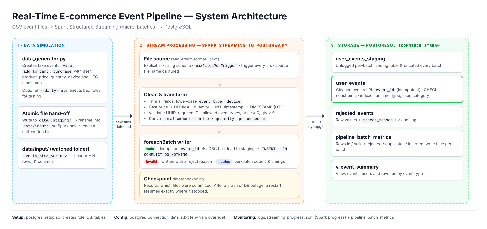
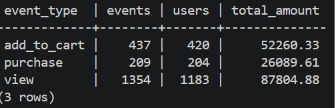
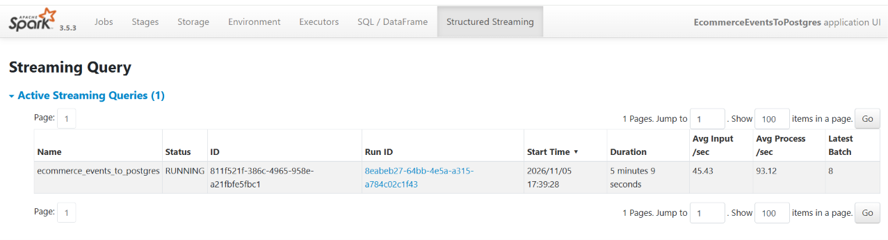
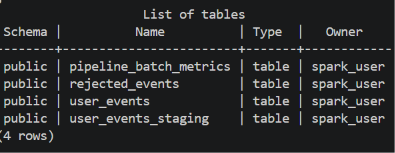
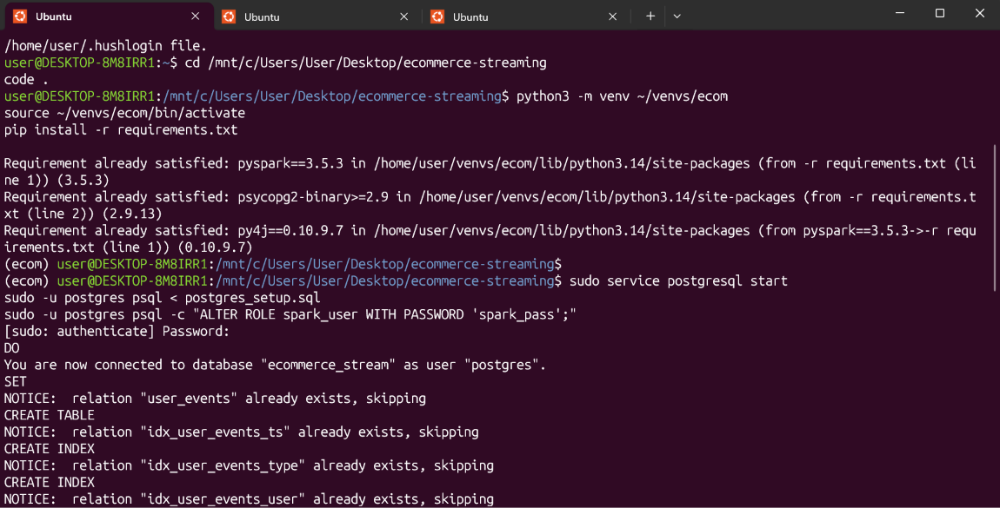
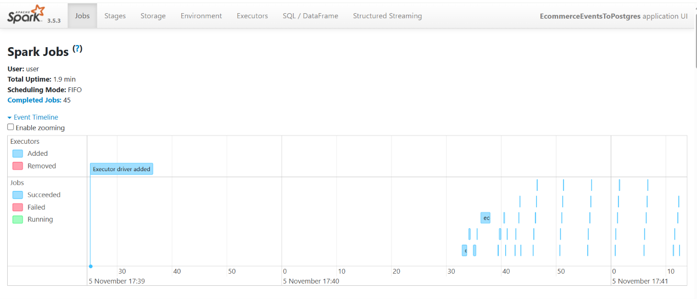

# Real-Time E-commerce Data Ingestion with Spark Structured Streaming and PostgreSQL

## What this project is about

Online shops need to know what their customers are doing right now: which products they look at, what they add to their cart, and what they buy. This information is most useful when it arrives within seconds, not hours later.

In this project I built a small real-time data pipeline that does exactly that. A Python script pretends to be a busy online shop and writes customer activity into CSV files. Apache Spark Structured Streaming watches the folder, picks up each new file within a few seconds, cleans and checks the data, and saves it into a PostgreSQL database. Broken rows are not silently lost. They are saved separately with the reason they were rejected.



## How it works

The pipeline has three parts that work together:

1. **The fake shop ([`data_generator.py`](data_generator.py)).** It creates shopper events (views, add-to-carts and purchases) with a user, a product, a price, a quantity, a device and a time. It writes them into CSV files in the `data/input` folder, by default 100 events every 2 seconds. Each file is written in a hidden waiting folder first and then moved in one step, so Spark never reads a half-finished file. For testing, it can also break some rows on purpose.

2. **The worker ([`spark_streaming_to_postgres.py`](spark_streaming_to_postgres.py)).** Spark checks the folder every 5 seconds. For each new group of files it:
   - removes extra spaces and fixes capital letters (for example `"  PURCHASE "` becomes `purchase`)
   - turns text into proper numbers and dates
   - checks every row against a set of rules (valid ID, user present, known event type, price not negative, quantity above zero, readable date)
   - works out `total_amount = price x quantity`
   - removes duplicate events
   - saves the good rows and the rejected rows into separate tables

3. **The storage (PostgreSQL).** The database `ecommerce_stream` holds:
   - `user_events`: the clean events
   - `rejected_events`: the broken rows and why they were rejected
   - `pipeline_batch_metrics`: how many rows each batch had and how long it took
   - `v_event_summary`: a ready-made summary of views, add-to-carts and purchases

## What makes it reliable

- **No duplicates.** Every event has a unique ID. If the same event arrives twice, it is saved only once.
- **No lost data.** Spark keeps a record (the "checkpoint") of which files it has finished. If Spark or the database stops, the pipeline continues from where it left off after a restart. I tested this by switching off the database while data was arriving. After restarting, every missed event was saved, and none were saved twice.
- **Every row is accounted for.** Each row ends up in exactly one place: saved, rejected with a reason, or skipped as a duplicate. The numbers always add up.
- **Correct times.** All times are kept in UTC, so they don't shift depending on the computer's time zone. I found and fixed a 2-hour shift during testing.

## Tools used

| Tool | What it is used for |
|---|---|
| Python 3 | Generating the fake shop data |
| Apache Spark 3.5 (PySpark) | Reading and cleaning the data as it arrives |
| PostgreSQL 16 | Storing the data |
| SQL | Creating the database and tables, and checking results |
| Ubuntu on Windows (WSL2) | Running Linux, where Spark and PostgreSQL run best |
| VS Code | Editing the code and running the terminals |

## What's in this folder

| File | What it is |
|---|---|
| [data_generator.py](data_generator.py) | Python script that generates the CSV event data |
| [spark_streaming_to_postgres.py](spark_streaming_to_postgres.py) | Spark Structured Streaming job that processes the data and writes it to PostgreSQL |
| [postgres_setup.sql](postgres_setup.sql) | SQL script that creates the database, user and tables |
| [postgres_connection_details.txt](postgres_connection_details.txt) | Database host, port, name, user and password |
| [project_overview.md](project_overview.md) | A more detailed explanation of the components and data flow |
| [user_guide.md](user_guide.md) | Step-by-step instructions to install and run the project, with screenshots |
| [test_cases.md](test_cases.md) | The test plan, with expected and actual results |
| [performance_metrics.md](performance_metrics.md) | Speed and performance results (latency, throughput) |
| [system_architecture.png](system_architecture.png) | Diagram of the system |
| [README.md](README.md) | This page |
| [requirements.txt](requirements.txt) | Python packages to install |
| [run_benchmark.py](run_benchmark.py) | Optional script that runs the performance tests |
| [images/](images/) | Pictures used in the documents |
| [data/](user_guide.md#whats-in-the-project-folder) | Created automatically when the project runs (not uploaded to GitHub); the link explains what it holds |
| [logs/](logs/) | Performance test results ([benchmark_results.json](logs/benchmark_results.json)) |

## How to run it 

Full first-time setup instructions (installing Ubuntu, Java, PostgreSQL and Python packages) are in **[user_guide.md](user_guide.md)**. Once everything is installed, running the project takes four steps.

**1. Open Ubuntu and go to the project folder.** If you are in PowerShell, type `wsl` first.
```bash
cd /mnt/c/Users/User/Desktop/ecommerce-streaming
source ~/venvs/ecom/bin/activate
sudo service postgresql start
```

**2. Start Spark (first terminal).** Wait until it says `[stream] query started`.
```bash
python spark_streaming_to_postgres.py
```

**3. Generate events (second terminal).**
```bash
cd /mnt/c/Users/User/Desktop/ecommerce-streaming
source ~/venvs/ecom/bin/activate
python data_generator.py
```
The Spark terminal prints a line for each batch, for example:
```
[batch 3] files=2 input=200 valid=193 rejected=5 inserted=193 duplicates_skipped=2 pg_write=310ms
```

**4. Check the results.**
```bash
PGPASSWORD=spark_pass psql -h localhost -U spark_user -d ecommerce_stream -c "SELECT * FROM v_event_summary;"
```

While Spark is running, you can also watch it work in the browser at **http://localhost:4040**.

To stop, press **Ctrl + C** in the Spark terminal.

## Results

I reran the whole project from an empty database on my laptop and checked each question from the project brief.

| Question | Result |
|---|---|
| Are the CSV files being generated correctly? | Yes. Each file has the 11 expected columns and valid rows. |
| Is Spark detecting and processing new files? | Yes. New files are picked up within one 5-second check. Spark ran 45 jobs with none failing. |
| Are the data transformations correct? | Yes. Broken rows are rejected with the right reason, and every saved row has a correct total and a valid event type. |
| Is data being written into PostgreSQL without errors? | Yes. 2,000 events generated and 2,000 events saved (437 add-to-carts, 209 purchases, 1,354 views). |
| Is the performance within expected limits? | Yes. An event typically reaches the database in about 5 seconds. Data arrived at about 45 events per second and Spark processed about 93 per second, twice as fast as needed. |

Events saved in the database after one run of the generator:



Spark keeping up with the incoming data:



More detail is in [test_cases.md](test_cases.md) and [performance_metrics.md](performance_metrics.md). I also ran larger load tests on my laptop with [`run_benchmark.py`](run_benchmark.py): 626,000 events in total, all saved with none lost. It kept up with about 3,900 events per second, and cleared a pile-up of waiting files at about 7,500 events per second.

## Execution record

This section lists everything I ran on my laptop (Windows, Ubuntu on WSL 2), with the real output and what it shows. Click a block to open the full output.

### 1. Environment check

```bash
uname -r
```
```
6.18.54.1-microsoft-standard-WSL2
```
This confirms that Ubuntu runs on WSL 2, a real Linux system inside Windows.

### 2. Setup

```bash
python3 -m venv ~/venvs/ecom
source ~/venvs/ecom/bin/activate
pip install -r requirements.txt
sudo service postgresql start
sudo -u postgres psql < postgres_setup.sql
sudo -u postgres psql -c "ALTER ROLE spark_user WITH PASSWORD 'spark_pass';"
```
Checking that the database was created:
```bash
PGPASSWORD=spark_pass psql -h localhost -U spark_user -d ecommerce_stream -c "\dt"
```


All four tables exist and belong to `spark_user`, the account the Spark job uses.

Running the setup again shows that the packages are already installed and the tables already exist. The script is safe to repeat.



### 3. Normal run: 20 files, 2,000 events

Terminal 1 (Spark):
```bash
python spark_streaming_to_postgres.py
```
Terminal 2 (generator):
```bash
python data_generator.py
```
<details>
<summary>Generator output</summary>

```
[generator] writing to /mnt/c/Users/User/Desktop/ecommerce-streaming/data/input | 100 events/file | interval 2.0s | dirty-rate 0.0
[generator] file 1: events_20261105_172944_951627_00001.csv (100 rows, total 100)
[generator] file 2: events_20261105_172946_963239_00002.csv (100 rows, total 200)
...
[generator] file 19: events_20261105_173021_303654_00019.csv (100 rows, total 1900)
[generator] file 20: events_20261105_173023_320006_00020.csv (100 rows, total 2000)
[generator] done: 20 files, 2000 events
```
</details>

Checking the database:
```bash
PGPASSWORD=spark_pass psql -h localhost -U spark_user -d ecommerce_stream -c "SELECT * FROM v_event_summary;"
```
```
 event_type  | events | users | total_amount
-------------+--------+-------+--------------
 add_to_cart |    437 |   420 |     52260.33
 purchase    |    209 |   204 |     26089.61
 view        |   1354 |  1183 |     87804.88
(3 rows)
```
437 + 209 + 1,354 = **2,000**: every generated event was saved.

The Spark web page (http://localhost:4040) showed 45 completed jobs and none failed. Data came in at about 45 events per second and Spark processed about 93 per second:




### 4. Run with broken rows and a restart

The generator was run with 5% broken rows while Spark was stopped:
```bash
python data_generator.py --files 10 --dirty-rate 0.05
```
Spark was then started and picked up all 10 waiting files in one batch:
```
[stream] query started id=5a81a270-43c9-4275-b82a-187bac5e60ad
[batch 30] files=10 input=1000 valid=950 rejected=44 inserted=950 duplicates_skipped=6 pg_write=2498ms
WARN ProcessingTimeExecutor: Current batch is falling behind. The trigger interval is 5000 milliseconds, but spent 10449 milliseconds
```
The warning appeared only for this batch, because it held 10 files at once and Spark was still warming up.

Checks:
```bash
psql -h localhost -U spark_user -d ecommerce_stream -c "SELECT reject_reason, count(*) FROM rejected_events GROUP BY 1;"
```
```
        reject_reason        | count
-----------------------------+-------
 quantity not integer        |    10
 unparseable event_timestamp |    29
 negative price              |    16
 missing user_id             |    11
 invalid event_type          |    15
(5 rows)
```
```bash
psql -h localhost -U spark_user -d ecommerce_stream -c "SELECT count(*) AS wrong_totals FROM user_events WHERE total_amount <> price*quantity OR event_type NOT IN ('view','add_to_cart','purchase');"
```
```
 wrong_totals
--------------
            0
```
```bash
psql -h localhost -U spark_user -d ecommerce_stream -c "SELECT sum(input_rows) AS input, sum(inserted_rows) AS stored, sum(rejected_rows) AS rejected, sum(duplicate_rows) AS duplicates FROM pipeline_batch_metrics;"
```
```
 input | stored | rejected | duplicates
-------+--------+----------+------------
  8000 |   7905 |       81 |         14
```
```
 median_latency_s | avg_db_write_ms
------------------+-----------------
             4.95 |             586
```
What this shows:
- Broken rows were rejected with the right reasons.
- No saved row breaks a rule.
- 8,000 = 7,905 + 81 + 14, so every row is accounted for.
- An event typically reached the database in about 5 seconds.

### 5. Performance tests

```bash
python run_benchmark.py
```
| Test | Events | Saved | Typical delay | Slowest 5% | Events saved per second |
|---|---:|---:|---:|---:|---:|
| S1: 100/s, 5 s checks | 6,000 | 6,000 | 4.3 s | 6.8 s | 91 |
| S2: about 1,000/s, 5 s checks | 60,000 | 60,000 | 4.4 s | 7.0 s | 993 |
| S3: about 1,000/s, 2 s checks | 60,000 | 60,000 | 3.3 s | 4.3 s | 949 |
| S4: about 3,900/s, 5 s checks | 300,000 | 300,000 | 6.2 s | 11.0 s | 3,977 |
| B1: 200 files waiting | 200,000 | 200,000 | not applicable | not applicable | 7,544 |

<details>
<summary>Full output (first test)</summary>

```
=== S1: Low load: 100 events/s ===
{
  "id": "S1",
  "expected_rows": 6000,
  "stored_rows": 6000,
  "batches": 19,
  "e2e_latency_ms": { "p50": 4331, "p95": 6750, "p99": 7455, "max": 7457, "avg": 4409 },
  "avg_batch_duration_ms": 1468,
  "avg_pg_write_ms": 423,
  "sustained_throughput_rows_per_s": 91,
  "actual_generator_rate_events_per_s": 99
}
...
Saved logs/benchmark_results.json
```
All five results are saved in [logs/benchmark_results.json](logs/benchmark_results.json) and explained in [performance_metrics.md](performance_metrics.md).
</details>

### 6. Test cases

**Part 1: generator checks (TC-01 to TC-03)**
```bash
python data_generator.py --output-dir test_data/gen_check --files 3 --events-per-file 50 --interval 0 --seed 1
wc -l test_data/gen_check/*.csv
ls -A test_data/.staging
```
```
[generator] done: 3 files, 150 events
event_id,user_id,session_id,event_type,product_id,product_name,category,price,quantity,device,event_timestamp
51a43486-cd6f-41e9-b199-7992110426c9,U00517,bb55d6e73f79,view,P0005,Laptop Stand,Electronics,29.95,1,mobile,2026-11-06 08:06:22.560
  153 total
rows: 150 unique IDs: 150 {'view': 109, 'add_to_cart': 30, 'purchase': 11}
```
- 3 files, each with the correct 11-column header.
- 150 rows, all with unique IDs.
- The `.staging` folder is empty, so no half-written files were left behind.

**Part 2: Spark detecting and cleaning the data (TC-04 to TC-11)**

Normal run, Spark in Terminal 1 and the generator in Terminal 2:
```
[batch 0] files=2 input=200 valid=200 rejected=0 inserted=200 duplicates_skipped=0 pg_write=2349ms
[batch 1] files=4 input=400 valid=400 rejected=0 inserted=400 duplicates_skipped=0 pg_write=344ms
...
[batch 8] files=1 input=100 valid=100 rejected=0 inserted=100 duplicates_skipped=0 pg_write=207ms
```
```
 event_type  | events | users | total_amount
-------------+--------+-------+--------------
 add_to_cart |    382 |   369 |     40191.43
 purchase    |    191 |   189 |     28697.08
 view        |   1427 |  1226 |     92101.03
```
All 20 files and 2,000 events were saved (382 + 191 + 1,427).

The test file with tricky rows, then the same data under a new name:
```bash
cp test_data/edge_cases.csv data/input/
cp test_data/edge_cases.csv data/input/edge_cases_copy.csv
cp test_data/header_only.csv data/input/
cp test_data/edge_cases.csv data/input/edge_cases.csv
```
```
[batch 14] files=1 input=12 valid=3 rejected=8 inserted=3 duplicates_skipped=1 pg_write=294ms
[batch 15] files=1 input=12 valid=3 rejected=8 inserted=0 duplicates_skipped=4 pg_write=303ms
```
```
               event_id               | event_type  |    category    | total_amount | device  |    event_timestamp
--------------------------------------+-------------+----------------+--------------+---------+------------------------
 11111111-1111-4111-8111-111111111111 | view        | Electronics    |        59.99 | mobile  | 2026-11-03 08:00:00
 22222222-2222-4222-8222-222222222222 | purchase    | Electronics    |       998.00 | desktop | 2026-11-03 08:00:01.5
 aaaaaaaa-aaaa-4aaa-8aaa-aaaaaaaaaaaa | add_to_cart | Home & Kitchen |       237.00 | desktop | 2026-11-03 08:00:10
```
```
             raw_event_id             |          reject_reason
--------------------------------------+----------------------------------
 33333333-3333-4333-8333-333333333333 | negative price
 44444444-4444-4444-8444-444444444444 | missing user_id
 55555555-5555-4555-8555-555555555555 | invalid event_type
 66666666-6666-4666-8666-666666666666 | quantity not integer
 77777777-7777-4777-8777-777777777777 | unparseable event_timestamp
 88888888-8888-4888-8888-888888888888 | non-positive quantity
 99999999-9999-4999-8999-999999999999 | incomplete row (missing columns)
 not-a-uuid                           | invalid event_id
```
What this shows:
- Messy values were tidied up (`"  PURCHASE "` became `purchase`).
- Every broken row was rejected with the right reason.
- Times stayed at 08:00 on a UTC+2 laptop.
- The copied file saved nothing new (`inserted=0`).
- The empty file and the repeated file name were ignored with no error.

**Part 3: run with broken rows (TC-12)**
```bash
python data_generator.py --files 10 --dirty-rate 0.05
```
```
 input | stored | rejected | duplicates
-------+--------+----------+------------
  3000 |   2957 |       33 |         10

 rule_breaks
-------------
           0

 typical_seconds | slowest_seconds
-----------------+-----------------
            4.45 |           10.92
```
Every row is accounted for (3,000 = 2,957 + 33 + 10), and no saved row breaks a rule. A typical event reached the database in 4.45 seconds.

**Part 4: database switched off and restarted (TC-13 to TC-15)**
```bash
sudo service postgresql stop
python data_generator.py --files 3 --events-per-file 500 --interval 0 --seed 11
```
Spark stopped instead of losing data:
```
psycopg2.OperationalError: connection to server at "localhost" (127.0.0.1), port 5432 failed: Connection refused
```
```bash
sudo service postgresql start
python data_generator.py --files 2 --events-per-file 500 --interval 0 --seed 12
python spark_streaming_to_postgres.py --available-now
```
The count went from 2,960 to **5,460**: all 2,500 waiting events were saved once. Running `--available-now` again processed nothing, and the count stayed at 5,460.

**Part 5: database rules and setup run again (TC-16, TC-17)**
```
ERROR:  new row for relation "user_events" violates check constraint "user_events_event_type_check"
ERROR:  new row for relation "user_events" violates check constraint "user_events_price_check"
```
```
NOTICE:  relation "user_events" already exists, skipping
NOTICE:  relation "rejected_events" already exists, skipping
...
```
The database refused a `refund` event and a negative price, and the setup script ran again safely.

All 17 tests passed. The full results are in [test_cases.md](test_cases.md).

## Common problems

| What you see | What to do |
|---|---|
| `cd : Cannot find path 'C:\mnt\c\...'` | You are in PowerShell. Type `wsl` first. |
| `Command 'python' not found` | Type `source ~/venvs/ecom/bin/activate`. |
| `can't open file '/home/user/data_generator.py'` | You are in the wrong folder. `cd` to the project folder first. |
| `Connection refused` | The database isn't running. Type `sudo service postgresql start`. |
| `password authentication failed` | Type `sudo -u postgres psql -c "ALTER ROLE spark_user WITH PASSWORD 'spark_pass';"` |

More fixes are listed at the end of [user_guide.md](user_guide.md).

## Possible improvements

- Replace the CSV folder with Kafka to get delays under one second.
- Add live totals, such as revenue per minute for each product category.
- Run the Spark job as a service so it restarts automatically if it stops.

## Note on the password

The password in [`postgres_connection_details.txt`](postgres_connection_details.txt) (`spark_pass`) is only for running the project on a local computer. A real system should keep passwords out of files, for example in environment variables or a secrets manager.
