# PulseGuard: Real-Time Patient Heart Beat Monitoring

PulseGuard simulates smartwatches worn by the patients of a clinic. It streams their heart
rates through **Kafka**, checks every reading against **each patient's own limits**, saves
everything in **PostgreSQL**, and **emails** the on-call person when a patient's heart rate
stays out of range, or when the pipeline itself fails.


> The lab calls the person being monitored a *customer*, and its message fields are
> `customer_id`, `timestamp` and `heart_rate`. PulseGuard keeps those exact field names;
> a "customer" here is a clinic patient (`PT-0001`, `PT-0002`, ...).

| Document | What's in it |
|---|---|
| **[README.md](README.md)** (this file) | what it does and how to run it |
| [**RUNBOOK.md**](RUNBOOK.md) | step-by-step: start, check, stop, and what to do for each email |
| [**DESIGN.md**](DESIGN.md) | Kafka architecture, design decisions, best practices, anti-patterns, trade-offs |
| [**TEST_CASES.md**](TEST_CASES.md) | every test case and its result |

## How it works

1. **[`producer.py`](pulseguard/services/producer.py)** registers the patients in PostgreSQL the first time, then sends one
   reading per patient per second to the Kafka topic **`heartbeats`**, keyed by patient id.
   - **[`patients.py`](pulseguard/simulation/patients.py)** gives every patient a profile (athlete / adult / senior, age, resting rate)
     and their **own limits**: high = 85% of (220 − age), low = 40 for athletes, otherwise 50.
   - **[`generator.py`](pulseguard/simulation/generator.py)** makes the heart rate drift naturally, with exercise, rare **medical
     events** (out of range for a minute or more) and **sensor glitches** (single bad values).
2. **[`consumer.py`](pulseguard/services/consumer.py)** (group `heartbeat-savers`) reads batches from `heartbeats`, then
   (each step is one line in `process_one_batch`, with the detail in its own file):
   - **[`validator.py`](pulseguard/processing/validator.py)** checks each reading; bad ones go to `rejected_readings` with a reason
   - labels each reading `normal` / `low` / `high` using **that patient's** limits
   - **[`episodes.py`](pulseguard/processing/episodes.py)** looks for **health alerts**: out of range for **30 seconds** or more
   - **[`batch.py`](pulseguard/processing/batch.py)** handles each batch; **[`database.py`](pulseguard/storage/database.py)** saves readings, rejected messages and alerts in **one transaction**
   - publishes each alert to the Kafka topic **`heartbeat-alerts`**
   - only then commits the Kafka offset, so nothing is ever lost
3. **[`alert_service.py`](pulseguard/services/alert_service.py)** (group `alert-emailers`) reads `heartbeat-alerts` and emails each
   alert once when it starts and once when it ends (**[`health_alerts.py`](pulseguard/notifications/health_alerts.py)**). Emails it can't send are retried.
4. **Failure emails:** if the consumer, producer, alert service or pipeline check fails, it emails
   a **system problem** email to the IT team (`SYSTEM_ALERT_TO`), written in plain words: what
   stopped, why, and whether data is lost, with the technical error only at the bottom.
   When that part starts working again, a **BACK ONLINE** email says how long it was down.
5. **Grafana** (<http://localhost:3000>) shows readings, open alerts and timing.

### What happens to each reading

| Reading | Result | Saved in |
|---|---|---|
| inside the patient's limits | `normal` | `readings` |
| below their low limit (but 25+ bpm) | `low` | `readings` |
| above their high limit (but 230 or less) | `high` | `readings` |
| out of range for 30 s or more | **health alert** + email | `alert_episodes` |
| below 25 / above 230, broken JSON, missing fields, bad timestamp | rejected | `rejected_readings` (with the reason) |

A short spike (one glitch, or a few seconds of effort) is saved as `high` or `low` but does
**not** raise an alert. Alerts are only for heart rates that **stay** out of range.

### Database tables

| Table / view | What's in it |
|---|---|
| `patients` | `customer_id`, `profile`, `age`, `resting_bpm`, `low_limit`, `high_limit` |
| `readings` | `customer_id`, `recorded_at`, `heart_rate`, `status`, timing (`sent_at`, `received_at`, `saved_at`, `kafka_seconds`, `save_seconds`, `total_seconds`). Indexed on `recorded_at`. |
| `rejected_readings` | `raw_message`, `reason`, `rejected_at` |
| `alert_episodes` | one row per alert: `kind`, `severity`, `limit_bpm`, `peak_bpm`, `started_at`, `ended_at`, `opened_email_at`, `closed_email_at` |
| `latest_readings` (view) | newest reading per patient |
| `open_alerts` (view) | alerts still going on |
| `timing_per_minute` (view) | average seconds per step, per minute |

## Folder structure

<pre>
heartbeat-monitor/
├── <a href="pulseguard">pulseguard/</a>                  the Python code (a package)
│   ├── <a href="pulseguard/config.py">config.py</a>                all settings (Kafka, database, limits, email)
│   ├── <a href="pulseguard/services">services/</a>                the three programs you run
│   │   ├── <a href="pulseguard/services/producer.py">producer.py</a>          sends readings to Kafka
│   │   ├── <a href="pulseguard/services/consumer.py">consumer.py</a>          starts up and loops over batches from Kafka
│   │   └── <a href="pulseguard/services/alert_service.py">alert_service.py</a>     reads the alerts topic, keeps going if the database is down
│   ├── <a href="pulseguard/simulation">simulation/</a>              fake patients and heart rates
│   │   ├── <a href="pulseguard/simulation/patients.py">patients.py</a>          patient profiles and personal limits
│   │   └── <a href="pulseguard/simulation/generator.py">generator.py</a>         normal life, medical events, glitches
│   ├── <a href="pulseguard/processing">processing/</a>              rules applied to each reading
│   │   ├── <a href="pulseguard/processing/validator.py">validator.py</a>         checks one message (is it valid?)
│   │   ├── <a href="pulseguard/processing/readings.py">readings.py</a>          checks a batch and labels each reading with the patient's limits
│   │   ├── <a href="pulseguard/processing/episodes.py">episodes.py</a>          decides when a patient needs a health alert (30 s rule)
│   │   ├── <a href="pulseguard/processing/alerts.py">alerts.py</a>            finds, prints and publishes alerts to the alerts topic
│   │   ├── <a href="pulseguard/processing/batch.py">batch.py</a>             one batch: check -&gt; alerts -&gt; save -&gt; publish -&gt; commit
│   │   └── <a href="pulseguard/processing/timing.py">timing.py</a>            measures how long each step takes
│   ├── <a href="pulseguard/storage">storage/</a>
│   │   ├── <a href="pulseguard/storage/database.py">database.py</a>          connects to PostgreSQL and saves each batch
│   │   ├── <a href="pulseguard/storage/alerts_db.py">alerts_db.py</a>         reads and updates health alerts in PostgreSQL
│   │   └── <a href="pulseguard/storage/retry.py">retry.py</a>             database down? keep the batch, wait, retry with a new connection
│   └── <a href="pulseguard/notifications">notifications/</a>
│       ├── <a href="pulseguard/notifications/email_sender.py">email_sender.py</a>      sends one email (all emails go through here)
│       ├── <a href="pulseguard/notifications/alert_emailer.py">alert_emailer.py</a>     emails each alert that still needs one, exactly once
│       ├── <a href="pulseguard/notifications/health_alerts.py">health_alerts.py</a>     doctors: alert raised / back to normal
│       ├── <a href="pulseguard/notifications/system_alerts.py">system_alerts.py</a>     IT team: SYSTEM PROBLEM in plain words
│       └── <a href="pulseguard/notifications/back_online.py">back_online.py</a>       IT team: BACK ONLINE after a problem
├── <a href="scripts">scripts/</a>                     end-to-end self-check (19 checks through real Kafka and PostgreSQL)
│   ├── <a href="scripts/check_pipeline.py">check_pipeline.py</a>        send -&gt; wait -&gt; compare -&gt; clean up -&gt; email if broken
│   ├── <a href="scripts/check_cases.py">check_cases.py</a>           the 19 test messages and what should happen
│   └── <a href="scripts/check_report.py">check_report.py</a>          results in plain words, remove test patients
├── <a href="sql">sql/</a>                         <a href="sql/schema.sql">schema.sql</a> (tables, indexes, views), <a href="sql/queries.sql">queries.sql</a> (examples)
├── <a href="tests">tests/</a>                       pytest tests, one file per topic (<a href="tests/helpers.py">helpers.py</a> = shared helpers)
├── <a href="screenshots">screenshots/</a>                 proof that it runs (see <a href="#screenshots">Screenshots</a>)
├── <a href="docs">docs/</a>                        architecture diagram
├── <a href="grafana">grafana/</a>                     Grafana data source and dashboard
├── <a href="docker-compose.yml">docker-compose.yml</a>           ZooKeeper, Kafka, Kafka UI, PostgreSQL, Mailpit, Grafana
└── <a href="requirements.txt">requirements.txt</a>, <a href="requirements-dev.txt">requirements-dev.txt</a>, <a href="pytest.ini">pytest.ini</a>, <a href=".env.example">.env.example</a>
</pre>

Run every command **from the project folder** (`heartbeat-monitor`). The programs are run as
modules with `python -m`, e.g. `python -m pulseguard.services.consumer`, so Python can find
the [`pulseguard`](pulseguard) package.

## How to run

You need **Docker Desktop** (running) and **Python 3.10+**. The commands are for Windows
PowerShell; on Mac or Linux, activate with `source .venv/bin/activate`.

**1. Start the services**

```powershell
docker compose up -d
docker compose ps
```

Wait until `hb-kafka`, `hb-zookeeper` and `hb-postgres` show **healthy**. This also starts
**Mailpit** (test email inbox, <http://localhost:8025>) and **Kafka UI** (<http://localhost:8080>).

**2. Install the Python packages (first time only)**

```powershell
python -m venv .venv
.venv\Scripts\activate
pip install -r requirements-dev.txt
```

**3. Start the three programs, each in its own window** (run `.venv\Scripts\activate` in each)

```powershell
python -m pulseguard.services.consumer --quiet     # window 1: check, save, find alerts
python -m pulseguard.services.alert_service        # window 2: email alerts
python -m pulseguard.services.producer             # window 3: 100 patients
```

Producer options: `--patients 500`, `--seconds 60`, `--bad-chance 0.1` (more glitches),
`--event-chance 0.001` (more medical events),
`--emergency PT-0007` (start a medical event for that patient now), `--emergency-kind low`.

**4. Look at the data**

```powershell
docker exec -it hb-postgres psql -U heartbeat -d heartbeat -c "SELECT * FROM open_alerts;"
docker exec -i hb-postgres psql -U heartbeat -d heartbeat < sql/queries.sql
```

**5. Dashboard**

Grafana starts with `docker compose up -d`: open <http://localhost:3000> (admin / admin).

**6. Stop**: Ctrl+C in each window, then `docker compose down` (or `down -v` to delete the database).

See [RUNBOOK.md](RUNBOOK.md) for health checks and what to do when something fails.

## Demonstrating the emails

**Health alert:**

```powershell
python -m pulseguard.services.producer --emergency PT-0007
```

PT-0007's heart rate climbs above their personal high limit and stays there for 75 seconds.
About 30 seconds after it crosses the limit, the consumer prints `ALERT WARNING: PT-0007 ...`
and Mailpit (<http://localhost:8025>) receives
`[PulseGuard] WARNING: PT-0007 heart rate HIGH (... bpm, limit ...)`. When it calms down,
a second email arrives: `[PulseGuard] RESOLVED: PT-0007 heart rate back to normal after ... s`.
The other 99 patients' glitches do not cause any alerts.

**Failure and automatic recovery:** with the consumer and alert service running, run
`docker stop hb-postgres`. They do **not** stop: each emails
`[PulseGuard] SYSTEM PROBLEM: ... (database not reachable)` once, then prints
`Database is down. Holding N messages and trying again in 10 s...`. Run `docker start hb-postgres`:
within 10 seconds they save the batch they were holding, carry on, and email
`[PulseGuard] BACK ONLINE: ... (was down ...)`. Nobody has to restart anything, and no readings are lost.

To use a real inbox instead of Mailpit (e.g. Gmail), set `SMTP_HOST`, `SMTP_PORT=587`,
`SMTP_TLS=yes`, `SMTP_USER`, `SMTP_PASSWORD` (an *app password*) and `ALERT_TO` (see [`.env.example`](.env.example)).

## Screenshots

Taken from a real run on Windows with Docker. All images are in [`screenshots/`](screenshots).

### 1. Everything running

**`docker compose ps`: ZooKeeper, Kafka, PostgreSQL, Kafka UI, Mailpit and Grafana are up and healthy** ([`01_docker_ps.png`](screenshots/01_docker_ps.png))

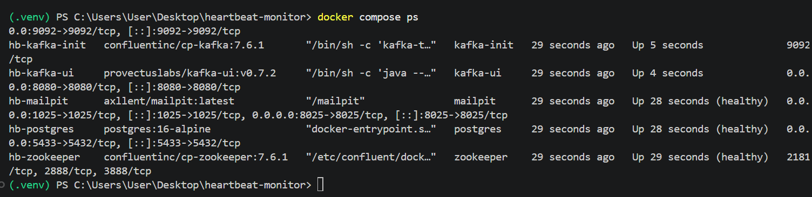

**The producer registers 100 patients and sends one reading per patient every second** ([`05_producer.png`](screenshots/05_producer.png))

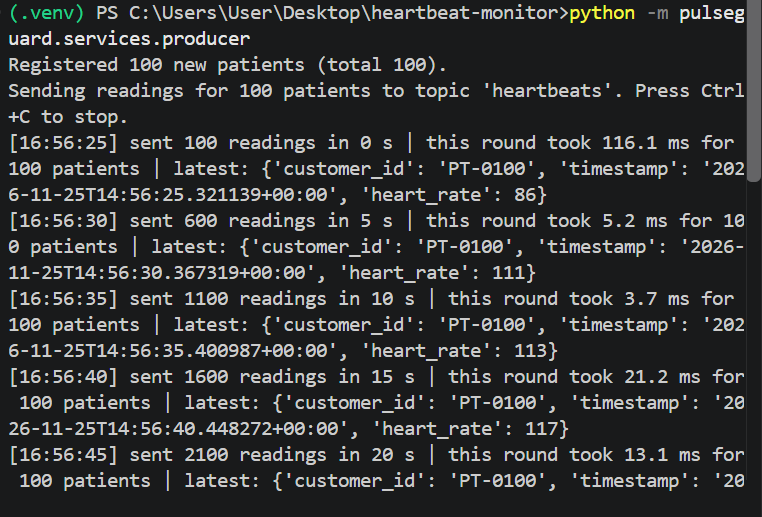

**All windows side by side: tests, consumer (about 100 ms from producer to database), alert service, producer** ([`06_all_running.png`](screenshots/06_all_running.png))

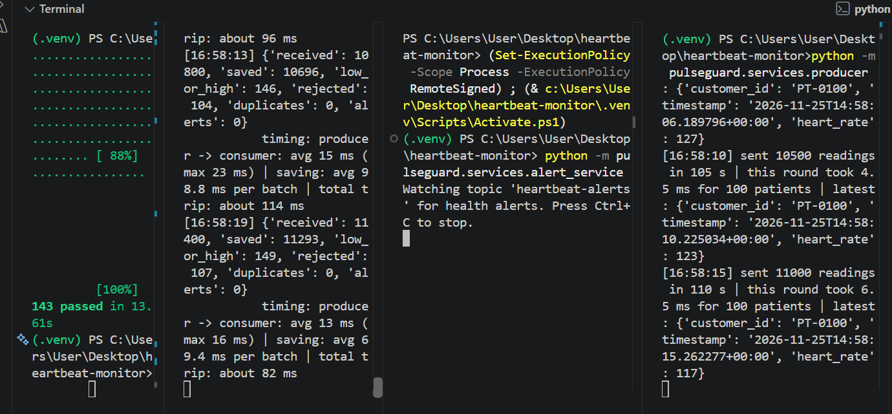

### 2. Kafka

**Topics: `heartbeats` has 3 partitions, `heartbeat-alerts` has 1** ([`31_kafka_ui_topics.png`](screenshots/31_kafka_ui_topics.png))

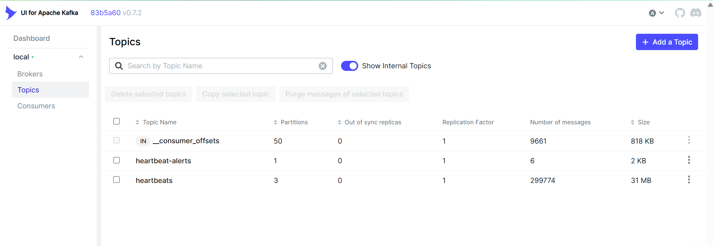

**Each message's key is the patient id, so one patient always goes to the same partition (in order)** ([`33_kafka_ui_messages_keys.png`](screenshots/33_kafka_ui_messages_keys.png))

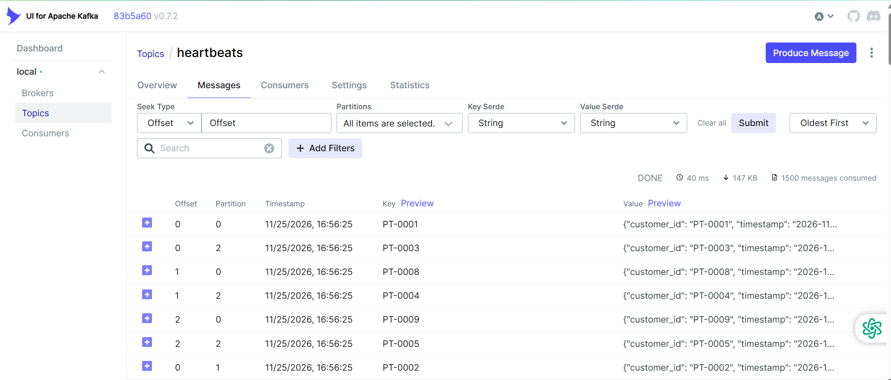

**Two consumer groups: `heartbeat-savers` (consumer) and `alert-emailers` (alert service)** ([`32_kafka_ui_consumer_groups.png`](screenshots/32_kafka_ui_consumer_groups.png))

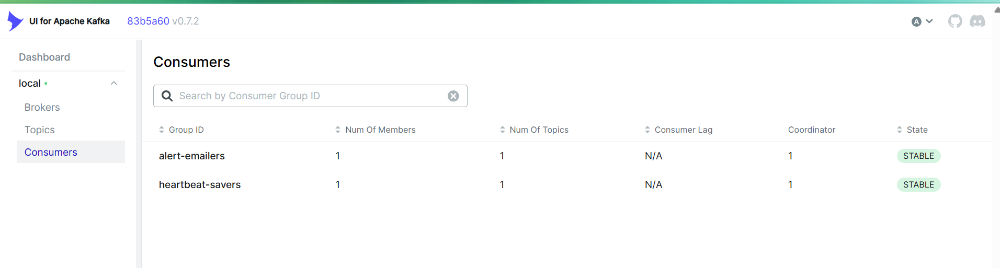

**The broker: 54 partitions online, none out of sync** ([`30_kafka_ui_brokers.png`](screenshots/30_kafka_ui_brokers.png))

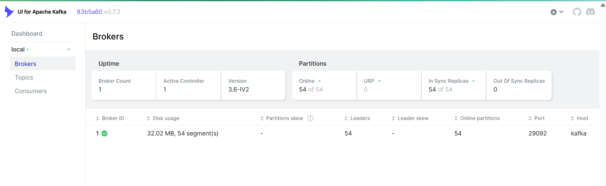

### 3. Data in PostgreSQL

**Saved readings with their status and `total_seconds` (producer to database, about 0.1 s)** ([`13_db_readings.png`](screenshots/13_db_readings.png))

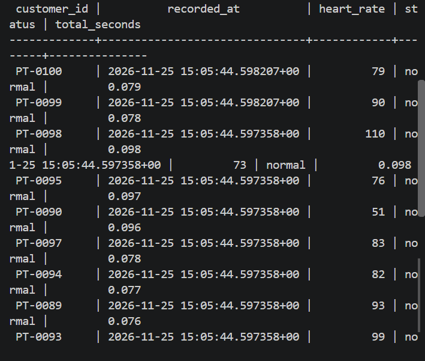

**Rejected readings, with the reason (impossible heart rates from sensor glitches)** ([`14_db_rejected.png`](screenshots/14_db_rejected.png))

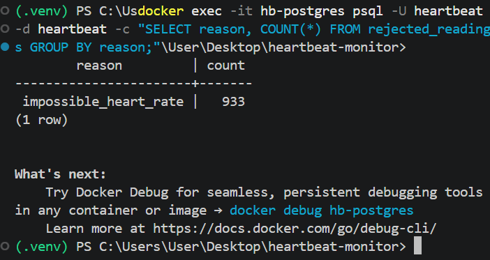

**Health alerts: who, high or low, how serious, the patient's own limit, the peak, start and end** ([`15_db_alerts.png`](screenshots/15_db_alerts.png))

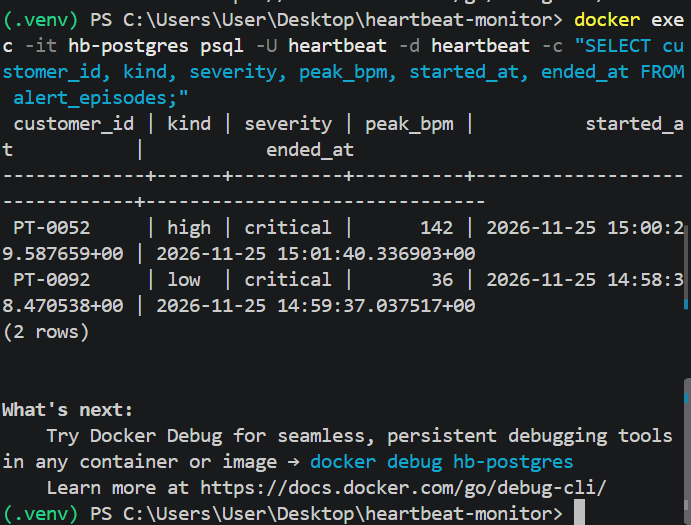

### 4. Tests

**`pytest`: 143 tests passed** ([`02_pytest.png`](screenshots/02_pytest.png))

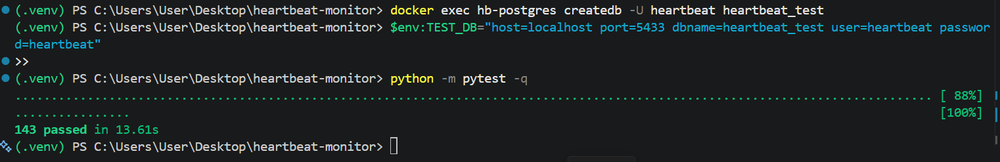

**End-to-end self-check through real Kafka and PostgreSQL: 19/19 passed** ([`08_self_check.png`](screenshots/08_self_check.png))

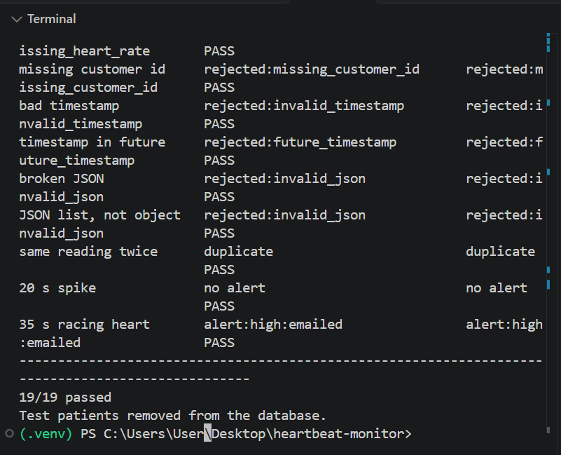

### 5. Health alert emails (to doctors)

**The alert service emails an alert when it starts and when it ends** ([`07_alert_emails_sent.png`](screenshots/07_alert_emails_sent.png))

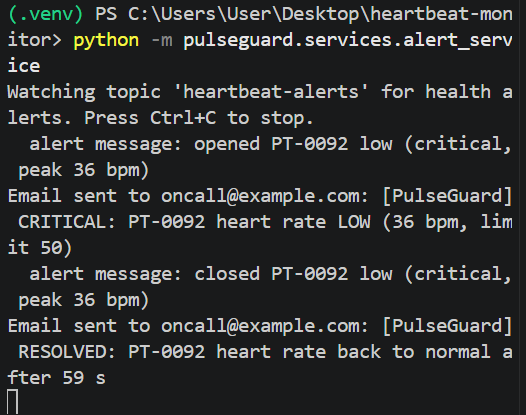

**CRITICAL: PT-0092's heart rate is LOW (36 bpm, limit 50)** ([`20_email_critical_low.png`](screenshots/20_email_critical_low.png))

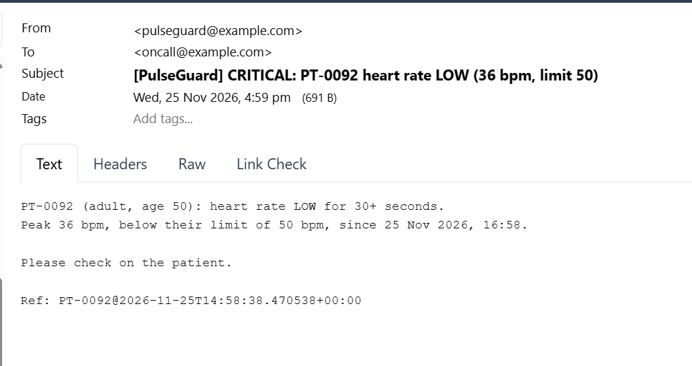

**CRITICAL: PT-0052 (senior, age 88) is HIGH, 142 bpm against their personal limit of 112** ([`23_email_critical_high.png`](screenshots/23_email_critical_high.png))

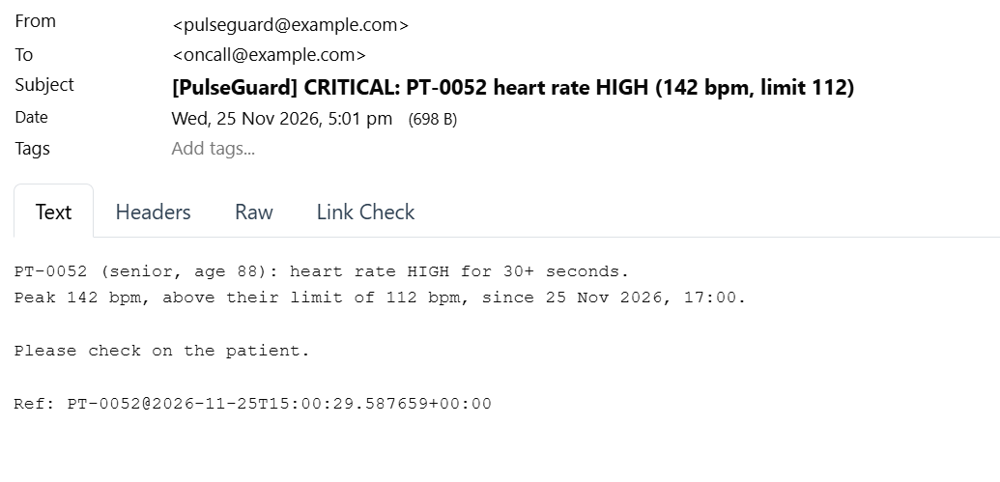

**RESOLVED: back to normal after 1 min 10 s** ([`24_email_resolved.png`](screenshots/24_email_resolved.png))

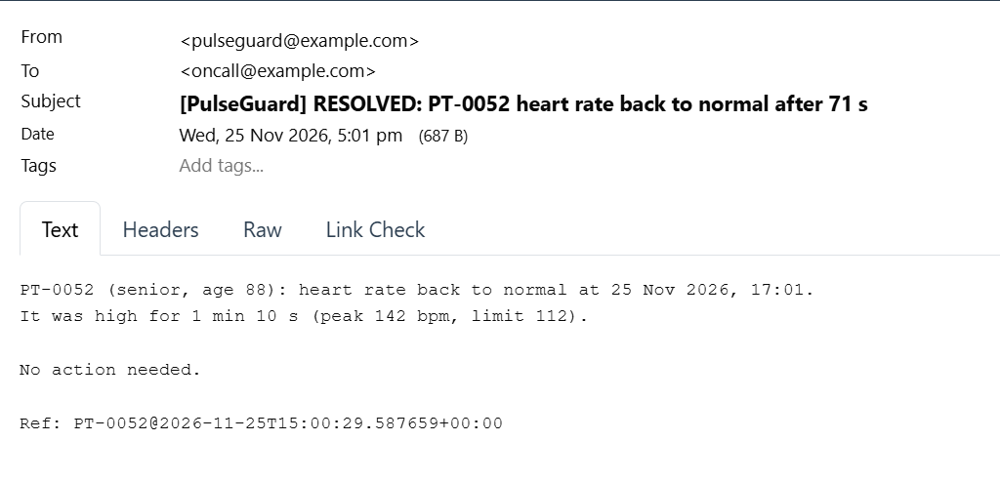

**Self-check test patients only email the IT team, marked [TEST]** ([`21_email_selfcheck_raised.png`](screenshots/21_email_selfcheck_raised.png))

![Self-check test patients only email the IT team, marked [TEST]](screenshots/21_email_selfcheck_raised.png)

### 6. Failure and automatic recovery (database stopped)

**`docker stop hb-postgres`: the consumer holds its batch and retries every 10 s instead of crashing** ([`10_database_down.png`](screenshots/10_database_down.png))

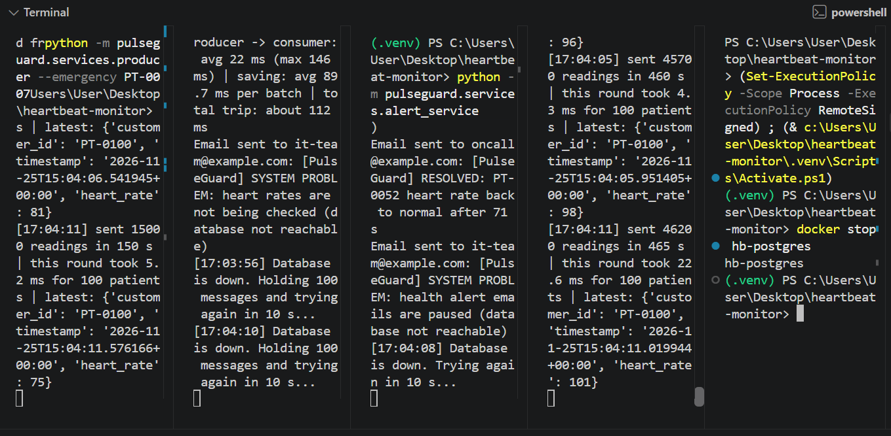

**SYSTEM PROBLEM email to the IT team, in plain words, with the technical details at the bottom** ([`25_email_problem_consumer.png`](screenshots/25_email_problem_consumer.png))

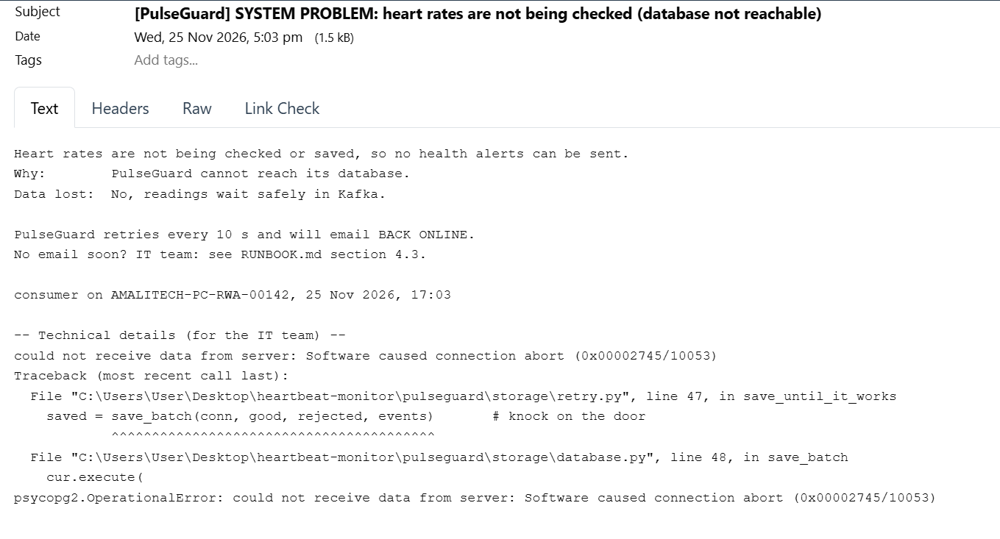

**The alert service sends its own SYSTEM PROBLEM email** ([`26_email_problem_alert_service.png`](screenshots/26_email_problem_alert_service.png))

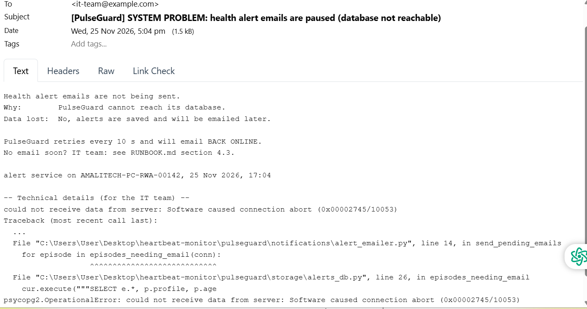

**`docker start hb-postgres`: the held batch is saved and both parts carry on by themselves** ([`11_back_online.png`](screenshots/11_back_online.png))

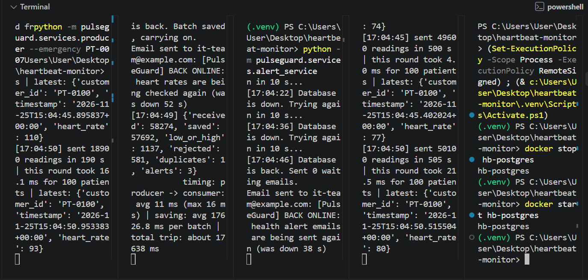

**BACK ONLINE: heart rates are being checked again (was down 52 s)** ([`28_email_back_online_consumer.png`](screenshots/28_email_back_online_consumer.png))

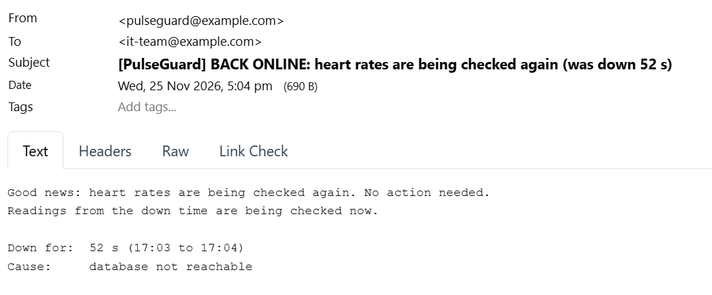

**BACK ONLINE: health alert emails are being sent again (was down 38 s)** ([`27_email_back_online_alerts.png`](screenshots/27_email_back_online_alerts.png))

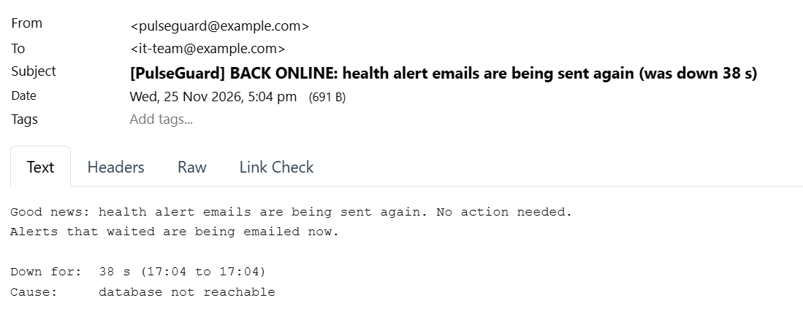

### 7. Grafana dashboard

**Readings, patients, low/high and rejected counts, open alerts, alerts emailed** ([`16_grafana_numbers.png`](screenshots/16_grafana_numbers.png))

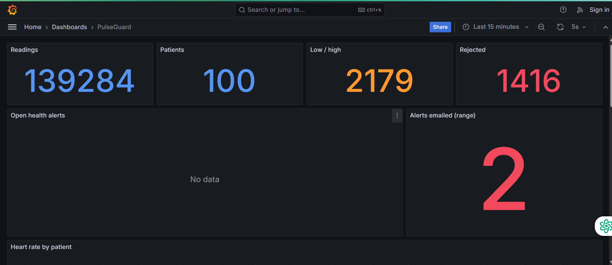

**Heart rate of all 100 patients** ([`17_grafana_heart_rate.png`](screenshots/17_grafana_heart_rate.png))

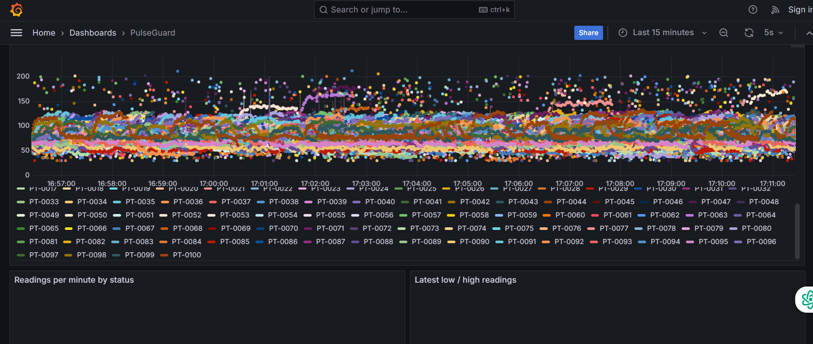

**Readings per minute by status, and the latest low/high readings** ([`18_grafana_status_and_latest.png`](screenshots/18_grafana_status_and_latest.png))

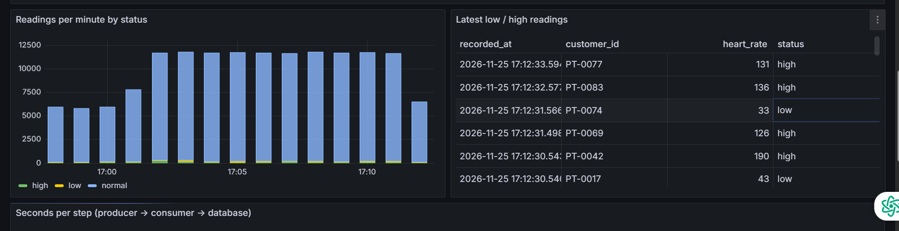

**Seconds per step: the spike at 17:04 is the database outage; readings waited in Kafka and nothing was lost** ([`19_grafana_seconds_per_step.png`](screenshots/19_grafana_seconds_per_step.png))

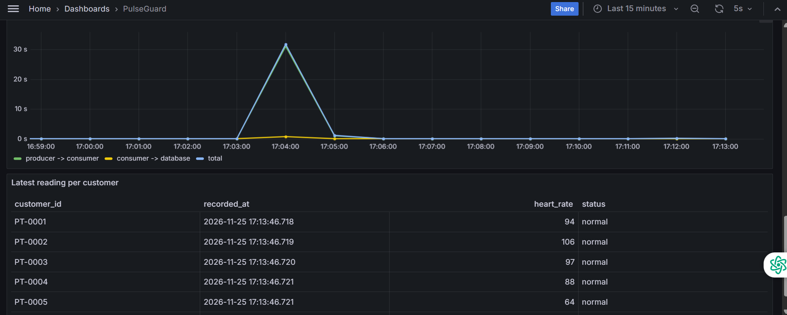

## Timing: how long each step takes

The **producer** prints how long each round of sends takes and the overall readings per second.
The **consumer** prints, every 5 seconds:

```
timing: producer -> consumer: avg 5 ms (max 6 ms) | saving: avg 18.5 ms per batch | total trip: about 24 ms
```

Every reading also stores its timing in the database (`kafka_seconds`, `save_seconds`,
`total_seconds`), and `timing_per_minute` shows the averages. If the consumer starts after
the producer, the first delays are large because messages were waiting in Kafka; once it
catches up they drop to milliseconds.

## Tests

| Kind | Command | What it proves |
|---|---|---|
| Unit + database + email tests | see below | every part, including 60+ error cases |
| Email tests | `pytest tests/test_email.py tests/test_failure_emails.py tests/test_back_online.py tests/test_alert_emails.py -v` | emails really arrive at a real (local) email server, exactly once |
| End-to-end | `python -m scripts.check_pipeline` (consumer and alert service running) | 19 checks through real Kafka, PostgreSQL and email; ends `19/19 passed` |

The self-check uses its own test patients (`TEST-...`). They never reach doctors: their alert
emails go to the IT team marked `[TEST]`, the dashboards hide them, and they are deleted from
the database when the check ends.

```powershell
docker exec hb-postgres createdb -U heartbeat heartbeat_test      # once
$env:TEST_DB="host=localhost port=5433 dbname=heartbeat_test user=heartbeat password=heartbeat"
pytest -v
```

Without `TEST_DB`, the database tests are skipped. To see a failure, stop the consumer and run
`python -m scripts.check_pipeline`: the checks fail, and a `SYSTEM PROBLEM: self-check failed` email lists them.
All test cases are listed in [TEST_CASES.md](TEST_CASES.md).

## Problems and fixes

| Problem | Fix |
|---|---|
| `password authentication failed for user "heartbeat"` | another PostgreSQL on your computer uses port 5432; that's why this project uses **5433** |
| `relation "patients" does not exist` | old database: `docker compose down -v`, then `docker compose up -d` |
| `Kafka not ready yet` | wait 30 seconds after `docker compose up -d` |
| No emails in Mailpit | `docker compose ps` shows `hb-mailpit`? Try `python -m pulseguard.notifications.email_sender` |

More in [RUNBOOK.md](RUNBOOK.md).
