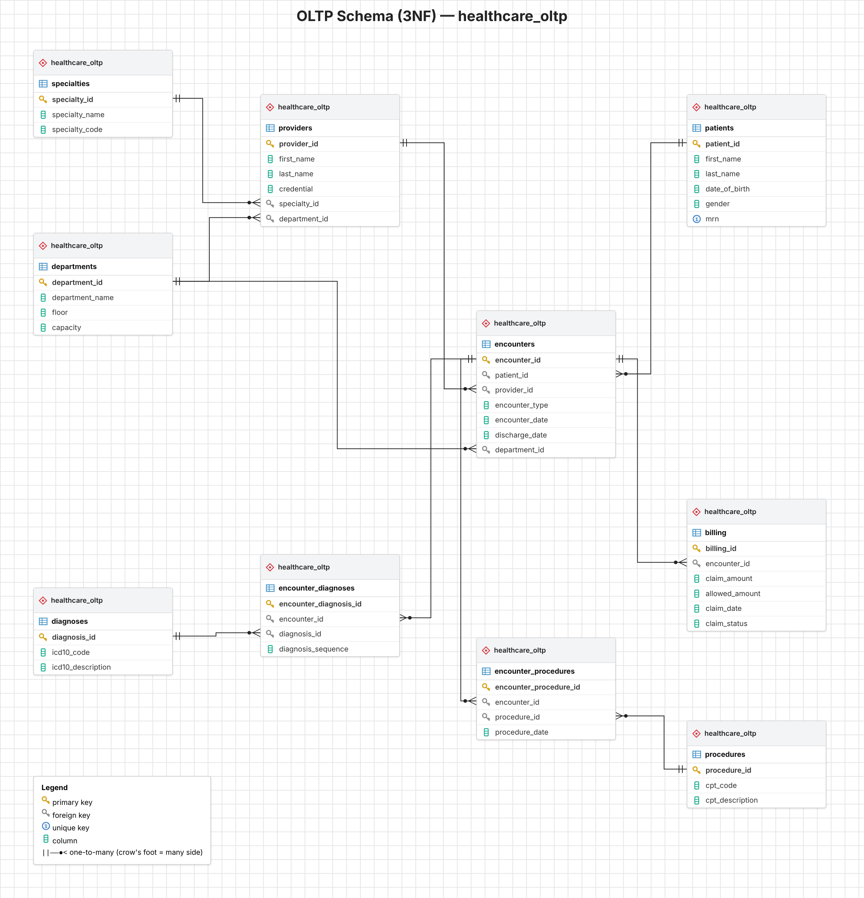
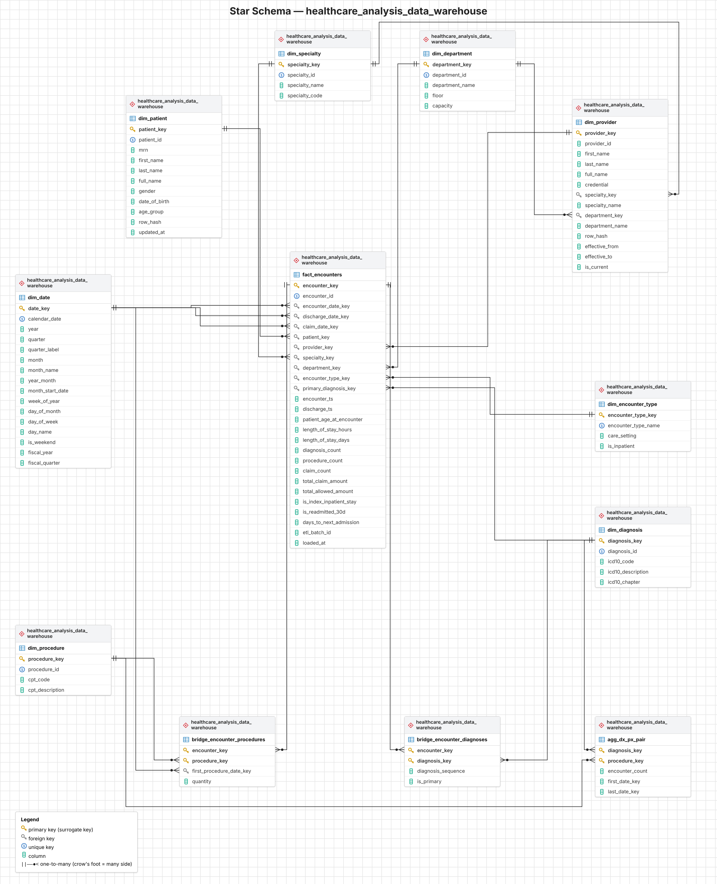
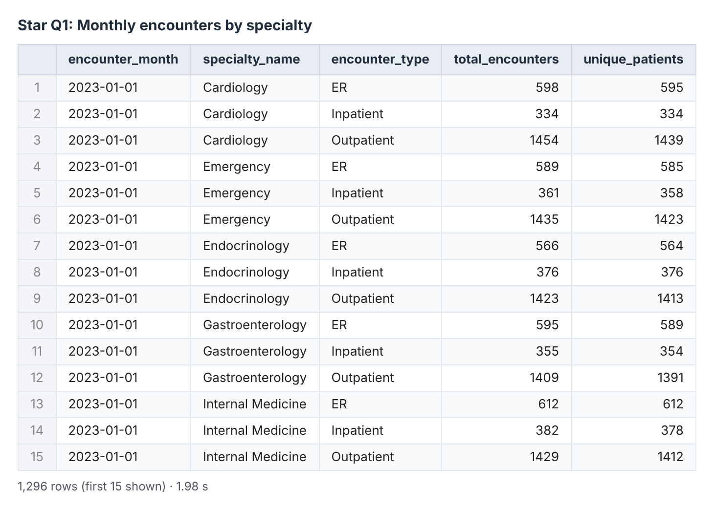
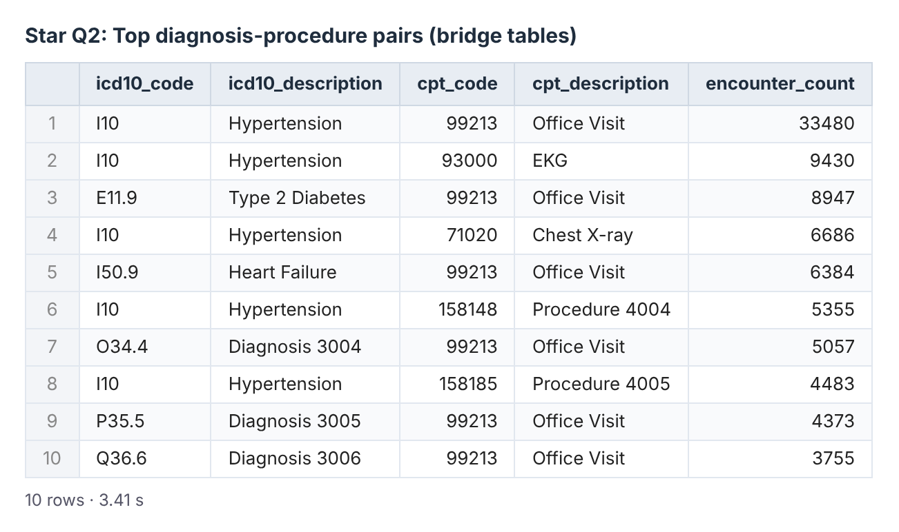
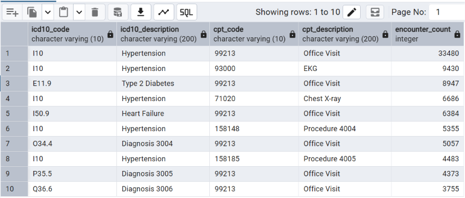
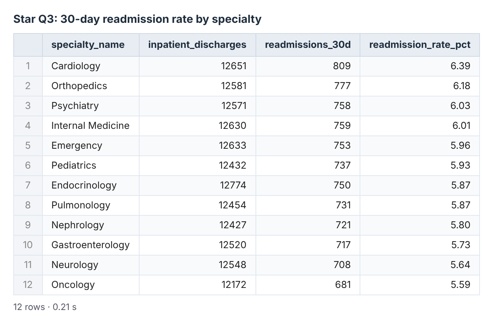
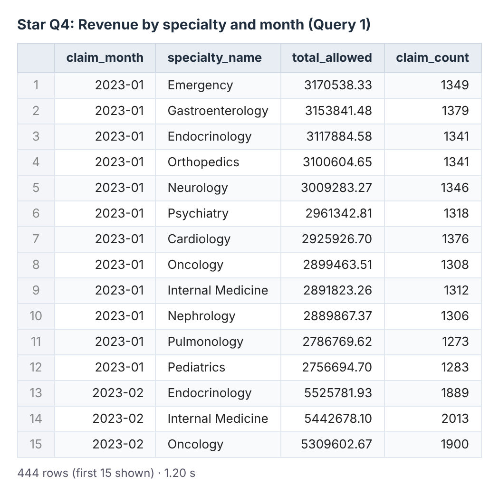
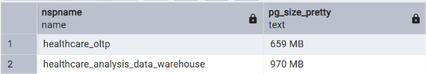

# Healthcare Analytics Lab: OLTP to Star Schema

In this project I took a normalized hospital database (OLTP), found out why four business reports are slow on it, and designed a star schema with an ETL process to make them faster. Everything runs in **PostgreSQL 18.6** and was tested in pgAdmin.

## Deliverables

| Part | File | What it contains |
|---|---|---|
| 2 | [query_analysis.txt](query_analysis.txt) | The four business questions on the OLTP schema, with times and bottlenecks |
| 3.1 | [design_decisions.txt](design_decisions.txt) | Fact grain, dimensions, pre-calculated metrics, bridge tables, indexes |
| 3.2 | [star_schema.sql](star_schema.sql) | DDL for the star schema (8 dimensions, 1 fact, 2 bridges, 1 summary table) |
| 3.3 | [star_schema_queries.txt](star_schema_queries.txt) | The four questions rewritten for the star schema, with comparisons |
| 3.4 | [etl_design.txt](etl_design.txt) | How the dimensions, fact, bridges and summary table are loaded and refreshed |
| 4 | [reflection.md](reflection.md) | What I learned, trade-offs and performance numbers |

## Folder structure

- [README.md](README.md)
- The six deliverables above
- [database_setup/](database_setup/)
  - [01_create_oltp_schema.sql](database_setup/01_create_oltp_schema.sql): normalized source schema (`healthcare_oltp`)
  - [02_load_lab_sample_data.sql](database_setup/02_load_lab_sample_data.sql): the sample rows from the lab brief
  - [03_generate_test_data.sql](database_setup/03_generate_test_data.sql): about 1 million encounters of test data
  - [04_etl_load_warehouse.sql](database_setup/04_etl_load_warehouse.sql): loads the star schema from the OLTP data
- [business_queries/](business_queries/)
  - [oltp_normalized/](business_queries/oltp_normalized/)
    - [q1_monthly_encounters_by_specialty.sql](business_queries/oltp_normalized/q1_monthly_encounters_by_specialty.sql)
    - [q2_top_diagnosis_procedure_pairs.sql](business_queries/oltp_normalized/q2_top_diagnosis_procedure_pairs.sql)
    - [q3_30day_readmission_rate.sql](business_queries/oltp_normalized/q3_30day_readmission_rate.sql)
    - [q4_revenue_by_specialty_month.sql](business_queries/oltp_normalized/q4_revenue_by_specialty_month.sql)
  - [star_schema/](business_queries/star_schema/)
    - [q1_monthly_encounters_by_specialty.sql](business_queries/star_schema/q1_monthly_encounters_by_specialty.sql)
    - [q2_top_diagnosis_procedure_pairs.sql](business_queries/star_schema/q2_top_diagnosis_procedure_pairs.sql)
    - [q2_top_pairs_from_summary_table.sql](business_queries/star_schema/q2_top_pairs_from_summary_table.sql)
    - [q3_30day_readmission_rate.sql](business_queries/star_schema/q3_30day_readmission_rate.sql)
    - [q4_revenue_by_specialty_month.sql](business_queries/star_schema/q4_revenue_by_specialty_month.sql)
- [diagrams/](diagrams/)
  - [oltp_schema.png](diagrams/oltp_schema.png)
  - [star_schema.png](diagrams/star_schema.png)

## How to run it

Run the scripts in this order in pgAdmin, each one in a fresh Query Tool tab:

1. [database_setup/01_create_oltp_schema.sql](database_setup/01_create_oltp_schema.sql): creates the `healthcare_oltp` schema
2. [database_setup/02_load_lab_sample_data.sql](database_setup/02_load_lab_sample_data.sql): inserts the lab's sample rows
3. [database_setup/03_generate_test_data.sql](database_setup/03_generate_test_data.sql): generates the test data (about 4 minutes)
4. [star_schema.sql](star_schema.sql): creates the empty warehouse `healthcare_analysis_data_warehouse`
5. [database_setup/04_etl_load_warehouse.sql](database_setup/04_etl_load_warehouse.sql): loads the warehouse (about 8.5 minutes). The last result shows three checks, and all should say `true`.

Then run any query in [business_queries/](business_queries/). To time a file that has two queries (Q4), highlight only the query you want, because F5 without a selection runs the whole tab.

The test data uses a fixed random seed, so every run creates exactly the same data:

| Table | Rows |
|---|---|
| encounters | 1,000,004 |
| encounter_diagnoses | 2,502,126 |
| encounter_procedures | 1,999,537 |
| billing | 900,411 |
| patients / providers | 100,000 / 600 |

## Results

Times are pgAdmin's "Total query runtime", the middle value of three runs on my laptop.

| Query | OLTP | Star | Speedup |
|---|---|---|---|
| Q1 Monthly encounters by specialty | 4.81 s | 1.98 s | 2.4x |
| Q2 Top diagnosis-procedure pairs (bridges) | 12.08 s | 3.41 s | 3.5x |
| Q2 using the summary table | 12.08 s | 0.089 s | ~136x |
| Q3 30-day readmission rate | 0.83 s | 0.21 s | 3.9x |
| Q4 Revenue by specialty and month | 1.49 s | 1.20 s | 1.2x |

Both versions of every query return the same rows. The readmission rate is 5.92% (8,901 of 150,393 inpatient stays) in both schemas, and the ETL checks confirm the fact table has one row per encounter and the revenue matches the billing table exactly. The warehouse uses 970 MB against 659 MB for the OLTP schema.

## Diagrams

### OLTP schema (source)

The normalized source database: 10 tables in 3NF. The specialty is only linked to the provider, so every report has to go encounters → providers → specialties to find it.

### Star schema (warehouse)

`fact_encounters` (one row per encounter) is in the middle, surrounded by the dimensions. The two bridge tables hold the diagnoses and procedures of each visit, and `agg_dx_px_pair` stores the pre-counted diagnosis-procedure pairs for Q2.

## Setup and loading

### 1. OLTP schema created

Running `01_create_oltp_schema.sql` created the `healthcare_oltp` schema with its 10 tables and indexes in 173 ms.

### 2. Lab sample data loaded

The sample rows from the lab brief, loaded with `02_load_lab_sample_data.sql`. They're only four encounters, which is too small to measure performance, so I generated test data on top of them.

### 3. Test data generated

Row counts after `03_generate_test_data.sql` (4 min 1 s): 1,000,004 encounters, 2,502,126 diagnosis rows, 1,999,537 procedure rows and 900,411 claims. The fixed random seed gives the same counts on every run.

### 4. Star schema created

`star_schema.sql` created the empty warehouse `healthcare_analysis_data_warehouse`, including the Unknown (-1) row in every dimension, in 182 ms.

### 5. ETL verification checks

The ETL (`04_etl_load_warehouse.sql`) took 8 min 35 s. All three checks at the end are `true`: the fact table has one row per encounter (1,000,004), the total allowed amount matches the billing table exactly, and no encounter has an unknown specialty.

## Star schema query results

Each star query returns exactly the same rows as its OLTP version. The OLTP results and times are described under each screenshot.

### Q1: Monthly encounters by specialty

1,296 rows (36 months × 12 specialties × 3 visit types), the same as the OLTP query. Middle time: **1.98 s** against **4.81 s** on OLTP (2.4x faster). On OLTP the specialty had to be found through providers, and `COUNT(DISTINCT patient_id)` sorted a million rows on disk. In the star schema the specialty is on the fact row, and unique patients are counted in two steps on integer keys.

### Q2: Top pairs using the bridge tables

The same top 10 pairs as OLTP. The most common is I10 (Hypertension) with 99213 (Office Visit) on 33,480 encounters. Middle time: **3.41 s** against **12.08 s** on OLTP (3.5x faster). On OLTP, joining the two junction tables created about 5 million rows that had to be counted with `COUNT(DISTINCT)`. The bridges only hold integer keys without duplicates, so a plain `COUNT(*)` works. The query also skips codes too rare to reach the top 10 (a pair can't be more common than its rarer code), which cuts the join from about 4.9 million pairs to about 670,000.

### Q2: Top pairs from the summary table

The same top 10 again, read from `agg_dx_px_pair`. Middle time: **0.089 s** against **12.08 s** on OLTP (about 136x faster). The ETL already counted every pair, so the query reads only 10 rows from an index.

### Q3: 30-day readmission rate

The same 12 specialties as OLTP, with Cardiology highest at 6.39%. Overall, 8,901 of 150,393 inpatient stays were readmitted (5.92%) in both schemas. Middle time: **0.21 s** against **0.83 s** on OLTP (3.9x faster). OLTP needed a self-join on the encounters table. The star query just counts the readmission flag the ETL stored.

### Q4: Revenue by specialty and month

444 rows (37 billing months × 12 specialties), the same as OLTP. Middle time: **1.20 s** against **1.49 s** on OLTP (1.2x faster). OLTP had to go billing → encounters → providers → specialties for every claim. In the star schema the billing totals and specialty are already on the fact row. My first star version took 2.24 s because it sorted 900,000 rows on text; the rewrite groups on integer keys before adding the names. The second part of Q4 (the overall ranking) gives the same order in both schemas, with Endocrinology first at $204.6 million.

## Storage

The warehouse takes 970 MB against 659 MB for the OLTP schema, about 47% more for the same information. That's the price of the bridge tables, the summary table, the extra indexes and the values copied onto every fact row.

## Main design choices

- **Grain:** one row per encounter in `fact_encounters`
- **Diagnoses and procedures:** bridge tables, plus a summary table `agg_dx_px_pair` for Q2
- **Pre-calculated on the fact:** specialty, billing totals, claim date, diagnosis/procedure counts, length of stay, age at visit, 30-day readmission flags
- **History:** SCD Type 2 for providers, Type 1 for patients and lookup tables
- **Missing data:** every dimension has an Unknown row with key -1
