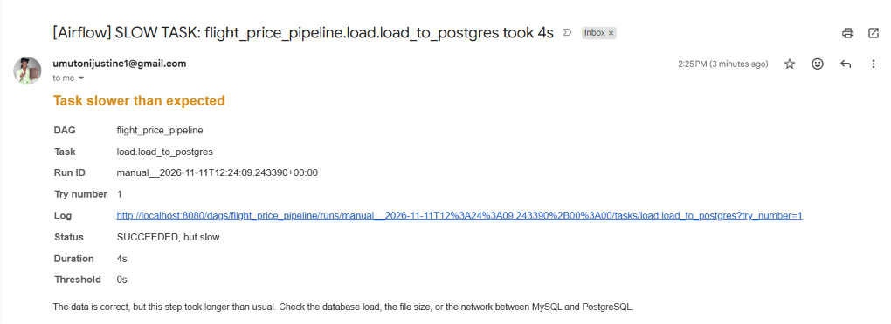
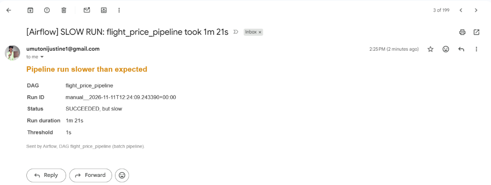
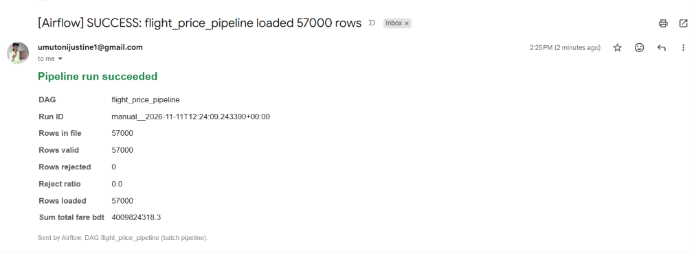
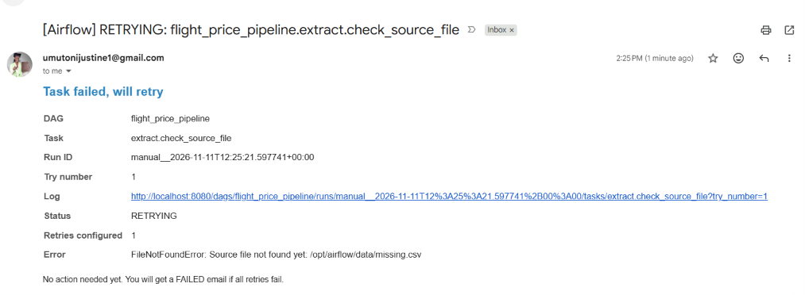
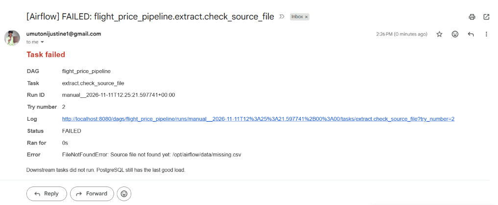
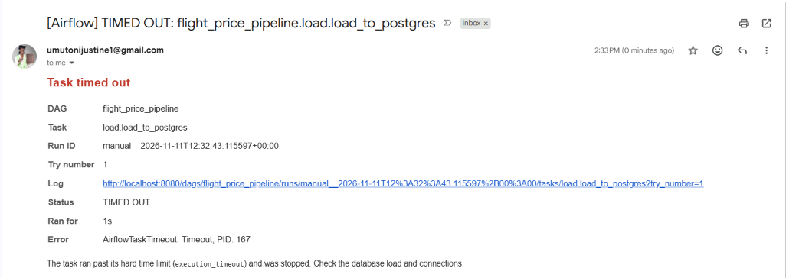

# Email alert test cases

These tests show that the pipeline sends an email in **every** alert case: success, slow task, slow
run, retry, failure and timeout. Each test changes a few settings in `.env` on purpose, triggers the
DAG, and checks the inbox. The pipeline's data stays safe throughout: a failed or timed-out load rolls
back, and PostgreSQL keeps the last good load.

**Environment:** Airflow 3.1.3 (Docker, LocalExecutor) · real Kaggle dataset (57,000 rows) ·
Gmail SMTP → `umutonijustine1@gmail.com` · tested 2026-11-11.

## Summary

| ID | Test case | How it is triggered | Expected email(s) | Result |
|---|---|---|---|---|
| A1 | Slow task | `ALERT_SLOW_LOAD_SECONDS=0` | `SLOW TASK: …load.load_to_postgres took …` | Pass |
| A2 | Slow run | `ALERT_SLOW_RUN_SECONDS=1` | `SLOW RUN: flight_price_pipeline took …` | Pass |
| A3 | Success summary | `ALERT_EMAIL_ON_SUCCESS=true` (normal run) | `SUCCESS: flight_price_pipeline loaded 57000 rows` | Pass |
| B1 | Retry | Run with `csv_path` pointing to a missing file, `SOURCE_FILE_RETRIES=1` | `RETRYING: …extract.check_source_file` | Pass |
| B2 | Final failure | Same run, after its last retry | `FAILED: …extract.check_source_file` | Pass |
| C1 | Timeout | `LOAD_TIMEOUT_SECONDS=1`, `TASK_RETRIES=0` | `TIMED OUT: …load.load_to_postgres` | Pass |

Every email was also confirmed in the Airflow task log (`Alert email sent to ['umutonijustine1@gmail.com']: …`).
RETRYING, FAILED and TIMED OUT were additionally written to the fallback log [`data/alerts.log`](../data/alerts.log).

**Result: 6 of 6 test cases passed.** The pipeline sends an email in every alert case.

---

## How to run a test

1. Change the settings listed for the test in `.env` and save.
2. Restart so Airflow reads them: `docker compose up -d`, then wait until `airflow-scheduler` shows **healthy** in `docker compose ps`.
3. Trigger the run with the command given for the test.
4. Search Gmail for `subject:"[Airflow]" in:anywhere`.
5. **Afterwards, restore the normal values** (see [Restore normal settings](#restore-normal-settings)).

---

## Test A: slow task, slow run and success (one normal run)

**Settings in `.env`:**

```dotenv
ALERT_SLOW_LOAD_SECONDS=0      # normal: 120
ALERT_SLOW_RUN_SECONDS=1       # normal: 900
ALERT_EMAIL_ON_SUCCESS=true
```

**Trigger:**

```powershell
docker compose exec airflow-scheduler airflow dags trigger flight_price_pipeline
```

**Expected:** the run succeeds (all tasks green). Because the load and run limits are almost zero, it
also sends the two slow warnings. Only `load_to_postgres` gets a SLOW TASK email: the other tasks keep
their normal 300 s limit.

**Actual (run `manual__2026-11-11T12:24:09`):**

### A1: Slow task 

`[Airflow] SLOW TASK: flight_price_pipeline.load.load_to_postgres took 4s`. Duration 4s, threshold 0s, status *SUCCEEDED, but slow*.



### A2: Slow run 

`[Airflow] SLOW RUN: flight_price_pipeline took 1m 21s`. Run duration 1m 21s, threshold 1s.



### A3: Success summary 

`[Airflow] SUCCESS: flight_price_pipeline loaded 57000 rows`. Rows in file 57,000, valid 57,000,
rejected 0, loaded 57,000, Σ total fare 4,009,824,318.3 BDT.



---

## Test B: retry, then final failure (missing source file)

**Settings in `.env`:**

```dotenv
SOURCE_FILE_RETRIES=1               # normal: 3
SOURCE_FILE_RETRY_DELAY_SECONDS=30  # normal: 300
ALERT_EMAIL_ON_RETRY=true
```

**Trigger** a run that points to a file that does not exist (only this run is affected):

```powershell
docker compose exec airflow-scheduler airflow dags trigger flight_price_pipeline --conf '{\"csv_path\": \"/opt/airflow/data/missing.csv\"}'
```

**Expected:** `extract.check_source_file` fails, retries once after 30 s, and fails again. Nothing
downstream runs, and PostgreSQL keeps the last good load.

**Actual (run `manual__2026-11-11T12:25:21`):**

### B1: Retrying 

`[Airflow] RETRYING: flight_price_pipeline.extract.check_source_file`. Try 1, retries configured 1,
error `FileNotFoundError: Source file not found yet: /opt/airflow/data/missing.csv`.



### B2: Failed 

`[Airflow] FAILED: flight_price_pipeline.extract.check_source_file`, 30 s later. Try 2, the same
error, and the message *"Downstream tasks did not run. PostgreSQL still has the last good load."*



[`data/alerts.log`](../data/alerts.log) (fallback record):

```
2026-11-11T12:25:40+00:00 | RETRYING | dag=flight_price_pipeline | task=extract.check_source_file | … | try=1
2026-11-11T12:26:11+00:00 | FAILED   | dag=flight_price_pipeline | task=extract.check_source_file | … | try=2
```

---

## Test C: timeout (load runs longer than its limit)

**Settings in `.env`:**

```dotenv
LOAD_TIMEOUT_SECONDS=1   # normal: 600 (the load normally takes ~4 s, so 1 s forces a timeout)
TASK_RETRIES=0           # normal: 3 (no retries, so the timeout is final at once)
```

**Trigger:**

```powershell
docker compose exec airflow-scheduler airflow dags trigger flight_price_pipeline
```

**Expected:**

* Extract, transform and the 4 KPIs succeed. `load.load_to_postgres` is stopped after 1 s (red).
* Email: `[Airflow] TIMED OUT: flight_price_pipeline.load.load_to_postgres`.
* `verify_postgres_load` and `notify_success` don't run, so there is no SUCCESS email.
* PostgreSQL still has the 57,000 rows of the previous run (the load transaction rolled back):
  ```powershell
  docker compose exec postgres-analytics psql -U analytics_user -d flight_analytics -c "SELECT COUNT(*) FROM analytics.fact_flight_prices;"
  ```

**Actual (run `manual__2026-11-11T12:32:43`):**

### C1: Timed out 

`[Airflow] TIMED OUT: flight_price_pipeline.load.load_to_postgres`. Try 1, ran for 1s, error
`AirflowTaskTimeout: Timeout, PID: 167`, and the message *"The task ran past its hard time limit
(execution_timeout) and was stopped."*



What the logs confirm:

* `extract`, `transform` and all 4 KPI tasks succeeded. `load.load_to_postgres` was stopped before it
  committed anything (no "Loaded into PostgreSQL" line).
* `verify_postgres_load` and `notify_success` never started, so there was no SUCCESS email, as expected.
* [`data/alerts.log`](../data/alerts.log):
  ```
  2026-11-11T12:33:44+00:00 | TIMED OUT | dag=flight_price_pipeline | task=load.load_to_postgres | … | try=1
  ```
* The load transaction rolled back, so PostgreSQL still holds the previous successful load (57,000 rows).

---

## Restore normal settings

After testing, set these back in `.env`, then run `docker compose up -d`:

```dotenv
ALERT_SLOW_LOAD_SECONDS=120
ALERT_SLOW_RUN_SECONDS=900
SOURCE_FILE_RETRIES=3
SOURCE_FILE_RETRY_DELAY_SECONDS=300
LOAD_TIMEOUT_SECONDS=600
TASK_RETRIES=3
```

Keep `ALERT_EMAIL_ON_SUCCESS` and `ALERT_EMAIL_ON_RETRY` as you prefer (both `true` = an email in every case).

## Automated tests

The same alert logic is also covered by unit tests that need no Airflow and no mail server
([`tests/test_alerts.py`](../tests/test_alerts.py)): failure, timeout (by exception and by duration), slow task, slow run, retry
(log + optional email), the fallback log, and "a mail server error never breaks the task".

```powershell
python -m pytest -q tests/test_alerts.py
```
