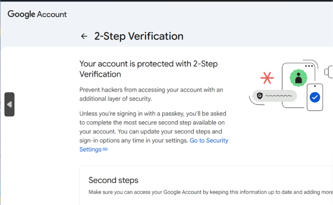
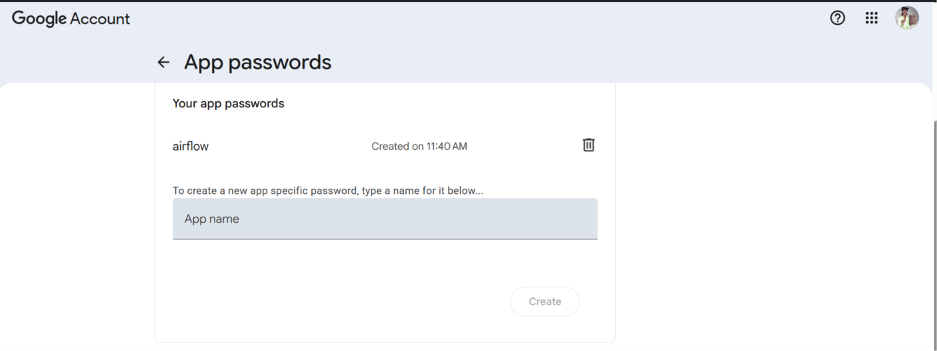
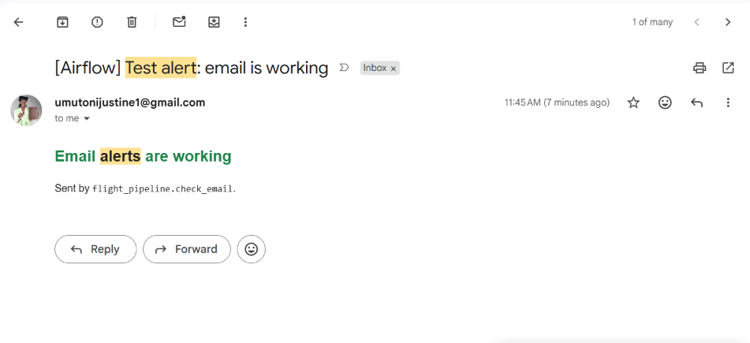
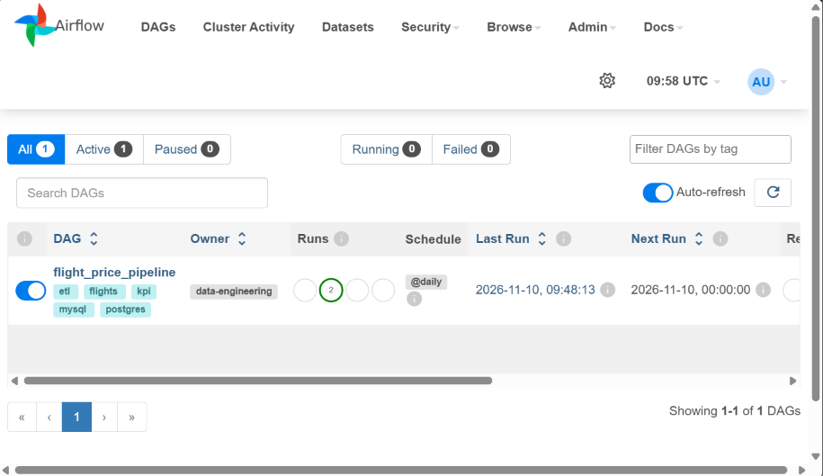

# Email alert setup (Gmail)

This guide turns on the pipeline's email alerts. It takes about 5 minutes and only has to be done once
per computer.

**What you will receive**

| Email subject | When |
|---|---|
| `[Airflow] SUCCESS: …` | A run finished. Includes rows read, valid, rejected and loaded. |
| `[Airflow] RETRYING: …` | A task failed and Airflow will retry it |
| `[Airflow] FAILED: …` | A task failed after all its retries |
| `[Airflow] TIMED OUT: …` | A task ran past its time limit and was stopped |
| `[Airflow] SLOW TASK: …` / `SLOW RUN: …` | The run succeeded, but more slowly than usual |

What to do for each alert is in [`RUNBOOK.md`](RUNBOOK.md#4-alerts-what-each-one-means-and-what-to-do).

---

## Step 1: Turn on 2-Step Verification

Google only allows App Passwords on accounts that have 2-Step Verification.

1. Go to **[https://myaccount.google.com](https://myaccount.google.com)** → **Security** → **2-Step Verification**.
2. Follow the steps until the page says **"Your account is protected with 2-Step Verification"**.



---

## Step 2: Create an App Password for Airflow

Airflow can't sign in with your normal Gmail password. It needs a separate 16-character **App Password**.

1. Go to **[https://myaccount.google.com/apppasswords](https://myaccount.google.com/apppasswords)**.
2. Under **App name**, type `airflow` and click **Create**.
3. Google shows a 16-character code in 4 groups, for example `abcd efgh ijkl mnop`. **Copy it now.** Google shows it only once.



> If you lose the code, delete the `airflow` entry (🗑) and create a new one, then update `.env` (Step 3).
> Deleting it also immediately stops anyone else from using it.

---

## Step 3: Put the settings in `.env`

Open `.env` in the project folder (next to [`docker-compose.yml`](../docker-compose.yml)) and set:

```dotenv
SMTP_HOST=smtp.gmail.com
SMTP_PORT=587
SMTP_STARTTLS=true
SMTP_USER=umutonijustine1@gmail.com
SMTP_PASSWORD=abcdefghijklmnop          # your App Password, written WITHOUT spaces
SMTP_FROM=umutonijustine1@gmail.com
ALERT_EMAIL_TO=umutonijustine1@gmail.com # several recipients: a@x.com,b@y.com

ALERT_EMAIL_ON_SUCCESS=true             # email after every successful run
ALERT_EMAIL_ON_RETRY=true               # email on every retry (false = only in data/alerts.log)
```

Rules:

* Write the password **without spaces** and without quotes.
* Never commit `.env` or paste the password into a chat or document. [`.gitignore`](../.gitignore) already excludes `.env`.
* If you don't have a `.env` file yet, create it from the template. In Windows PowerShell:
  ```powershell
  Copy-Item .env.example .env
  ```
  Then edit it in VS Code. Don't create it with `echo … > .env`, because Windows PowerShell saves that
  as UTF-16, which Docker can't read.

---

## Step 4: Restart the containers

The containers read `.env` only when they start:

```powershell
docker compose up -d
```

---

## Step 5: Test the connection

```powershell
docker compose exec -w /opt/airflow/dags airflow-scheduler python -m flight_pipeline.check_email --send
```

Expected output:

```
1. Settings seen by Airflow
     SMTP_HOST      = smtp.gmail.com
     SMTP_PORT      = 587
     SMTP_USER      = umutonijustine1@gmail.com
     SMTP_PASSWORD  = ************xx  (16 chars)
     ALERT_EMAIL_TO = umutonijustine1@gmail.com
  [OK]   settings present
2. Network: can we reach smtp.gmail.com:587?
  [OK]   server reachable
3. Secure connection and login
  [OK]   TLS encryption started
  [OK]   logged in as umutonijustine1@gmail.com
4. Sending a test alert to umutonijustine1@gmail.com
  [OK]   sent - check your inbox (and Spam the first time)

Email connection is working.
```

Without `--send`, it only checks the connection and login and sends no email.

---

## Step 6: Check your inbox

You should receive **"[Airflow] Test alert: email is working"**:



If you don't see it:

* Search Gmail for `subject:"Test alert" in:anywhere`. An email sent from your address to your own
  address sometimes lands only in **Sent** or **All Mail**.
* Check **Spam**, **Promotions** and **Updates**. If it's in Spam, mark it **Not spam**.
* Recommended: add a Gmail filter so alerts always reach your Inbox. Go to Settings ⚙ → See all settings →
  Filters and Blocked Addresses → Create a new filter. Set **Subject** to `[Airflow]`, then tick
  **Never send it to Spam**, **Always mark it as important** and **Categorize as: Primary**.

---

## Step 7: Run the pipeline and receive a pipeline alert

Open **[http://localhost:8080](http://localhost:8080)** and log in (`admin` / `admin`). The `flight_price_pipeline` DAG is
switched on, owned by `data-engineering`, and scheduled `@daily`. In the **Runs** column, a **green**
circle counts successful runs and a **red** one counts failed runs. Each successful run sends a
`[Airflow] SUCCESS: …` email (`ALERT_EMAIL_ON_SUCCESS=true`).



*Above: 2 successful runs, last run 2026-11-10 09:48 UTC, next scheduled run at 00:00 UTC.*

To trigger a run now, open `flight_price_pipeline` → **Trigger**.

**Optional: test a SLOW TASK alert**

1. In `.env`, set `ALERT_SLOW_LOAD_SECONDS=0` and run `docker compose up -d`.
2. Trigger the DAG at [http://localhost:8080](http://localhost:8080) → `flight_price_pipeline` → ▶.
3. You should receive `[Airflow] SLOW TASK: flight_price_pipeline.load.load_to_postgres took …`, followed by `[Airflow] SUCCESS: …`.
4. Set `ALERT_SLOW_LOAD_SECONDS=120` again and run `docker compose up -d`.

---

## Test every alert type

Test cases for SUCCESS, SLOW TASK, SLOW RUN, RETRYING, FAILED and TIMED OUT, with the steps and
screenshots of the emails received: [`EMAIL_ALERT_TESTS.md`](EMAIL_ALERT_TESTS.md).

---

## Troubleshooting

| `check_email` says | Cause | Fix |
|---|---|---|
| `[FAIL] SMTP_PASSWORD is empty`, or it shows the placeholder | `.env` not saved, or the containers weren't restarted | Save `.env`, then `docker compose up -d` |
| `[WARN] Gmail App Passwords are 16 characters` | Your normal Gmail password was used | Use the App Password from Step 2 |
| `[FAIL] cannot connect` | No internet from Docker, or a firewall or antivirus is blocking port 587 | Check your connection and firewall, or try `SMTP_PORT=465` with `SMTP_SSL=true` and `SMTP_STARTTLS=false` |
| `[FAIL] login refused: 535` | Wrong or revoked App Password, or 2-Step Verification is off | Repeat Steps 1–2 with a new App Password, update `.env`, restart |
| Everything `[OK]`, but no email | Gmail filed it in Sent or Spam | See Step 6 |

Even when email fails, every retry and failure is still written to **[`data/alerts.log`](../data/alerts.log)**.
