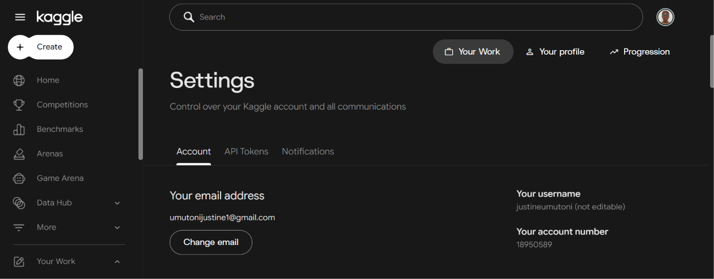
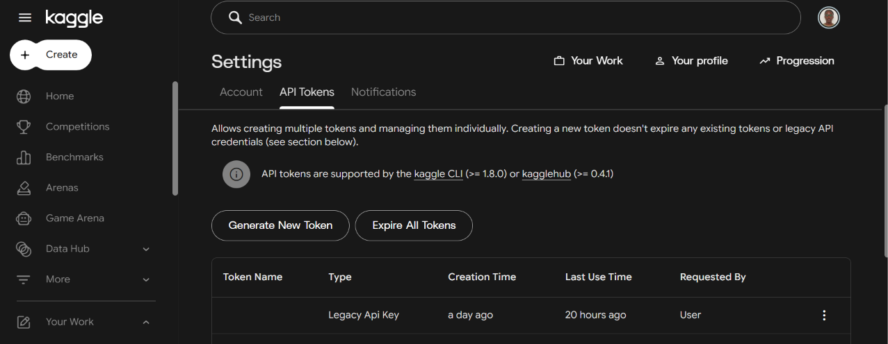
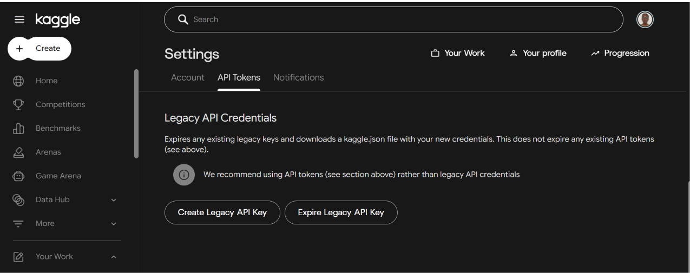
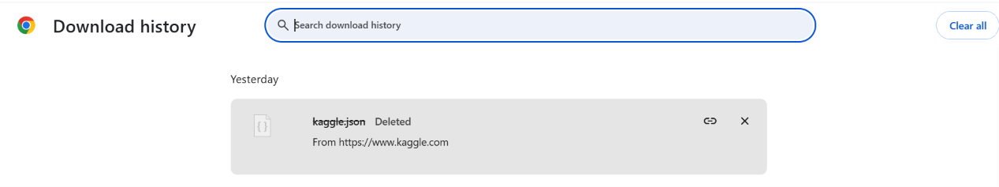

# Kaggle setup and dataset download

The pipeline reads **[`data/Flight_Price_Dataset_of_Bangladesh.csv`](../data/Flight_Price_Dataset_of_Bangladesh.csv)**, the Kaggle dataset
**Flight Price Dataset of Bangladesh**:

| | |
|---|---|
| Kaggle ID | [`mahatiratusher/flight-price-dataset-of-bangladesh`](https://www.kaggle.com/datasets/mahatiratusher/flight-price-dataset-of-bangladesh) |
| Download size | about 3.5 MB zipped, about 12 MB unzipped |
| Rows | about 57,000 |
| Must be saved as | [`data\Flight_Price_Dataset_of_Bangladesh.csv`](../data/Flight_Price_Dataset_of_Bangladesh.csv) (exact name) |

Do this **once**, before the first run. You only need it again to get a newer version of the data.

## Two ways to get the data

| | Option 1: download from the Kaggle website | Option 2: Kaggle API ([`kaggle.json`](https://www.kaggle.com/settings)) |
|---|---|---|
| Needs | A free Kaggle account and a browser | A Kaggle account, a [`kaggle.json`](https://www.kaggle.com/settings) key and the `kaggle` Python package |
| Setup time | None | About 5 minutes, once |
| Download | Click **Download**, unzip, copy the CSV | One command: [`python scripts/download_data.py`](../scripts/download_data.py) |
| Slow or broken downloads | Re-download by hand | Retries by itself; never leaves a half-written file |
| Best for | A quick start, or when the API is blocked | Repeatable setup, other users, automation |

Both give exactly the same file. Pick one.

---

## Option 1: Download from the Kaggle website

No token or Python package needed.

1. Sign in, or sign up for free, at **[https://www.kaggle.com](https://www.kaggle.com)**.
2. Open the dataset page:
   **[https://www.kaggle.com/datasets/mahatiratusher/flight-price-dataset-of-bangladesh](https://www.kaggle.com/datasets/mahatiratusher/flight-price-dataset-of-bangladesh)**
   (or search Kaggle for *Flight Price Dataset of Bangladesh*).
3. Click **Download** (top right) → **Download dataset as zip**. Your browser saves a `.zip` file,
   about 3.5 MB, to **Downloads**. It's often called `archive.zip`.
4. Put the CSV in the project's [`data\`](../data/) folder **with this exact name**:
   [`Flight_Price_Dataset_of_Bangladesh.csv`](https://www.kaggle.com/datasets/mahatiratusher/flight-price-dataset-of-bangladesh)

   **By hand:** right-click the zip → **Extract All…**, then copy the CSV into [`data\`](../data/) and rename it
   if needed.

   **Or in PowerShell**, from the project folder (set `$zip` to your file's name):

   ```powershell
   $zip = "$HOME\Downloads\archive.zip"
   Expand-Archive $zip -DestinationPath data\.download -Force
   Get-ChildItem data\.download -Filter *.csv -Recurse | Select-Object -First 1 |
       Move-Item -Destination data\Flight_Price_Dataset_of_Bangladesh.csv -Force
   Remove-Item data\.download -Recurse -Force
   dir data
   ```

   Unzipping into `data\.download` first and then moving the file is safer: Airflow never sees a
   half-copied file.

5. Go to [Run the pipeline](#run-the-pipeline).

---

## Option 2: Kaggle API ([`kaggle.json`](https://www.kaggle.com/settings))

Set up once, then download with one command, and repeat any time. Recommended when other people will
run the project or when the download is slow or unreliable.

### Step 2.1: Create your Kaggle API key ([`kaggle.json`](https://www.kaggle.com/settings))

**1. Sign in and open Settings.** Sign in (or sign up for free) at **[https://www.kaggle.com](https://www.kaggle.com)**, click
your **profile picture** (top right), then **Settings**. The **Account** tab shows your username, for
example `justineumutoni`. It's the same username that will be in [`kaggle.json`](https://www.kaggle.com/settings).



**2. Open the API Tokens tab.** It has two kinds of credentials:

* **API tokens** (top, **Generate New Token**): the newer kind, for `kaggle` CLI ≥ 1.8.0. You
  can have several. A new one doesn't expire the others.
* **Legacy API credentials** (further down): the classic **[`kaggle.json`](https://www.kaggle.com/settings)** file. **This project uses this one.**

If you already created a key, the table shows it as **Legacy Api Key**, with its creation and
last-use time.



**3. Create the legacy key.** Scroll down to **Legacy API Credentials** and click
**Create Legacy API Key**. Your browser downloads **[`kaggle.json`](https://www.kaggle.com/settings)**.



> **Create Legacy API Key** expires any older legacy key and gives you a new [`kaggle.json`](https://www.kaggle.com/settings).
> **Expire Legacy API Key** turns it off completely. Use it if the file ever leaks.

**4. Find the downloaded file.** It's in your **Downloads** folder (Chrome: **Ctrl+J** shows the
download history). [`kaggle.json`](https://www.kaggle.com/settings) looks like this:

```json
{"username":"justineumutoni","key":"0123456789abcdef..."}
```



*In the screenshot, Chrome shows "Deleted" because the file has already been **moved** out of
Downloads (Step 2.2). That's expected: the file now lives in `.kaggle` or the project folder.*

> **[`kaggle.json`](https://www.kaggle.com/settings) is a password.** Don't commit it, email it, or paste it into a chat.

### Step 2.2: Put [`kaggle.json`](https://www.kaggle.com/settings) where the Kaggle tool can find it

**Recommended: your user folder.** Do this once, and it works for every project.

```powershell
mkdir $HOME\.kaggle -Force
Move-Item $HOME\Downloads\kaggle.json $HOME\.kaggle\kaggle.json
```

The file ends up at `C:\Users\<you>\.kaggle\kaggle.json`.

**Or the project folder.** You must tell the tool where it is, **in every new terminal**:

```powershell
$env:KAGGLE_CONFIG_DIR = $PWD
```

[`kaggle.json`](https://www.kaggle.com/settings) is listed in [`.gitignore`](../.gitignore), so it is never committed from the project folder.

### Step 2.3: Install the Kaggle tool (in the project venv)

```powershell
.\.venv\Scripts\Activate.ps1          # prompt starts with (.venv)
pip install -r requirements-dev.txt   # includes kaggle + six (kaggle needs six but doesn't install it)
```

Check that it works:

```powershell
kaggle datasets list -s "flight price bangladesh"
```

You should see [`mahatiratusher/flight-price-dataset-of-bangladesh`](https://www.kaggle.com/datasets/mahatiratusher/flight-price-dataset-of-bangladesh) in the list.

### Step 2.4: Download the dataset

**a) With the download script (recommended)**

```powershell
python scripts/download_data.py
```

```
[OK]   Kaggle login
[..]   Downloading mahatiratusher/flight-price-dataset-of-bangladesh (attempt 1/3) - this can take a few minutes
100%|██████████| 3.34M/3.34M [00:04<00:00, 812kB/s]
[OK]   Downloaded in 6s
[OK]   Saved ...\data\Flight_Price_Dataset_of_Bangladesh.csv (57,000 rows)
Next:  docker compose exec airflow-scheduler airflow dags trigger flight_price_pipeline
```

What the script does for you:

* **Safe for slow downloads.** It downloads into `data\.download\` first. Only when the file is
  complete and checked does it move it to [`data\Flight_Price_Dataset_of_Bangladesh.csv`](../data/Flight_Price_Dataset_of_Bangladesh.csv), in a single
  step. Airflow never sees a half-downloaded file, even if a run starts during the download.
* **Retries on network errors**: 3 attempts, waiting 15 s and then 30 s between them.
* **Checks the file.** The required columns must be there and the file must not be empty.
* **Never breaks a good file.** If the download fails or you press **Ctrl+C**, [`data\`](../data/) is left exactly as it was.
* **Doesn't download twice.** If a good file is already in [`data\`](../data/), it stops.

| Command | Use it when |
|---|---|
| [`python scripts/download_data.py`](../scripts/download_data.py) | First download |
| [`python scripts/download_data.py --force`](../scripts/download_data.py) | Replace the file in [`data\`](../data/), for example a **sample/test file**, or to get a newer Kaggle version |
| [`python scripts/download_data.py --retries 6`](../scripts/download_data.py) | Slow or unstable internet: more attempts |

> **Replacing the generated sample file?** Use `--force`. The sample file has the same columns, so
> without `--force` the script would think the data is already there.

**b) With the Kaggle command**

```powershell
kaggle datasets download -d mahatiratusher/flight-price-dataset-of-bangladesh -p data --unzip --force
dir data
```

This writes straight into [`data\`](../data/), so **don't trigger the DAG until it has finished**. If the
file has a different name, rename it:
[`Rename-Item "data\<name>.csv" "Flight_Price_Dataset_of_Bangladesh.csv"`](https://www.kaggle.com/datasets/mahatiratusher/flight-price-dataset-of-bangladesh).

---

## Run the pipeline

After Option 1 or Option 2:

```powershell
docker compose exec airflow-scheduler airflow dags trigger flight_price_pipeline
```

The SUCCESS email shows the row counts of the real data. With the Kaggle file, expect about
**57,000 rows**. The generated sample file has exactly **57,057**.

---

## When the download takes a long time

| Situation | What to do |
|---|---|
| The progress bar is slow but moving | Wait. The script only replaces the file when it's complete. |
| It stops or fails on a network error | The script retries by itself (3×). For more attempts: `--retries 6`. |
| It keeps failing | Use **Option 1** (browser download). It usually works when the API doesn't. |
| You need to stop it | Press **Ctrl+C**. Nothing in [`data\`](../data/) changes, and the temporary folder is removed. |
| A scheduled run (00:00 UTC) starts while you're downloading | With the script, nothing to worry about: Airflow reads the old complete file. With the Kaggle command (2.4 b) or a browser download copied into [`data\`](../data/), the run may read a partial file, so download before midnight UTC or pause the DAG (toggle in the UI) while downloading. |
| [`data\`](../data/) has no CSV when a run starts | `check_source_file` waits and retries **3 times, 5 minutes apart** (about 15 min). To wait longer, raise `SOURCE_FILE_RETRIES` in [`.env`](../.env.example), then run `docker compose up -d`. |
| A `data\.download\` folder is left over | It's leftover from an interrupted run. You can delete it; it's ignored by git and by Airflow. |

---

## Troubleshooting

| Error | Cause | Fix |
|---|---|---|
| `No module named 'six'` | The kaggle package is missing a dependency | `pip install six` or [`pip install -r requirements-dev.txt`](../requirements-dev.txt) |
| `'kaggle' is not recognized` | The venv isn't active | `.\.venv\Scripts\Activate.ps1` |
| [`Could not find kaggle.json`](https://www.kaggle.com/settings) / `Kaggle login failed` | The token isn't where the tool looks | Step 2.2: move it to `$HOME\.kaggle\`, or `$env:KAGGLE_CONFIG_DIR = $PWD` |
| `401 Unauthorized` | Old or wrong key (creating a new legacy key expires the old one) | Create a new legacy key (Step 2.1) and replace [`kaggle.json`](https://www.kaggle.com/settings) |
| `403 Forbidden` | You haven't opened the dataset page yet, or haven't accepted its terms | Open the dataset page in the browser while signed in, then try again |
| `running scripts is disabled on this system` | PowerShell blocks venv activation | `Set-ExecutionPolicy -Scope Process -ExecutionPolicy Bypass` |
| `Downloaded file is not the expected dataset` | Wrong dataset ID, or Kaggle changed the file | Check the ID: [`mahatiratusher/flight-price-dataset-of-bangladesh`](https://www.kaggle.com/datasets/mahatiratusher/flight-price-dataset-of-bangladesh) |

---

## Security checklist

* [`kaggle.json`](https://www.kaggle.com/settings) is in `$HOME\.kaggle\`, or in the project folder **and** listed in [`.gitignore`](../.gitignore).
* It has never been committed, emailed or pasted anywhere.
* If it leaked: Kaggle → Settings → **API Tokens** → **Expire Legacy API Key** (or **Create Legacy API Key**
  for a new one). The old key stops working at once.
