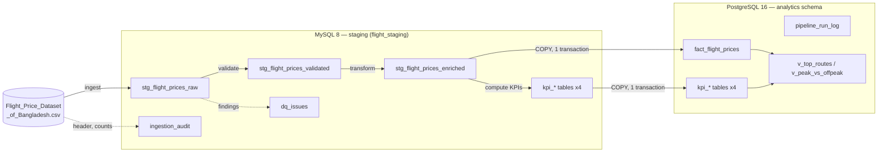
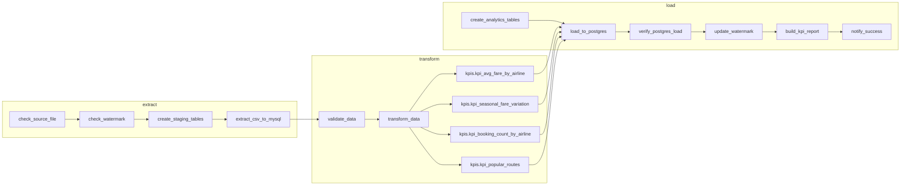
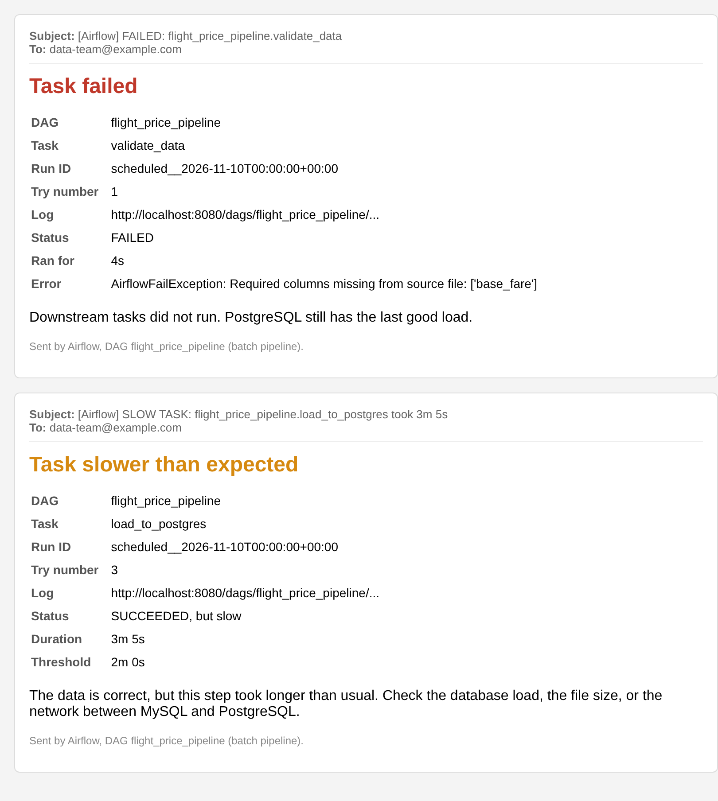

# Flight Price Analysis Pipeline — Project Report

**Scope:** an end-to-end Apache Airflow pipeline that ingests the *Flight Price Dataset of Bangladesh*
(Kaggle CSV), stages it in MySQL, validates and transforms it, computes four KPIs, and loads the
results into PostgreSQL for analysis.

**Stack:** Apache Airflow 3.1.3 (LocalExecutor, TaskFlow API / Task SDK) · MySQL 8.0 (staging) · PostgreSQL 16
(analytics) · Python 3.11 / pandas · Docker Compose.

---

## 1. Pipeline architecture



### Design principles

| Principle | How it is applied |
|---|---|
| **Separation of concerns** | Business logic lives in [`dags/flight_pipeline/`](../dags/flight_pipeline/) (pure Python / pandas). The DAG file only wires tasks and supplies connections through Airflow hooks. The logic can be unit-tested without Airflow or a database. |
| **Data passes through tables, not XCom** | Each stage reads its input table and writes its output table. XCom carries only small JSON summaries (row counts, DQ stats, KPI previews) shown in the Airflow UI. |
| **Idempotency** | Every stage replaces its output inside a transaction. Re-running a DAG run (or the whole DAG) gives the same result with no duplicates. This was checked by running the DAG twice: still 56,827 fact rows, one batch. |
| **Traceability** | Every row carries `source_row_num` (its line in the CSV) and `batch_id` (the Airflow `run_id`). `ingestion_audit`, `dq_issues` and `pipeline_run_log` record what happened in each run. |
| **Fail fast on bad data, retry on transient errors** | Tasks retry transient failures (DB restarts, network) up to 3 times with exponential backoff (Section 2.3). A data quality failure raises `AirflowFailException`, which skips the retries, because bad data won't fix itself on a retry. |

### Infrastructure (docker-compose.yml)

| Service | Image | Purpose |
|---|---|---|
| `airflow-db` | postgres:16 | Airflow metadata database |
| `mysql-staging` | mysql:8.0 (host port 3307) | Staging database `flight_staging` |
| `postgres-analytics` | postgres:16 (host port 5433) | Analytics database `flight_analytics`, schema `analytics` |
| `airflow-init` | apache/airflow:3.1.3-python3.11 | Migrates the metadata DB and creates the admin user (FAB login) |
| `airflow-apiserver` | same | Airflow 3 web UI, REST API and task execution API on :8080 |
| `airflow-scheduler` | same | Scheduling and task execution (LocalExecutor, so tasks run in parallel) |
| `airflow-dag-processor` | same | Parses the DAG files (a separate service in Airflow 3) |

The connections `mysql_staging` and `postgres_analytics` are defined as `AIRFLOW_CONN_*` environment
variables, so the stack runs with no manual setup in the UI.

---

## 2. DAG and task description

The DAG is organised as **Extract → Transform → Load**, with one Airflow TaskGroup for each step.
Each task is a short `@task` function that calls a plain Python function from `flight_pipeline/`
(the same pattern as `extract → clean_sales()` in the course demo), so all the logic can be tested
without Airflow.



**Dependencies** are written out in one block at the end of the DAG file:

```python
file_info >> staging_ddl >> extracted                 # extract
transformed >> kpis                                    # transform (4 KPI tasks in parallel)
analytics_ddl >> loaded >> checks >> report_info >> done   # load
extract >> transform >> load                           # groups
```

TaskFlow XComs add the data dependencies too: for example, `validate_data` receives the extract
summary, and `load_to_postgres` receives the validation summary and the KPI results.

### 2.1 DAG parameters

| Setting | Value | Why |
|---|---|---|
| `schedule` | `@daily` | Batch: one run per day |
| `start_date` / `catchup` | 2026-01-01 / `False` | Don't create a run for every past day |
| `max_active_runs` | 1 | Runs replace the same tables, so two must never overlap |
| `max_active_tasks` | 8 | Enough for the 4 parallel KPI tasks |
| `dagrun_timeout` | 1 h | A stuck run is stopped instead of blocking the next day |
| `default_args` | owner, retry policy, timeouts, alert callbacks | See 2.3 and Section 6 |
| `params` | see below | Values a person can change when triggering a run manually |
| `doc_md` | DAG and per-task docs | Shown in the Airflow UI (DAG Docs and each task's details) |

**Run parameters** (`params`, typed and validated by Airflow, and shown in the *Trigger DAG* form):

| Param | Type | Default | Used by |
|---|---|---|---|
| `csv_path` | string | `/opt/airflow/data/Flight_Price_Dataset_of_Bangladesh.csv` | `check_source_file`, `extract_csv_to_mysql` |
| `max_reject_ratio` | number 0–1 | 0.05 | `validate_data` quality gate |
| `top_routes_limit` | integer 1–100 | 10 | `kpis.kpi_popular_routes` (`is_top_route`) |
| `send_success_email` | boolean | false | `notify_success` |

Scheduled runs use the defaults. Tested: a manual run with `top_routes_limit=5` and
`send_success_email=true` flagged 5 top routes and sent the summary email.

### 2.2 Tasks

| Group | Task | Description | Output |
|---|---|---|---|
| extract | `check_source_file` | Checks that the CSV exists and is not empty, and records its size and MD5 checksum. A missing or empty file raises a *retryable* error, because the file may arrive late. | file info |
| extract | `check_watermark` | Short-circuit task: compares the file's MD5 with the last successful load in `analytics.pipeline_watermark`. Same file → all downstream tasks are skipped and the run ends green; changed file, first run or `force_full_reload` → continue. | run / skip |
| extract | `create_staging_tables` | Idempotent `CREATE TABLE IF NOT EXISTS` for all MySQL tables, generated from the schema in `config.py`. | MySQL tables |
| extract | `extract_csv_to_mysql` | Reads the CSV as text, normalises the headers, casts each column to its type, and bulk-inserts into `stg_flight_prices_raw` in batches of 5,000. Writes an `ingestion_audit` row and **verifies that the MySQL row count equals the file row count**. | raw staging |
| transform | `validate_data` | Schema check, then row-level checks (Section 3). Writes `stg_flight_prices_validated` and `dq_issues`. **Quality gate:** fails if there are no rows or the rejected share is above `max_reject_ratio`. | validated rows + issues |
| transform | `transform_data` | Valid rows only. Recalculates Total Fare where needed, adds season, peak flag, route, calendar fields and booking lead-time bucket. | `stg_flight_prices_enriched` |
| transform | `kpis.*` (4) | One parallel task per KPI, each writing its own `kpi_*` table. | 4 KPI tables |
| load | `create_analytics_tables` | Idempotent DDL for the `analytics` schema, indexes and views. | PG tables |
| load | `load_to_postgres` | Reads the enriched and KPI tables from MySQL, then **in one PostgreSQL transaction** truncates the targets, `COPY`s each table in, and upserts `pipeline_run_log`. | analytics tables |
| load | `verify_postgres_load` | Reconciles MySQL against PostgreSQL: row counts per table, Σ bookings per airline = fact rows, Σ bookings per route = fact rows, Σ `total_fare` equal in both databases, and `total = base + tax` on every row. | verification report |
| load | `update_watermark` | Upserts the file's MD5 into `analytics.pipeline_watermark`, only after `verify_postgres_load` passed. | watermark |
| load | `build_kpi_report` | Reads the KPI tables from PostgreSQL and writes `data/reports/kpi_report.html`: a self-contained page (inline SVG charts, no internet needed) with headline numbers, a chart per KPI, hover details, light and dark mode, and a table view. The file is written to a temporary name and then renamed, so it's never half-written. | KPI report |
| load | `notify_success` | Builds the run summary (rows in file, valid, rejected, loaded, Σ fare). Logs it, and emails it when `send_success_email` is on. Also runs the SLOW RUN check. | summary |

### 2.3 Retry policy

| Task(s) | Retries | Delay | Rationale |
|---|---|---|---|
| All tasks (default) | 3 | 1 min, exponential backoff (1 → 2 → 4 min), capped at 10 min | Transient errors (a database restarting, a network blip, a lock) usually clear within minutes. Backoff avoids hammering a database that is struggling. |
| `load_to_postgres` | 3 | 2 → 4 → 8 min | The load locks the analytics tables, so it waits longer between tries. Each failed try rolls back fully. |
| `check_source_file` | 3 | Fixed 5 min (no backoff) | Gives a late file up to ~15 minutes to arrive |
| `notify_success` | 1 | 1 min | Only a notification |
| Data quality failures | **0** | — | `AirflowFailException` skips the retries, because bad data won't fix itself |

**On each retry** (`on_retry_callback`), a `RETRYING` line is written to the fallback alert log
[`data/alerts.log`](../data/alerts.log). It is emailed only when `ALERT_EMAIL_ON_RETRY=true`, to avoid noise. **On the final
failure** (`on_failure_callback`), a `FAILED` or `TIMED OUT` email is sent and a line is written to
[`data/alerts.log`](../data/alerts.log). The log is the fallback record when email can't be delivered (Section 6).

All values can be changed in `.env` (`TASK_RETRIES`, `RETRY_DELAY_SECONDS`, `MAX_RETRY_DELAY_SECONDS`,
`SOURCE_FILE_RETRIES`, `SOURCE_FILE_RETRY_DELAY_SECONDS`, `NOTIFY_RETRIES`, `DAGRUN_TIMEOUT_SECONDS`).

What to do when an alert arrives is described in **[`docs/RUNBOOK.md`](RUNBOOK.md)**, the operator guide.

### Data model

**MySQL (staging)**

| Table | Grain / purpose |
|---|---|
| `stg_flight_prices_raw` | One row per CSV row, typed to match the source structure (VARCHAR, DATETIME, DECIMAL(14,2), INT) |
| `ingestion_audit` | One row per load: header seen, missing/unexpected columns, file vs inserted counts, type-cast failures |
| `stg_flight_prices_validated` | Raw columns after cleaning, plus `dq_status` (valid/rejected) and `dq_flags` |
| `dq_issues` | One row per finding: row, rule, column, original value, severity, action taken |
| `stg_flight_prices_enriched` | Valid rows plus derived columns (see Section 4) |
| `kpi_*` (4) | KPI results |

**PostgreSQL (`analytics` schema):** `fact_flight_prices` (indexed on airline, route and season),
the 4 `kpi_*` tables, `pipeline_run_log`, and the views `v_top_routes` and `v_peak_vs_offpeak`.

---

## 3. Data ingestion and validation

### 3.1 Ingestion

* **Header normalisation.** `"Base Fare (BDT)"` → `base_fare`, `"Tax & Surcharge (BDT)"` → `tax_surcharge`,
  `"Departure Date & Time"` → `departure_date_time`, `"Class"` → `travel_class`, and so on.
  Small header differences (with or without "(BDT)", extra spaces) therefore don't break the load.
* **Typed staging.** Columns are cast to the types in `config.SOURCE_SCHEMA`. A value that cannot be
  cast (for example `"abc"` in a fare) becomes NULL, and the number of such values per column is
  recorded in `ingestion_audit.type_coercion_failures`. The validation step reports them, so the
  conversion is never silent.
* **Completeness check.** After the insert, `COUNT(*)` in MySQL must equal the number of data rows in
  the file, or the task fails.

### 3.2 Validation checks

**Schema level:** `Airline`, `Source`, `Destination`, `Base Fare`, `Tax & Surcharge` and `Total Fare` must
be in the header. A missing column fails the run immediately. The one exception is `Total Fare`: it can
be derived, so a missing Total Fare column only produces a warning (see Challenges, item 6).

**Row level:**

| Rule | Severity | Action |
|---|---|---|
| `missing_required_value`: Airline, Source or Destination is null or blank | error | reject |
| `invalid_airport_code`: not a 3-letter IATA code, even after trimming and upper-casing (e.g. `Dhaka`, `12A`) | error | reject |
| `airport_code_corrected`: e.g. `' cgp'` → `CGP` | info | corrected |
| `unknown_airport_code`: valid format but not in the known airport list | warning | kept, flagged |
| `same_source_destination` | error | reject |
| `missing_fare_imputed`: base or tax missing, but total and the other component present | warning | imputed (`base = total − tax`) |
| `missing_fare`: base or tax missing and cannot be imputed | error | reject |
| `non_numeric_fare`: unparseable values counted at ingestion | error | reported (value NULLed, then the rules above apply) |
| `negative_fare`: any fare below 0 | error | reject |
| `zero_base_fare` | warning | kept, flagged |
| `total_fare_missing` | warning | derived in transform |
| `total_fare_mismatch`: \|total − (base + tax)\| > 1 BDT | warning | recalculated in transform |
| `arrival_before_departure` | warning | kept, flagged |
| `negative_days_before_dep` | warning | set to NULL |
| `duplicate_row`: identical in every source column | warning | kept, flagged (the dataset has no booking ID, so identical rows may be real bookings) |

String fields are also trimmed and repeated whitespace is collapsed.

**Quality gate:** the run fails if the rejected share is above `FLIGHT_MAX_REJECT_RATIO` (default 5 %).
A small number of bad rows is quarantined and the run continues. A file that is mostly bad stops the
pipeline before it reaches analytics, and PostgreSQL keeps the last good load.

**Example run (synthetic test file, 57,057 rows):** 56,827 valid, 230 rejected (0.40 %), 633 findings.

| Rule | Findings |
|---|---|
| missing_fare_imputed | 124 |
| total_fare_mismatch | 108 |
| total_fare_missing | 65 |
| missing_required_value | 61 |
| negative_fare | 60 |
| same_source_destination | 60 |
| duplicate_row | 57 |
| invalid_airport_code | 49 |
| airport_code_corrected | 49 |

---

## 4. Transformation and KPI definitions

### 4.1 Transformation (`stg_flight_prices_enriched`)

| Column | Logic |
|---|---|
| `total_fare` | **`Total Fare = Base Fare + Tax & Surcharge`** when the source value is missing or differs from the sum by more than 1 BDT. Otherwise the source value is kept. |
| `total_fare_recalculated` | TRUE if the value above was recalculated (113 rows in the test run) |
| `season` | From the dataset's `Seasonality` column, normalised (e.g. `eid-ul-fitr` → `Eid`, `winter` → `Winter Holidays`). If it is blank, derived from the departure date: Eid window = 7 days before to 3 days after each Bangladesh Eid date (2023–2026); Winter Holidays = 10 Dec–15 Jan; otherwise Regular. |
| `season_source` | `dataset`, `derived` or `default`, so the analysis can tell which seasons were inferred |
| `is_peak_season` | TRUE for any season other than `Regular` (Eid, Hajj, Winter Holidays) |
| `route` | `source || '-' || destination` (directional: DAC-DXB ≠ DXB-DAC) |
| `departure_date`, `departure_year`, `departure_month`, `departure_weekday` | From departure timestamp |
| `booking_lead_bucket` | 0-7, 8-14, 15-30, 31-60, 61+ days before departure |

### 4.2 KPIs

All KPIs are computed from valid, enriched rows only. Each row is one booking.

| KPI | Table | Definition | Computation |
|---|---|---|---|
| **Average Fare by Airline** | `kpi_avg_fare_by_airline` | Mean `total_fare` per airline | `GROUP BY airline → AVG(total_fare)`, plus median, min, max, average base fare, average tax and booking count for context. `fare_rank` 1 = most expensive. |
| **Seasonal Fare Variation** | `kpi_seasonal_fare_variation` | Average fare in peak vs non-peak periods | Two levels. `season`: average per season. `peak_flag`: all peak seasons together vs non-peak. `pct_diff_vs_baseline = (avg − regular_avg) / regular_avg × 100`, where the baseline is the non-peak (Regular) average. |
| **Booking Count by Airline** | `kpi_booking_count_by_airline` | Total bookings per airline | `COUNT(*) GROUP BY airline`, plus `booking_share_pct` (share of all bookings) and `booking_rank` (ties share a rank). |
| **Most Popular Routes** | `kpi_popular_routes` | Source→destination pairs ranked by booking count | `COUNT(*) GROUP BY source, destination`, ranked descending. Ties are broken by average fare, then route name, so ranks don't change between runs. All routes are stored; `is_top_route` marks the top 10 (`v_top_routes`). |

**Example output (synthetic data, so the values are illustrative only):**

| Season | Bookings | Avg fare (BDT) | vs Regular |
|---|---|---|---|
| Hajj | 2,492 | 94,923 | +46.7 % |
| Eid | 3,116 | 84,086 | +29.9 % |
| Winter Holidays | 5,742 | 74,572 | +15.2 % |
| Regular | 45,477 | 64,722 | 0 % |
| **Peak (all)** | 11,350 | 81,653 | **+26.2 %** |

---

## 5. Loading into PostgreSQL: consistency and latency

* **Consistency.** All analytics tables (the fact table, the 4 KPI tables and the run log) are replaced in
  **one transaction**: `TRUNCATE … ; COPY … ; INSERT … ON CONFLICT ; COMMIT`. PostgreSQL DDL and
  `TRUNCATE` are transactional, so a reader sees either the complete previous batch or the complete new
  one, never a partial or mixed state. If anything fails, the transaction rolls back and the previous
  data stays. A `lock_timeout` of 30 s prevents the load from waiting forever behind a long-running query.
* **Low latency.**
  1. All data is read from MySQL *before* the PostgreSQL transaction opens, so the lock window covers
     only the write.
  2. Data is written with `COPY FROM STDIN`, which streams each table in a single round trip and is much
     faster than row-by-row INSERTs.
  3. In the test run, ~57k fact rows plus the KPI tables loaded in about 2 seconds, including the MySQL read.
* **Verification.** `verify_postgres_load` checks the result after commit (Section 2, task 12).

---

## 6. Monitoring and email alerts

### 6.1 What triggers an email

| Alert | Trigger | Mechanism | Effect on the run |
|---|---|---|---|
| **RETRYING** | A try failed and Airflow will retry it | `on_retry_callback` → `alerts.task_retry_alert` → line in [`data/alerts.log`](../data/alerts.log) (email optional) | None yet; the retry policy (2.3) takes over |
| **FAILED** | A task fails after all its retries. Data quality failures fail at once (no retries). | `on_failure_callback` → `alerts.task_failure_alert` | Run fails; downstream tasks don't run; PostgreSQL keeps the last good load |
| **TIMED OUT** | A task runs past its hard limit: `LOAD_TIMEOUT_SECONDS` (600 s) for `load_to_postgres`, `TASK_TIMEOUT_SECONDS` (1,800 s) for the others | `execution_timeout` stops the task → `on_failure_callback` reports it as a timeout | The PostgreSQL transaction rolls back; previous data is untouched |
| **SLOW TASK** | A task succeeds but is slower than its threshold: 120 s for `extract_csv_to_mysql` and `load_to_postgres`, 300 s for the others | `on_success_callback` → `alerts.task_duration_check` | Warning only; the run continues |
| **SLOW RUN** | The whole run succeeds but takes longer than 900 s | `on_success_callback` of the last task → `alerts.run_duration_check` | Warning only |

A normal run sends **no email**. Normal timings on ~57k rows are about 5 s for ingestion and validation,
2 s for the PostgreSQL load and ~25 s for the whole run, so the thresholds leave plenty of room before
warning. All thresholds can be changed in `.env` without touching code.

There are two levels on purpose. A **slow** load is an early warning (the data is still correct, but
something such as database load or file growth needs attention). A **timed-out** load is stopped, so
a stuck task can't block the next day's run (`max_active_runs=1`).

### 6.2 How the email is sent

* `alerts.py` sends HTML email with Python's `smtplib` (STARTTLS on port 587 or SSL on 465). The SMTP
  server, login and recipients come from environment variables in `.env` (`SMTP_HOST`, `SMTP_PORT`,
  `SMTP_USER`, `SMTP_PASSWORD`, `SMTP_FROM`, `ALERT_EMAIL_TO`). For Gmail an App Password is required.
* It doesn't depend on Airflow's `[smtp]` settings or `email_on_failure`, which changed between Airflow 2
  and 3. The same code runs on both.
* An alert can never break the pipeline. If SMTP isn't configured or the mail server is down, the alert
  is written to the task log and the task result is unchanged.
* **Fallback log:** RETRYING, FAILED and TIMED OUT alerts are also appended to [`data/alerts.log`](../data/alerts.log), one line
  each, so there is a record on disk even when no email is sent. Tested by pointing SMTP at a closed
  port: the email failed, the failure was still logged, and the task outcome was unchanged.
* Each email has the DAG, task, run ID, try number, a link to the task log, the duration, and the error
  or the threshold that was crossed:



---

## 7. Batch, not streaming: why Airflow fits this project

Airflow is a **workflow orchestrator for batch jobs**. It starts finite tasks on a schedule, tracks their
dependencies, retries them, and records each run. It does not process an endless flow of events as they
arrive. This project matches that model:

| | This pipeline (batch) | A streaming pipeline |
|---|---|---|
| Input | A complete CSV file (a bounded dataset) | Unbounded events (bookings as they happen) |
| Trigger | Schedule (`@daily`) or manual trigger | Always running |
| Unit of work | One DAG run processes the whole file and finishes | Each event, or a small time window |
| Latency | Minutes to hours is acceptable (daily KPIs) | Seconds or less |
| KPIs | Recomputed over the full dataset each run | Updated incrementally |
| Typical tools | **Airflow** + SQL databases | Kafka, Spark Structured Streaming, Flink |

"Minimal latency" in this project therefore means a **short load window**: data moves into PostgreSQL
in one fast transaction (Section 5), not real-time delivery. The alert thresholds measure job duration
for the same reason. They watch for a batch that took too long, not for event lag. If the business ever
needed real-time fares, the usual design would be a streaming tool for ingestion, with Airflow kept for
the scheduled jobs around it (daily KPI rebuilds, data quality checks, backfills).

---

## 8. Challenges and how they were resolved

| # | Challenge | Resolution |
|---|---|---|
| 1 | **Header variations.** The Kaggle header uses `"Base Fare (BDT)"` and `"Tax & Surcharge (BDT)"`, while the brief says `Base Fare` and `Tax & Surcharge`. The `&`, brackets and spaces are also awkward as SQL column names. | `normalize_column_name()` drops the currency suffix and `&`, converts to snake_case and applies an alias map. The required-column check runs on these canonical names, so both spellings are accepted. |
| 2 | **Typed staging vs dirty values.** The brief asks for column types that match the source, but a strictly typed insert would crash on one bad value such as `"N/A"` in a fare. | Values are cast in Python before the insert. A value that can't be cast becomes NULL and is **counted** in `ingestion_audit`, and validation then handles it (impute or reject) and reports it. The load never crashes on one bad cell, and nothing is converted silently. |
| 3 | **pandas ↔ SQLAlchemy version conflicts in the Airflow image.** `DataFrame.to_sql`/`read_sql` are known to break across pandas 2.x and SQLAlchemy 1.4/2.0 combinations. | All database I/O uses plain DB-API cursors (`executemany`, `COPY`) through the Airflow hooks' `get_conn()`. This works the same with mysqlclient, PyMySQL and psycopg2, under pandas 2.1 (the Airflow image) and 3.0. |
| 4 | **Nullable integers turning into floats.** Building a DataFrame from DB rows turns an INT column that contains NULLs into float (`7.0`), which PostgreSQL `COPY` then rejects for an INTEGER column. | `fetch_df` keeps `dtype=object`, so the driver's Python types (int, Decimal, datetime, None) are kept as they are. pandas' nullable `Int64` is used where integer arithmetic is needed. |
| 5 | **Airflow parsed the helper package as DAG files.** Airflow's DAG discovery opens any `.py` file that contains both "airflow" and "dag", and the relative imports in `flight_pipeline/` produced import errors in the UI. | Added [`dags/.airflowignore`](../dags/.airflowignore) with `flight_pipeline/*`. The package can still be imported, but it is no longer scanned for DAGs. |
| 6 | **Is "Total Fare" required or derived?** The brief lists it as a required column but also says to calculate it if it isn't present. | It is treated as *required but derivable*: if the column is missing, the run warns and derives it. At row level it is recalculated when missing or inconsistent, and `total_fare_recalculated` records each correction. |
| 7 | **Idempotent reloads in MySQL.** `TRUNCATE TABLE` causes an implicit commit in MySQL, so a failure halfway through the reload would leave an empty staging table. | Staging reloads use `DELETE FROM` inside the same transaction as the inserts, and roll back on error. The table sizes (~57k rows) make the cost negligible. |
| 8 | **Defining "peak season".** The dataset labels seasons (Regular, Eid, Hajj, Winter Holidays), but some rows may have no label. | The dataset's label is used when it is present. Otherwise the season is inferred from a configurable Bangladesh Eid and winter calendar, and `season_source` records which method was used, so the KPI can be checked. Peak = any non-Regular season. |
| 9 | **Retries on bad data waste time.** With `retries=3`, a quality failure would run 4 times before failing. | `DataQualityError` is converted to `AirflowFailException`, which fails immediately without retrying. Real transient errors still get retried. |
| 10 | **Keeping analytics consistent during the load.** | Single-transaction `TRUNCATE` + `COPY` (Section 5), followed by an independent reconciliation task. |
| 11 | **Detecting a "slow" load, not just a failed one.** Airflow 3 removed SLA misses, and `execution_timeout` alone only catches loads that are stuck. | Two levels: a hard `execution_timeout` (stops the task, rolls back, sends TIMED OUT) and a softer duration check in `on_success_callback` (sends SLOW TASK / SLOW RUN). Each task's start time is recorded with an `on_execute_callback`, because `ti.start_date` is not always filled in (for example in `airflow dags test`). |
| 12 | **Airflow 2 and 3 differences.** Import paths moved (`airflow.sdk`), Airflow 3 reads `.airflowignore` as glob patterns instead of regex, and it doesn't always put the [`dags`](../dags/) folder on Python's import path. Airflow 3 also didn't always pass the exception to the failure callback. | The DAG tries the Airflow 3 imports first and falls back to Airflow 2. `.airflowignore` uses `flight_pipeline/*`, which works in both syntaxes. The DAG adds its own folder to `sys.path`. Timeouts are recognised from the exception type *or* from run time ≥ the time limit. |
| 13 | **Email delivery must not become a new point of failure.** | Alerts are sent with `smtplib`, settings come from `.env`, and every error inside the alert code is caught and logged, never raised. |
| 14 | **Retrying the right things.** A blanket "retry 3 times" would retry bad data pointlessly, and would fail at once for a file that is only a few minutes late. | A per-task retry policy (2.3): exponential backoff for database tasks, a fixed 5-minute wait for the source file, and no retries for data-quality failures. Retries go to `alerts.log` and the final failure is emailed. |
| 15 | **Task IDs changed when tasks were grouped.** Inside TaskGroups the IDs become `load.load_to_postgres`, so the slow-task thresholds stopped matching. Long email subjects were also being wrapped onto two lines. | Thresholds are matched on the task name without the group prefix (`_short_task_id`). Emails use an SMTP policy with long header lines, so the subject stays on one line. |

---

## 9. Testing performed

* **Unit tests** (24 tests: [`tests/test_pipeline_logic.py`](../tests/test_pipeline_logic.py) and [`tests/test_alerts.py`](../tests/test_alerts.py)): header normalisation, type-cast failure
  counting, the required-column check, every main validation rule, the quality gate, Total Fare
  recalculation, season normalisation and derivation, all four KPIs, and the alert callbacks
  (failure, timeout, slow task, slow run, and SMTP errors not breaking the task). They pass under pandas 2.1.4
  (the version in the Airflow 2.10.5 image) and pandas 3.0.
* **End-to-end runs** with Airflow 2.10.5 against MySQL 8 and PostgreSQL 16 on a 57,057-row synthetic file:
  * Full run: all 12 tasks succeeded in about 24 s. Post-load reconciliation passed.
  * Re-run: idempotent (56,827 fact rows, no duplicates, `pipeline_run_log` has one row per run).
  * Failure path: a file without the `Base Fare` column failed at `validate_data` with no retries. The
    downstream tasks did not run, and PostgreSQL kept the previous good data.
  * **Alerts**, tested with a local SMTP server, on both **Airflow 2.10.5 and Airflow 3.1.3**:
    normal run → no email; missing column → `FAILED: validate_data`; load time limit set to 1 s →
    `TIMED OUT: load_to_postgres` (PostgreSQL still had 56,827 rows afterwards); thresholds set low →
    `SLOW TASK: load_to_postgres` and `SLOW RUN`.
  * **Retry policy**, on both Airflow versions: file arriving 12 s late → `check_source_file` retried
    (RETRYING lines in `alerts.log`), then the whole run succeeded; file never arriving → 2 retries,
    (retries lowered for the test), then a `FAILED` email plus a FAILED line in `alerts.log`; bad data → failed on the first try with no
    retries; mail server down → the failure was still recorded in `alerts.log`.
  * **Params:** a manual run with `{"top_routes_limit": 5, "send_success_email": true}` flagged 5 top
    routes and sent the SUCCESS summary email.

> The synthetic file ([`scripts/generate_sample_data.py`](../scripts/generate_sample_data.py)) uses the Kaggle header and value ranges and
> ~1 % injected errors. It exists only to test the pipeline. For the real analysis, replace it with the
> Kaggle CSV. No code changes are needed.

## 10. Possible extensions

* Incremental loads keyed on a file checksum (skip a run if the file hasn't changed).
* Data contracts with Great Expectations or Soda.
* Send the same alerts to Slack or Microsoft Teams as well as email (the callback functions are the only place to change).
* A dashboard (Metabase or Superset) on top of the `analytics` views.
* Partitioning `fact_flight_prices` by departure month as the data grows.
