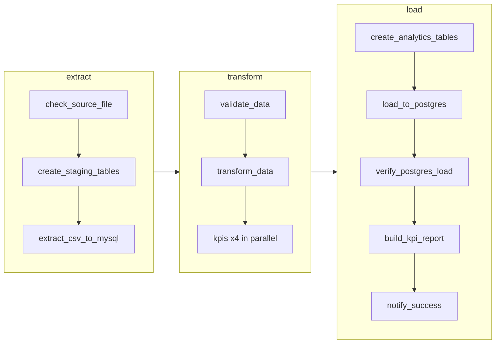

# Runbook — `flight_price_pipeline`

This page is for the people who **run and support** the pipeline. It covers how to start it, what
each alert means, and what to do when something goes wrong. For design details, see `REPORT.md`.

| | |
|---|---|
| **DAG** | `flight_price_pipeline` |
| **Owner** | data-engineering |
| **Schedule** | Daily (`@daily`, midnight UTC). No catch-up. Only one run at a time. |
| **Type** | Batch ETL (not streaming). Each run processes the whole CSV and finishes. |
| **Normal duration** | About 25–40 seconds for ~57,000 rows |
| **Input** | [`data/Flight_Price_Dataset_of_Bangladesh.csv`](../data/Flight_Price_Dataset_of_Bangladesh.csv) |
| **Output** | PostgreSQL `flight_analytics`, schema `analytics` |
| **Airflow UI** | [http://localhost:8080](http://localhost:8080) |

---

## 1. What the pipeline does



| Step | Task | In one line |
|---|---|---|
| Extract | `extract.check_source_file` | Is the CSV there and not empty? Waits up to ~15 min for a late file. |
| Extract | `extract.create_staging_tables` | Creates the MySQL tables if they don't exist. |
| Extract | `extract.extract_csv_to_mysql` | Copies the CSV into MySQL and checks that the row counts match. |
| Transform | `transform.validate_data` | Checks the data quality and stops the run if the data is bad. |
| Transform | `transform.transform_data` | Recalculates Total Fare and adds season, peak flag and route. |
| Transform | `transform.kpis.*` | Computes the 4 KPIs. |
| Load | `load.create_analytics_tables` | Creates the PostgreSQL tables if they don't exist. |
| Load | `load.load_to_postgres` | Replaces the analytics tables in one transaction. |
| Load | `load.verify_postgres_load` | Checks that PostgreSQL matches MySQL. |
| Load | `load.build_kpi_report` | Writes the KPI charts page [`data/reports/kpi_report.html`](../data/reports/kpi_report.html). |
| Load | `load.notify_success` | Logs a summary of the run, and emails it if that is turned on. |

---

## 2. Starting and running

### First time

1. Put the CSV in the [`data/`](../data/) folder, named `Flight_Price_Dataset_of_Bangladesh.csv`.
2. `cp .env.example .env` and fill in the email settings (`SMTP_*`, `ALERT_EMAIL_TO`).
   Step-by-step with screenshots: [`EMAIL_SETUP.md`](EMAIL_SETUP.md).
3. `docker compose up -d`, then wait about a minute.
4. Open [http://localhost:8080](http://localhost:8080) and log in. The DAG is already switched on (unpaused).

### Run it now (manual run)

* **UI:** **Dags** → `flight_price_pipeline` → **Trigger**. To change settings for that run only, edit the params in the trigger form.
* **Command line:**
  ```bash
  docker compose exec airflow-scheduler airflow dags trigger flight_price_pipeline
  docker compose exec airflow-scheduler airflow dags trigger flight_price_pipeline \
      --conf '{"top_routes_limit": 5, "send_success_email": true}'
  ```

### Run parameters

Scheduled runs use the defaults. Change them only for a manual run.

| Param | Default | When to change it |
|---|---|---|
| `csv_path` | `/opt/airflow/data/Flight_Price_Dataset_of_Bangladesh.csv` | To run a file with a different name. It must be inside [`data/`](../data/), which appears as `/opt/airflow/data/` in the container. |
| `max_reject_ratio` | `0.05` (5 %) | To accept a file with more bad rows **after you've checked them**. Don't raise it just to make a red run go green. |
| `top_routes_limit` | `10` | How many routes count as "top routes". |
| `send_success_email` | `ALERT_EMAIL_ON_SUCCESS` from `.env` | Turn it on or off for one manual run. |

### Pause or stop

* **Pause:** use the toggle next to the DAG name. Scheduled runs stop; nothing is deleted.
* **Stop a running run:** open the run → **Mark as failed**. The PostgreSQL load is all-or-nothing, so this is safe.

---

## 3. Retry policy: what Airflow does by itself

| Situation | What happens automatically | You get |
|---|---|---|
| Database restart, network blip, lock timeout (any task) | Up to **3 retries**, waiting 1 → 2 → 4 min (max 10 min) | A `RETRYING` line in [`data/alerts.log`](../data/alerts.log). Email only if `ALERT_EMAIL_ON_RETRY=true`. |
| `load_to_postgres` fails | Up to 3 retries, waiting 2 → 4 → 8 min. Every try rolls back fully. | Same as above |
| CSV missing or empty | `check_source_file` retries **3 times, 5 min apart**, in case the file arrives late | Same as above |
| Bad data (missing column, too many rejected rows) | **No retry.** Fails immediately, because bad data won't fix itself. | `FAILED` email |
| All retries used up | Task fails. Downstream tasks are skipped. PostgreSQL keeps the last good data. | `FAILED` email + a line in [`data/alerts.log`](../data/alerts.log) |
| Task runs too long (load > 10 min, other tasks > 30 min) | Task is stopped and counts as a failed try | `TIMED OUT` email once retries run out |
| Whole run takes > 1 hour | The run is marked failed (`dagrun_timeout`) and unfinished tasks stop | The run shows as failed in the UI. Check which task was still running. |

You can change all of these numbers in `.env` (`TASK_RETRIES`, `RETRY_DELAY_SECONDS`,
`MAX_RETRY_DELAY_SECONDS`, `SOURCE_FILE_RETRIES`, `SOURCE_FILE_RETRY_DELAY_SECONDS`,
`LOAD_TIMEOUT_SECONDS`, `TASK_TIMEOUT_SECONDS`, `DAGRUN_TIMEOUT_SECONDS`), then run `docker compose up -d`.

---

## 4. Alerts: what each one means and what to do

Alerts arrive by email. Retries and failures are **also** written to [`data/alerts.log`](../data/alerts.log), so if no email
arrives, look there:

```
2026-11-10T08:00:05+00:00 | RETRYING | dag=flight_price_pipeline | task=extract.check_source_file | run=scheduled__… | try=1 | …
2026-11-10T08:15:07+00:00 | FAILED   | dag=flight_price_pipeline | task=extract.check_source_file | run=scheduled__… | try=4 | …
```

| Email subject | Meaning | Is the data OK? | What to do |
|---|---|---|---|
| `RETRYING: …` | One try failed. Airflow will retry. | Yes | Nothing. Act only if a `FAILED` email follows. |
| `FAILED: …extract.check_source_file` | The CSV was never found or is empty | Yes (yesterday's load) | Put the file in [`data/`](../data/) with the exact name, then **Clear** the task (see section 5). |
| `FAILED: …extract.extract_csv_to_mysql` | MySQL is down, or the row counts didn't match | Yes | `docker compose ps`: is `mysql-staging` healthy? Check the task log. Fix it, then Clear the task. |
| `FAILED: …transform.validate_data` | **Data quality.** A required column is missing, or too many rows were rejected. | Yes | Read the error in the email, then check `dq_issues` (section 6). Fix the file and re-run. Raise `max_reject_ratio` only if the rejected rows have been reviewed. |
| `FAILED: …transform.*` (others) | Code or database error | Yes | Read the task log and Clear the task. If it fails again, contact the owner. |
| `FAILED: …load.load_to_postgres` | PostgreSQL is unavailable, out of disk space, or locked | **Yes**: the load rolled back | `docker compose ps`, check disk space, look for long queries holding locks. Fix it, then Clear the task. |
| `TIMED OUT: …load.load_to_postgres` | The load ran longer than 10 minutes and was stopped | **Yes**: rolled back | Usually another session is locking the tables, or the database is overloaded. Check `pg_stat_activity` (section 6), then Clear the task. |
| `FAILED: …load.verify_postgres_load` | PostgreSQL doesn't match MySQL after the load | **Check it**: the new data was committed but didn't pass the checks | Read the mismatch in the log. Re-run the whole DAG. If it fails again, contact the owner before anyone uses the KPIs. |
| `SLOW TASK: …` | A task succeeded, but took longer than usual | Yes | Not urgent. Check whether the file got bigger or the database is busy. If it happens daily, raise the threshold or look into it. |
| `SLOW RUN: …` | The whole run took more than 15 minutes | Yes | As above |
| `SUCCESS: …` | The run finished. Sent when `ALERT_EMAIL_ON_SUCCESS=true` in `.env`, or `send_success_email` is on for a manual run | Yes | Nothing |

> **Golden rule:** a failed run never leaves half-loaded data in PostgreSQL. Dashboards keep showing the
> last good run until a new run succeeds.

---

Examples of every alert email, and how to trigger each one on purpose: [`EMAIL_ALERT_TESTS.md`](EMAIL_ALERT_TESTS.md).

---

## 5. Re-running after a fix

The pipeline is **idempotent**: re-running replaces the data and never creates duplicates.

* **Re-run from the failed task:** Grid view → click the red task → **Clear** → keep *Downstream* ticked → Confirm.
  Airflow re-runs that task and everything after it.
* **Re-run the whole run:** click the run → **Clear** → Confirm.
* **New run:** **Trigger** on the DAG page.
* **Command line:**
  ```bash
  docker compose exec airflow-scheduler airflow tasks clear flight_price_pipeline \
      -t "transform.validate_data" -d -y        # -d = also clear downstream tasks
  ```

Don't trigger a second run while one is running. The DAG allows only one run at a time, so a new run waits in the queue.

---

## 6. Useful checks

```bash
# Are the containers healthy?
docker compose ps

# Fallback alert log (retries and failures)
cat data/alerts.log                     # Windows PowerShell: Get-Content data\alerts.log -Tail 20
```

```sql
-- MySQL staging (docker compose exec mysql-staging mysql -u staging_user -p flight_staging)
SELECT rule_name, severity, action_taken, COUNT(*) FROM dq_issues GROUP BY 1,2,3 ORDER BY 4 DESC;
SELECT * FROM dq_issues WHERE severity = 'error' LIMIT 20;
SELECT batch_id, rows_in_file, rows_inserted, missing_columns, type_coercion_failures
FROM ingestion_audit ORDER BY id DESC LIMIT 5;

-- PostgreSQL analytics (docker compose exec postgres-analytics psql -U analytics_user -d flight_analytics)
SELECT * FROM analytics.pipeline_run_log ORDER BY loaded_at DESC LIMIT 5;   -- last good loads
SELECT pid, state, now() - query_start AS running_for, query                -- who is locking?
FROM pg_stat_activity WHERE datname = 'flight_analytics' AND state <> 'idle';
```

---

## 7. Email not arriving?

Full setup and troubleshooting guide: [`EMAIL_SETUP.md`](EMAIL_SETUP.md).

**Fastest check:** run the email checker. It tests the settings, the network, the login, and
(with `--send`) sends a test email, then tells you which step failed:

```bash
docker compose exec -w /opt/airflow/dags airflow-scheduler python -m flight_pipeline.check_email          # connect + login only
docker compose exec -w /opt/airflow/dags airflow-scheduler python -m flight_pipeline.check_email --send   # also send a test email
```

1. Check [`data/alerts.log`](../data/alerts.log). If the alert is there, Airflow detected the problem and only the email failed.
2. Search the task log for `Could not send alert email` or `email not configured`.
3. Check `.env`: `SMTP_HOST`, `SMTP_PORT`, `SMTP_USER`, `SMTP_PASSWORD`, `ALERT_EMAIL_TO`.
   For Gmail, `SMTP_PASSWORD` must be an **App Password**, not your normal password.
4. After editing `.env`, run `docker compose up -d` so the containers pick up the change.

---

## 8. Escalation

| When | Who |
|---|---|
| The same task fails again after a fix, or `verify_postgres_load` fails | Pipeline owner (data-engineering) |
| A database is down or out of disk space | Platform / infrastructure team |
| The source file is late or wrong | Whoever provides the dataset |
