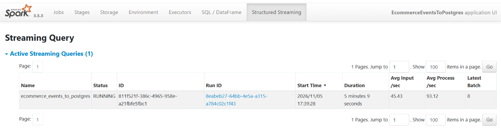
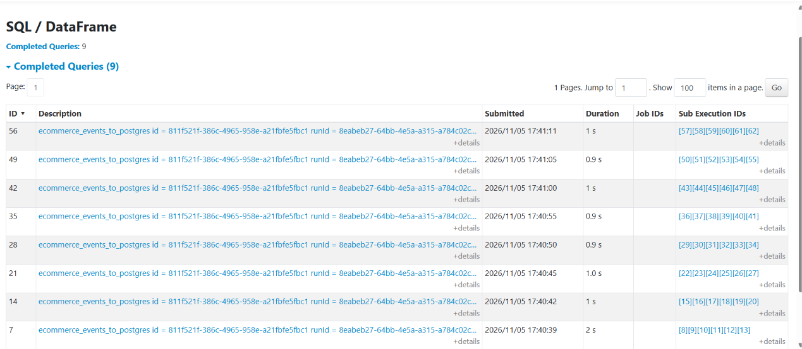
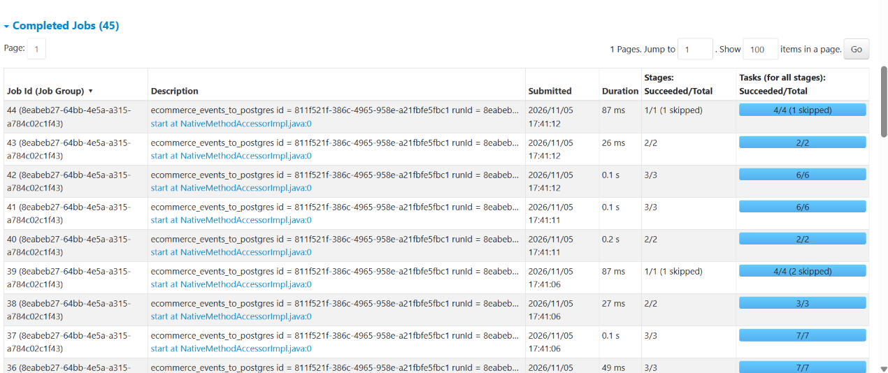
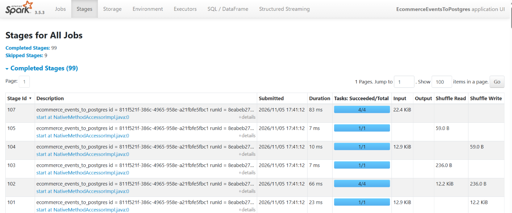
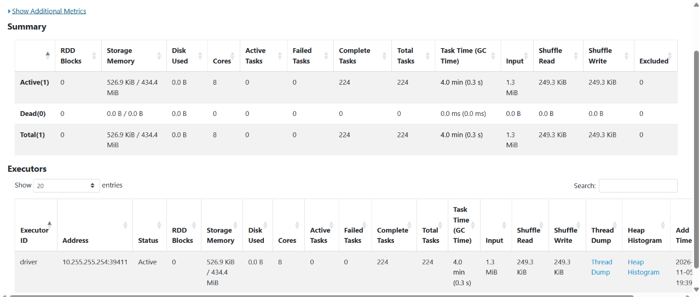

# Performance Metrics Report

This report shows how fast my pipeline is, how much data it can handle, and whether any data was lost along the way. All the numbers in this report come from my own laptop.

## 1. How the tests were done

**Computer:** my Windows laptop, running Ubuntu through WSL2. Spark ran in local mode and used 8 processor cores. PostgreSQL and the data generator ran on the same laptop. The project folder was on the Windows Desktop (`/mnt/c/Users/User/Desktop/ecommerce-streaming`).

**Software:** PySpark 3.5.3, Python 3.14, OpenJDK 17 and PostgreSQL, all installed in Ubuntu.

**Method:** I ran `python run_benchmark.py`. For each test, the script:

1. empties the database tables and the input folder
2. starts Spark
3. runs the data generator at a fixed speed
4. waits until every event has reached the database
5. measures the results

The raw numbers are saved in [`logs/benchmark_results.json`](logs/benchmark_results.json).

**Data:** clean events only (no broken rows), so the tests measure speed and not data cleaning.

**The five tests:**

| Test | What it does |
|---|---|
| S1 | Low load: 100 events per second for 60 seconds, Spark checks every 5 seconds |
| S2 | Medium load: 1,000 events per second for 60 seconds, Spark checks every 5 seconds |
| S3 | Same as S2, but Spark checks every 2 seconds |
| S4 | High load: aiming for 5,000 events per second for 60 seconds, Spark checks every 5 seconds |
| B1 | 200 files (200,000 events) already waiting before Spark starts; Spark handles them as fast as it can |

### What the measurements mean

- **Latency** is how long one event takes to travel from the moment it is created to the moment it is saved in the database. Lower is better.
- **Warmed up** means the first two batches after Spark starts are left out. Those batches are slower because Spark is still getting ready.
- **Throughput** is how many events the system saves per second. Higher is better.
- **Batch time** is how long Spark takes to handle one group of files.
- **Round time** is the full time Spark spends on one check: looking for files, reading, cleaning and saving. For Spark to keep up, this should be shorter than the time between checks.

## 2. Results

### 2.1 Was any data lost?

No. In every test, every event that was generated arrived in the database.

| Test | Events generated | Events saved | Lost |
|---|---:|---:|---:|
| S1 | 6,000 | 6,000 | 0 |
| S2 | 60,000 | 60,000 | 0 |
| S3 | 60,000 | 60,000 | 0 |
| S4 | 300,000 | 300,000 | 0 |
| B1 | 200,000 | 200,000 | 0 |
| **Total** | **626,000** | **626,000** | **0** |

The database cannot store the same event twice, because every event ID must be unique, so no event was saved twice either.

### 2.2 How fast did the generator actually send data?

The generator is a single Python program, so at high speed it could not always reach its target.

| Test | Target | Actually sent |
|---|---:|---:|
| S1 | 100 per second | 99 per second |
| S2 | 1,000 per second | 962 per second |
| S3 | 1,000 per second | 961 per second |
| S4 | 5,000 per second | **3,856 per second** |

So the highest load my laptop was really tested with is about **3,900 events per second**.

### 2.3 How long does an event take to reach the database?

Times are in seconds. "Typical" is the median: half of the events were faster and half were slower. "Slowest 5%" means 95% of events arrived faster than this.

| Test | Typical (warmed up) | Slowest 5% (warmed up) | Slowest event (warmed up) | Typical (all) | Slowest event (all) |
|---|---:|---:|---:|---:|---:|
| S1: 100/s, 5 s checks | **4.3** | 6.8 | 7.5 | 4.3 | 7.5 |
| S2: about 1,000/s, 5 s checks | **4.4** | 7.0 | 7.1 | 4.8 | 10.3 |
| S3: about 1,000/s, 2 s checks | **3.3** | 4.3 | 4.6 | 3.6 | 10.8 |
| S4: about 3,900/s, 5 s checks | **6.2** | 11.0 | 12.8 | 6.7 | 13.9 |
| B1: 200 files waiting | not applicable | not applicable | not applicable | 38.5 | 44.1 |

In test B1, all 200,000 events were created before Spark was started, so they had to wait in a queue. That number shows waiting time, not how fast the pipeline is.

### 2.4 How much work can it handle?

| Test | Batches | Average rows per batch | Average batch time | Average database write | Average round time | Events saved per second |
|---|---:|---:|---:|---:|---:|---:|
| S1 | 19 | 421 | 1.5 s | 0.42 s | 2.7 s | 91 |
| S2 | 13 | 4,615 | 1.5 s | 0.51 s | 2.8 s | 993 |
| S3 | 27 | 2,222 | 1.1 s | 0.39 s | 2.4 s | 949 |
| S4 | 15 | 20,000 | 2.7 s | 1.16 s | 4.9 s | 3,977 |
| B1 | 4 | 50,000 | 5.6 s | 2.19 s | 7.8 s | **7,544** |

The slowest database write in each test (2.2 to 4.0 seconds) always happened in the first batch, while Spark and the database connection were still starting up.

Spark's own speed counter shows how fast it worked while a batch was running. It reached a peak of about **7,500 events per second** in S4 and **10,300 events per second** in B1.

### 2.5 How quickly did it finish after the generator stopped?

| Test | Generator finished after | Last event saved after | Extra time |
|---|---:|---:|---:|
| S1 | about 60.6 s | 67.6 s | about 7 s |
| S2 | about 62.4 s | 65.6 s | about 3 s |
| S4 | about 77.8 s | 81.7 s | about 4 s |

In every test, all events were saved within a few seconds of the generator stopping, so Spark never built up a long queue.

## 3. What the results tell us

**How often Spark checks for files decides much of the delay.** With checks every 5 seconds, an event typically took about 4.3 to 4.4 seconds to arrive at low and medium load. Checking every 2 seconds brought this down to 3.3 seconds, and the slowest 5% dropped from 7.0 to 4.3 seconds. A new file waits on average half of the checking interval before Spark notices it, and then needs time to be processed.

**At 2-second checks, my laptop was working without a break.** Each round took about 2.4 seconds, a little longer than the 2 seconds between checks, so Spark started each new round as soon as the previous one ended. It still kept up (949 events saved per second against 961 sent, and nothing was lost). But 2 seconds is about the fastest checking interval that makes sense on this laptop.

**More data means more delay, but the system keeps up.** Going from 100 to about 3,900 events per second (39 times more data), the typical time went from 4.3 to 6.2 seconds. Bigger batches are more efficient per row: a batch of 421 rows took 1.5 seconds and a batch of 20,000 rows only 2.7 seconds. So Spark handled far more data with only a small increase in time.

**At about 3,900 events per second, my laptop is close to its limit.** At this load, each 5-second round took 4.9 seconds of work, leaving almost no spare time. The slowest 5% of events took 11.0 seconds. Everything was still saved, and saving finished 4 seconds after the generator stopped. But this is about the highest steady load the laptop can handle with 5-second checks.

**When files pile up, Spark catches up quickly.** In test B1, Spark processed the waiting files at about 7,500 events per second, and peaked at about 10,300 per second. Large batches make Spark much more efficient, so a backlog clears faster than data arrives under normal load.

**Saving to the database takes 30 to 43% of each batch.** Rows are first loaded in bulk into a temporary table, then copied into the main table in one step that also skips duplicates. At the highest load, this was 1.2 of the 2.7 seconds per batch.

**The first batch is always the slowest.** The highest overall delays (10 to 14 seconds) come from the first batches after Spark starts, when Spark is still warming up. In a system that runs all the time, this only happens once.

**Working on the Windows drive slows things down.** The project folder is on the Windows Desktop. Ubuntu (WSL2) reads and lists files there more slowly than files stored inside Ubuntu itself. Part of each round is spent listing the folder, so this adds to every round.

## 4. Did it meet the targets?

| Target | Result | Met? |
|---|---|---|
| No data lost and nothing saved twice | 626,000 out of 626,000 events saved in all five tests | Yes |
| Handle at least 1,000 events per second without falling behind | Kept up with about 1,000 per second easily, and with about 3,900 per second at the limit | Yes |
| 95% of events arrive within 10 seconds (once warmed up) | 4.3 to 7.0 seconds in S1 to S3; 11.0 seconds at the highest load (S4) | Yes up to about 1,000 events per second; slightly over at about 3,900 per second |
| Each round finishes before the next check | 2.7 to 2.8 s of 5 s in S1 and S2; 4.9 s of 5 s in S4; 2.4 s of 2 s in S3 | Yes with 5-second checks (only just at the highest load); no with 2-second checks, though it still kept up |

## 5. How it could be made faster

- **Move the project into Ubuntu's own folder** (for example `~/ecommerce-streaming`) instead of the Windows Desktop. Ubuntu reads its own files much faster, which would shorten every round. This is the simplest improvement on my laptop.
- **For shorter delays:** check every 2 seconds. On my laptop this cut the typical delay from 4.4 to 3.3 seconds, but going lower would make Spark fall behind.
- **To handle more data:** let Spark read more files per batch, give it more processors, or write to the database using several connections at once. The downside is that the slowest events may take longer.
- **For a much bigger database:** split the main table by day and remove indexes that aren't needed.
- **For delays under one second:** replace the folder of CSV files with a streaming system such as Kafka. This needs extra setup.

## 6. Live runs and the Spark web page

Besides the benchmark, I ran the pipeline by hand several times.

**Normal run with broken rows (5 Nov 2026):** 8,000 events in total. 7,905 were saved, 81 were rejected as broken and 14 were skipped as duplicates, so every event is accounted for. An event typically reached the database in **4.95 seconds**, and saving took **0.59 seconds** per batch on average. After a restart with 10 files waiting, Spark handled all 1,000 waiting events in one batch of 10.4 seconds. It printed a "falling behind" warning for that one batch only, because the batch was 10 times bigger than usual and Spark was still warming up.

**Full rerun from an empty database:** 20 files of 100 events, then 10 files with broken rows. These screenshots come from the Spark web page at http://localhost:4040.

| What I looked at | What it showed | What it means |
|---|---|---|
| Structured Streaming tab | About 45 events per second coming in, about 93 per second processed | Spark works about twice as fast as the data arrives, so it never falls behind |
| SQL / DataFrame tab | One batch about every 5 seconds, each taking about 1 second (the first one 2 seconds) | Each batch finishes well before the next one starts |
| Jobs tab | 45 jobs, each between 26 ms and 0.2 s, none failed | The individual steps are very quick |
| Stages tab | 99 stages done, 9 skipped | "Skipped" is good: Spark reused data it already had in memory instead of reading it again |
| Executors tab | 8 processor cores, 224 tasks done, 0 failed, 1.3 MB of CSV data read | Spark ran on my laptop and every task succeeded |











## 7. How to run the tests again

```bash
python run_benchmark.py               # runs all tests (about 10 minutes)
python run_benchmark.py --only S3     # runs just one test
cat logs/benchmark_results.json       # shows the saved results
```

Note: [`run_benchmark.py`](run_benchmark.py) empties the database tables and the input folder before each test. Stop any other running Spark job first.
