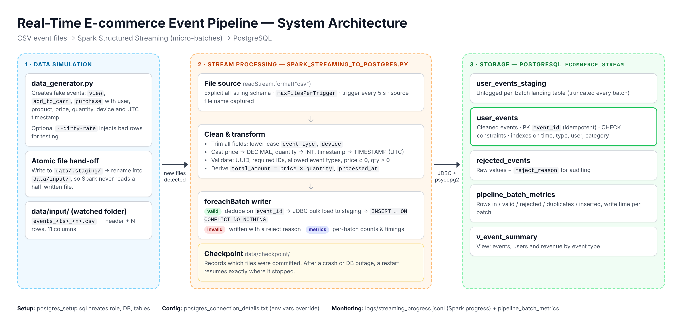

# Project Overview: Real-Time E-commerce Event Ingestion

## Purpose

An online shop wants to know what its customers are doing as it happens: which products they look at, what they add to their cart, and what they buy. This project builds a small system that collects that activity and stores it in a database within a few seconds.

A Python script plays the role of the shop and writes customer activity into CSV files. Apache Spark Structured Streaming notices each new file as soon as it arrives, cleans and checks every row, and saves the results into a PostgreSQL database. I designed every step so that no data is lost and nothing is saved twice, even if Spark or the database stops in the middle.

## The main parts

| Part | File | What it does |
|---|---|---|
| Event generator | [data_generator.py](data_generator.py) | Creates realistic fake shopper events and saves them as CSV files in the `data/input` folder. Each file is first written into a hidden waiting folder and then moved in one step, so Spark never reads a half-written file. It can also break some rows on purpose (`--dirty-rate`) to test the cleaning. |
| Streaming job | [spark_streaming_to_postgres.py](spark_streaming_to_postgres.py) | Watches the `data/input` folder, cleans and checks each new group of rows (a "batch"), and saves it into PostgreSQL. |
| Database setup | [postgres_setup.sql](postgres_setup.sql) | Creates the database user, the `ecommerce_stream` database, the tables, the indexes and a summary view. It is safe to run more than once. |
| Connection details | [postgres_connection_details.txt](postgres_connection_details.txt) | The database address, port, name, user and password. The Spark job reads them from this file. |
| Performance tests | [run_benchmark.py](run_benchmark.py) | Runs the speed tests described in [performance_metrics.md](performance_metrics.md). |

## What the data looks like

**Each CSV file has 11 columns:**

| Column | Example | Meaning |
|---|---|---|
| `event_id` | 5ce8248b-ae26-4c95-a346-04da0dc4188e | A unique ID for each event |
| `user_id` | U02488 | The shopper |
| `session_id` | 6002aa268f05 | One visit to the shop |
| `event_type` | purchase | `view`, `add_to_cart` or `purchase` |
| `product_id` | P0004 | The product |
| `product_name` | Bluetooth Speaker | Product name |
| `category` | Electronics | Product category |
| `price` | 39.50 | Price of one item |
| `quantity` | 3 | How many items |
| `device` | mobile | `mobile`, `desktop` or `tablet` |
| `event_timestamp` | 2026-11-05 09:00:17.285 | When it happened (UTC) |

**The database tables:**

- **`user_events`**: the clean events. Each event can be stored only once, because its `event_id` must be unique. The database also refuses rows with an unknown event type, a negative price or a quantity of zero. Besides the 11 columns, each row stores `total_amount` (price x quantity), the file it came from, the batch number, and when it was processed and saved.
- **`rejected_events`**: every row that failed the checks, exactly as it arrived, together with the reason it was rejected.
- **`user_events_staging`**: a temporary table. Each batch is loaded here first, then copied into `user_events`.
- **`pipeline_batch_metrics`**: one row per batch, recording how many rows came in, how many were saved, rejected or duplicates, and how long saving took.
- **`v_event_summary`**: a ready-made summary showing the number of events, the number of different shoppers and the total amount for each event type.

## How the data flows, step by step

1. **Create.** The generator writes a file called `events_<time>_<number>.csv` into `data/input`, by default 100 rows every 2 seconds.
2. **Notice.** Every 5 seconds, Spark looks in the folder and picks up any files it hasn't seen before (up to 10 files at a time).
3. **Read.** Spark reads every column as plain text first. That way, one strange value cannot crash the program. The conversion to numbers and dates happens in the next step, under control.
4. **Clean and check.**
   - Remove extra spaces, and make `event_type` and `device` lower-case (`"  PURCHASE "` becomes `purchase`).
   - Turn `price` into a number with two decimals, `quantity` into a whole number, and `event_timestamp` into a date and time.
   - Check each row. If something is wrong, record the first problem found: invalid ID, missing user or product, unknown event type, missing columns, price not a number or negative, quantity not a whole number or zero, or a date that can't be read.
   - Work out `total_amount = price x quantity`, and add the batch number and processing time.
5. **Save.**
   - Good rows: duplicates inside the batch are removed, the rows are loaded in bulk into the staging table, and then copied into `user_events`, skipping any event that is already there.
   - Bad rows: saved into `rejected_events` with their reason.
   - Batch statistics are saved into `pipeline_batch_metrics`, and Spark's own speed figures go into `logs/streaming_progress.jsonl`.
6. **Remember.** Spark notes in `data/checkpoint` which files it has finished, so after a restart it carries on from where it stopped.

## Why the system can be trusted

- **Nothing is saved twice.** Spark remembers which files it has finished, and the database skips any event ID it already has. Even if a batch is processed again after a crash, no duplicates appear. I tested this by switching off PostgreSQL while data was arriving and then restarting Spark (see TC-13 and TC-14 in [test_cases.md](test_cases.md)).
- **No half-written files.** The generator moves each finished file into the folder in a single step.
- **Nothing disappears without a trace.** Every row ends up in exactly one place: saved in `user_events`, rejected in `rejected_events` with a reason, or counted as a duplicate in `pipeline_batch_metrics`. In my test run with 3,000 rows, including broken ones, they added up exactly: 2,957 saved + 33 rejected + 10 duplicates.
- **Times are stored correctly.** Spark and Java are both set to UTC, so stored times match the CSV files whatever the computer's time zone. During testing I found that times were being shifted by 2 hours, and fixed it this way.

## Key results

**On my own laptop** (Windows with Ubuntu through WSL2, rerun from an empty database):

- 2,000 events generated and 2,000 saved, with 0 lost.
- An event typically reached the database in about 5 seconds.
- Data arrived at about 45 events per second, and Spark processed about 93 per second, twice as fast as needed.
- 45 Spark jobs and 224 tasks ran, with no failures.

**Load tests on my laptop** (using [`run_benchmark.py`](run_benchmark.py), five tests from 100 to about 3,900 events per second):

- 626,000 events in total, with 0 lost.
- When Spark checked every 5 seconds, an event typically arrived in about 4.3 seconds at normal load. Checking every 2 seconds brought it down to 3.3 seconds, so how often Spark checks for files decides much of the delay.
- It kept up with about 3,900 events per second, which is close to my laptop's limit with 5-second checks. When files had piled up, it caught up at about 7,500 events per second.

All the figures are in [performance_metrics.md](performance_metrics.md).

## How it could be extended

- Replace the folder of CSV files with Kafka, for shorter delays and to accept data from many sources at once.
- Add live totals, such as revenue per minute for each product category, in a second table.
- Run the Spark job as a service (for example with systemd, Kubernetes or Airflow) so it restarts automatically if the database goes down.
