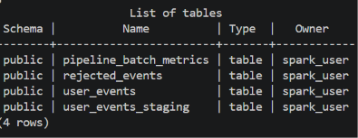
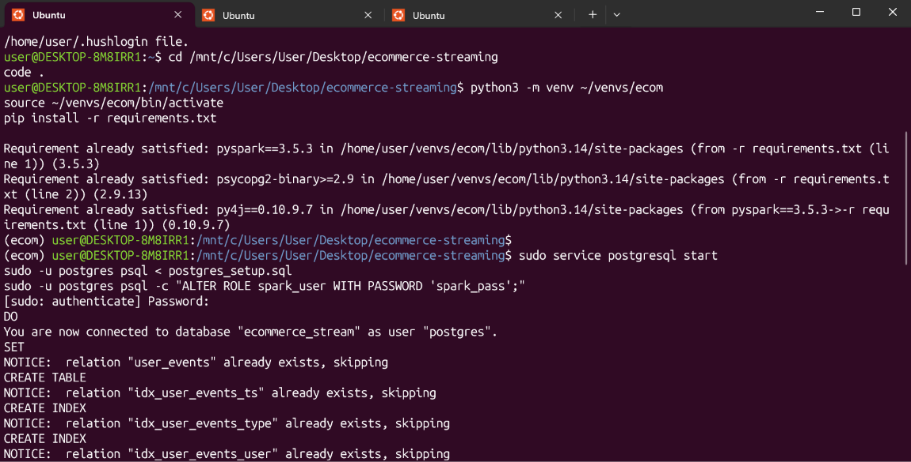
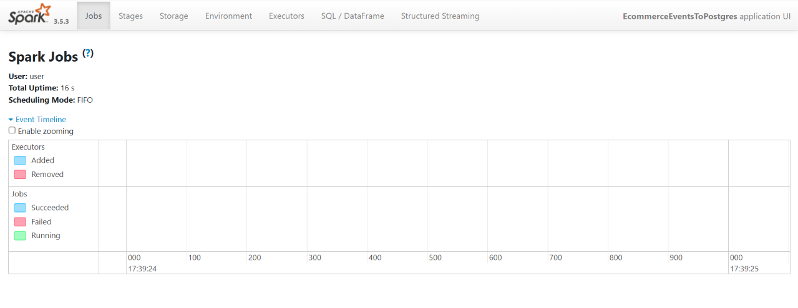
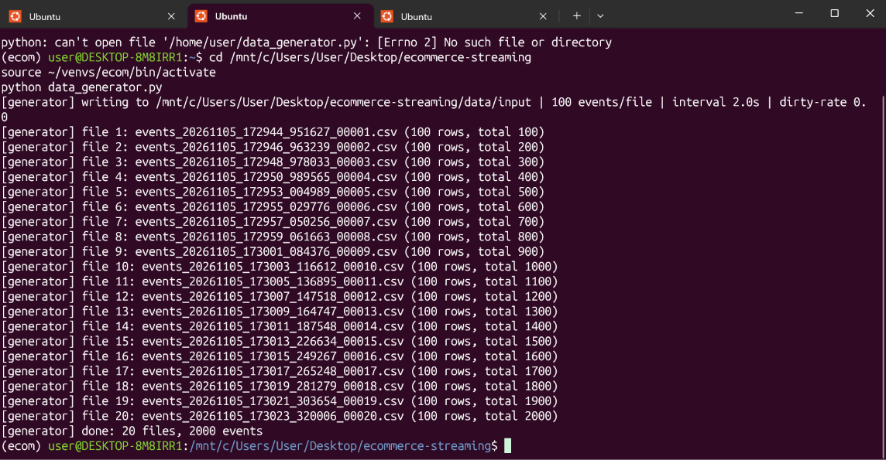
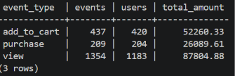
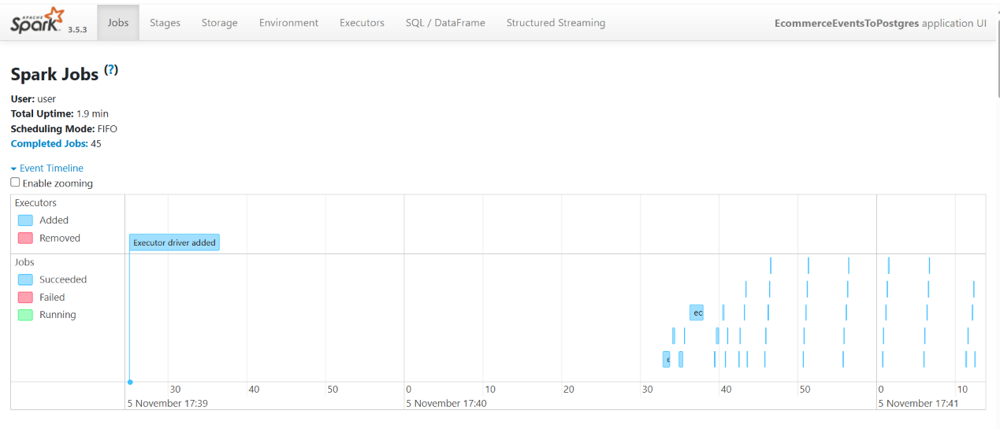
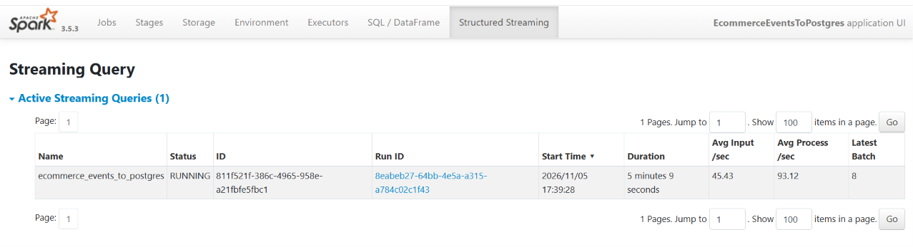

# User Guide: Running the Real-Time E-commerce Pipeline

This guide explains, step by step, how to set up and run the project. I ran it on a Windows laptop using VS Code and Ubuntu.

**A quick note on Windows and Linux:** Spark and PostgreSQL work best on Linux. Windows has a built-in feature called **WSL** (Windows Subsystem for Linux) that lets you run Linux inside Windows. The version of Linux I installed with it is **Ubuntu**. So the project runs on Linux (Ubuntu), while the files sit in a normal Windows folder on the Desktop. If you already use Linux or a Mac, skip Steps 1 to 3 and type the same commands in your normal terminal.

## What's in the project folder

```
ecommerce-streaming/
├── data_generator.py                # creates fake shop events as CSV files
├── spark_streaming_to_postgres.py   # reads the CSV files with Spark and saves them to PostgreSQL
├── postgres_setup.sql               # creates the database, the user and the tables
├── postgres_connection_details.txt  # database address, name, user and password
├── project_overview.md              # explains how the system works
├── user_guide.md                    # this guide
├── test_cases.md                    # the tests, with expected and actual results
├── performance_metrics.md           # speed and performance results
├── system_architecture.png          # diagram of the system
├── README.md                        # short summary
├── requirements.txt                 # list of Python packages to install
├── run_benchmark.py                 # optional: runs the performance tests again
├── images/                          # pictures used in this guide
├── data/                            # created automatically when you run the project
└── logs/                            # created automatically when you run the project
```

**Important:** always type the commands while you are inside the `ecommerce-streaming` folder.

---

## Part A: Setting up (only once)

### Step 1: Install Ubuntu on Windows
Click Start, type **PowerShell**, right-click it and choose **Run as administrator**. Then type:
```bash
wsl --install
```
Restart your computer when it finishes. Ubuntu will open and ask you to choose a username and password. The password does not show while you type; that is normal.

### Step 2: Install VS Code
Download VS Code from code.visualstudio.com and install it. Open it, go to Extensions (the icon with four squares on the left), and install **WSL** and **Python**, both made by Microsoft.

### Step 3: Open the project folder
Open **Ubuntu** from the Start menu. If you are in **PowerShell** instead (the line starts with `PS C:\Users\User>`), type `wsl` first to switch into Ubuntu. The line then changes to something like `user@DESKTOP-8M8IRR1:~$`.

Now type the following (change the path if your folder is somewhere else):
```bash
cd /mnt/c/Users/User/Desktop/ecommerce-streaming
code .
```
VS Code opens the project. You should see **WSL: Ubuntu** in the bottom-left corner, which means VS Code is connected to Ubuntu. Open a terminal inside VS Code with **Ctrl + `** (the key under Esc).

### Step 4: Install Java, PostgreSQL and the database driver
Spark needs Java to run, PostgreSQL is the database, and the driver is what lets Spark talk to the database. Ubuntu will ask for your password.
```bash
sudo apt update
sudo apt install -y openjdk-17-jdk python3-pip python3-venv postgresql libpostgresql-jdbc-java
java -version
```
The last command should print a Java version (17), which confirms Java is installed.

### Step 5: Install the Python packages
This creates a separate space for the project's Python packages (called "ecom") and installs PySpark into it. The download is large, so it may take a few minutes.
```bash
python3 -m venv ~/venvs/ecom
source ~/venvs/ecom/bin/activate
pip install -r requirements.txt
```
When it is switched on, the start of your terminal line shows `(ecom)`.

If you run this step again later, pip prints `Requirement already satisfied` for each package. That is fine; it just means everything is already installed.

### Step 6: Create the database
Start PostgreSQL, create the database and tables, and set the password:
```bash
sudo service postgresql start
sudo -u postgres psql < postgres_setup.sql
sudo -u postgres psql -c "ALTER ROLE spark_user WITH PASSWORD 'spark_pass';"
```
To check it worked, list the tables:
```bash
PGPASSWORD=spark_pass psql -h localhost -U spark_user -d ecommerce_stream -c "\dt"
```
You should see four tables: `pipeline_batch_metrics`, `rejected_events`, `user_events` and `user_events_staging`.



If the database already exists, the setup script prints lines like `NOTICE: relation "user_events" already exists, skipping`. That is fine. The script never deletes or overwrites anything, so it is safe to run again.

This is what it looks like when the setup has already been done before:



---

## Part B: Running the project (every time)

### 0. Open the project
Open **Ubuntu** from the Start menu (or open PowerShell and type `wsl`), then:
```bash
cd /mnt/c/Users/User/Desktop/ecommerce-streaming
code .
```
Check that VS Code shows **WSL: Ubuntu** in the bottom-left corner, then open the terminal with **Ctrl + `**. Do not use `code .` from PowerShell, because that opens VS Code on Windows instead of Ubuntu.

### 1. Start the database
PostgreSQL does not start on its own when you open Ubuntu, so start it first:
```bash
sudo service postgresql start
```

### 2. Start Spark (first terminal)
```bash
source ~/venvs/ecom/bin/activate
python spark_streaming_to_postgres.py
```
Wait until you see `[stream] query started`. Spark is now watching for new files. Leave this terminal running.

If you open **http://localhost:4040** in your browser now, the Spark page is still empty. That is normal: Spark is ready but no files have arrived yet.



### 3. Create some events (second terminal)
Click the split icon at the top right of the terminal panel to open a second terminal next to the first one. Then type:
```bash
source ~/venvs/ecom/bin/activate
python data_generator.py
```
This creates 20 files with 100 events each, one file every 2 seconds. In the first terminal, Spark prints a line every time it saves a group of files, for example:
```
[batch 3] files=2 input=200 valid=193 rejected=5 inserted=193 duplicates_skipped=2 pg_write=310ms
```
This means Spark read 2 files with 200 rows, saved 193 good rows, rejected 5 broken rows and skipped 2 duplicates, and the database save took 310 milliseconds.

This is what the second terminal shows while the generator runs. The first line shows a common mistake: running the command from the home folder (`~`) instead of the project folder. After `cd` to the project folder, it works and creates 20 files with 2,000 events:



### 4. Look at the data
```bash
PGPASSWORD=spark_pass psql -h localhost -U spark_user -d ecommerce_stream -c "SELECT * FROM v_event_summary;"
```
This shows how many views, add-to-carts and purchases were saved. After one run of the generator, the three numbers add up to 2,000 (here 437 + 209 + 1,354):



### 5. Stop
Click the first terminal (where Spark is running) and press **Ctrl + C**. Next time you start Spark, it remembers which files it already handled and continues from there.

---

## Options you can change

You can add these settings after the command, for example `python spark_streaming_to_postgres.py --trigger-seconds 2`.

**For [`spark_streaming_to_postgres.py`](spark_streaming_to_postgres.py):**

| Option | Default | What it does |
|---|---|---|
| `--trigger-seconds` | 5 | How often Spark checks for new files. A smaller number means data arrives faster. |
| `--max-files-per-trigger` | 10 | The most files Spark reads in one go |
| `--available-now` | off | Handle all the files that are waiting, then stop |
| `--run-seconds` | 0 | Stop by itself after this many seconds (0 means keep running) |
| `--jdbc-jar` | found automatically | Where the database driver file is. You normally don't need this. |
| `--input-dir`, `--checkpoint-dir` | `data/input`, `data/checkpoint` | Which folders to use |

**For [`data_generator.py`](data_generator.py):**

| Option | Default | What it does |
|---|---|---|
| `--files` | 20 | How many files to create (0 means keep going until you stop it) |
| `--events-per-file` | 100 | How many events go in each file |
| `--interval` | 2.0 | How many seconds to wait between files |
| `--dirty-rate` | 0.0 | How many rows to break on purpose for testing, e.g. `0.05` means 5% |
| `--seed` | none | Makes the random data the same every time, for repeatable tests |

## Useful database commands

To open the database and type your own queries (type `\q` to leave):
```bash
PGPASSWORD=spark_pass psql -h localhost -U spark_user -d ecommerce_stream
```
Some useful queries:
```sql
-- how many events are saved
SELECT count(*) FROM user_events;

-- summary by type of event
SELECT * FROM v_event_summary;

-- why rows were rejected
SELECT reject_reason, count(*) FROM rejected_events GROUP BY 1 ORDER BY 2 DESC;

-- the last 10 groups of files Spark handled
SELECT * FROM pipeline_batch_metrics ORDER BY batch_id DESC LIMIT 10;

-- typical time (in seconds) for an event to reach the database
SELECT round(percentile_cont(0.5) WITHIN GROUP
       (ORDER BY EXTRACT(EPOCH FROM inserted_at - event_timestamp))::numeric, 2) AS median_latency_s
FROM user_events;
```

## Watching Spark in the browser
While Spark is running, open **http://localhost:4040** in your web browser. The **Jobs** tab shows the work Spark has done (blue means it worked, red means it failed). The **Structured Streaming** tab shows graphs of how fast data is coming in and being processed.

After the generator has run, the **Jobs** tab fills up with blue bars, one for each piece of work Spark finished:



The **Structured Streaming** tab shows that the query is running, how many batches it has done, and how fast data arrives and is processed:



## Running the performance tests (optional)
```bash
python run_benchmark.py              # runs all tests, takes about 10 minutes
python run_benchmark.py --only S2    # runs just one test
```
**Be careful:** this empties the database tables and the `data/` folder before each test. The results are saved in [`logs/benchmark_results.json`](logs/benchmark_results.json).

## Starting again from zero
To delete all the saved data and begin fresh:
```bash
PGPASSWORD=spark_pass psql -h localhost -U spark_user -d ecommerce_stream \
  -c "TRUNCATE user_events, rejected_events, pipeline_batch_metrics, user_events_staging"
rm -rf data logs/streaming_progress.jsonl
```

## If something goes wrong

| What you see | What to do |
|---|---|
| `cd : Cannot find path 'C:\mnt\c\Users\...' because it does not exist` | You are in PowerShell, not Ubuntu. Type `wsl` first, then run the `cd` command again. |
| `wsl --install` says `ERROR_ALREADY_EXISTS` | Ubuntu is already installed, so there is nothing to fix. Just type `wsl` to open it. |
| `Requirement already satisfied` or `NOTICE: ... already exists, skipping` | Not an error. That part of the setup was already done. |
| `Command 'python' not found` | The Python packages aren't switched on in this terminal. Type `source ~/venvs/ecom/bin/activate`. |
| `password authentication failed for user "spark_user"` | Reset the password: `sudo -u postgres psql -c "ALTER ROLE spark_user WITH PASSWORD 'spark_pass';"` |
| `Connection refused` | The database isn't running. Type `sudo service postgresql start`. |
| `python: can't open file '/home/user/data_generator.py'` | You are in your home folder, not the project folder. Type `cd /mnt/c/Users/User/Desktop/ecommerce-streaming` first. |
| `can't open file '.../data_generator.py'` | You are in the wrong folder. Go back to the project folder with `cd` (see Step 3). |
| A `:` appears at the bottom of the results | The results are paused in a viewer. Press `q`. |
| `JAVA_GATEWAY_EXITED` | Java isn't installed. Repeat Step 4 and check with `java -version`. |
| `ClassNotFoundException: org.postgresql.Driver` | The database driver is missing. Type `sudo apt install libpostgresql-jdbc-java`. |
| Files are in `data/input` but nothing happens | Spark has already handled those files. Create new ones, or start again from zero. |
| Times in the database are a few hours off | Don't remove the `-Duser.timezone=UTC` settings in [`spark_streaming_to_postgres.py`](spark_streaming_to_postgres.py). They keep all times in UTC. |
